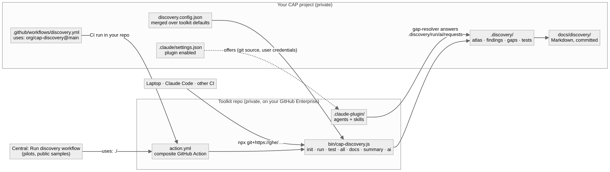

# Run discovery inside your own project

The toolkit runs in two places with the same code:

| | Central mode | Portable mode |
| --- | --- | --- |
| Where | this repo's Actions tab ("Run discovery", `discover.yml`) | your project's own CI, or any checkout of it |
| Input | a repo URL | the checkout it runs in |
| Private code | needs a token, and the toolkit repo must be private too | never leaves your repo |
| Output | GitHub Pages index of many apps | artifact, job summary, PR comment, `docs/discovery/` |
| Entry point | `bin/pipeline.js` + workflow steps | `bin/cap-discovery.js` (the pilots in `discover.yml` run through it too) |



## Where the toolkit lives

The toolkit is meant to sit in a **private repo on your GitHub Enterprise** (Cloud or Server), e.g. `https://<ghe-host>/<org>/cap-discovery`. Nothing in it names a host or repo: `init` takes the location from `--toolkit`, `$CAP_DISCOVERY_TOOLKIT`, or the `repository` field in this repo's `package.json` (change that one line after moving). Moving it:

1. Create the private repo on GHE and push this repo's history to it (`git push --mirror https://<ghe-host>/<org>/cap-discovery.git`).
2. In that repo: Settings → Actions → General → Access → "Accessible from repositories in the organization" (or enterprise). That is what lets private project repos `uses:` it.
3. Set `"repository"` in `package.json` to the new URL.
4. GHE Server only: the action uses `actions/setup-node` and `actions/upload-artifact` (enable GitHub Connect or sync them), and the runner needs npm registry access (or your npm mirror). Opengrep is downloaded from github.com and is skipped with a warning when that is blocked.

## Three ways in, one command underneath

1. **GitHub Action** (recommended for teams). One step in the project's workflow; `init` writes it:

   ```yaml
   - uses: actions/checkout@v4
     with: { fetch-depth: 0 }
   - uses: <org>/cap-discovery@main      # resolved on the same GHE host
     with:
       comment: true                    # one PR comment, updated on every push
   ```

   Inputs: `path`, `app`, `ui`, `mode`, `tests`, `install`, `out`, `docs`, `images`, `opengrep`, `summary`, `comment`, `artifact`, `fail-on-error` (see [action.yml](action.yml)). Outputs: `status`, `startup`, `generated`, `aftertests`, `out`, `app`, `ui`.

2. **npx, no install** (laptop, any other CI such as Azure DevOps, GitLab, Jenkins). Git reads the private repo with your normal credentials for that host:

   ```sh
   T=git+https://<ghe-host>/<org>/cap-discovery.git#main
   npx --yes $T init      # once: config, workflow, Claude Code settings, .gitignore
   npx --yes $T run       # static pipeline -> .discovery/ (no app start, no AI)
   npx --yes $T all       # + start the app under cds.test, generated tests, measured
   npx --yes $T docs      # Markdown output -> docs/discovery/ (commit it)
   ```

   Pin with `#<tag or commit>`. Nothing is added to the project's `package.json`. In a CI job, give git a token first: `git config --global url."https://x-access-token:$TOKEN@<ghe-host>/".insteadOf "https://<ghe-host>/"` (as `.github/workflows/portable.yml` does).

3. **Claude Code plugin** (the optional AI pass, and running everything from a Claude Code session). `init` adds the toolkit repo as a plugin marketplace to the project's `.claude/settings.json` (a `git` source with the GHE URL), so everyone who opens the project in Claude Code is offered the `cap-discovery` plugin: the `gap-resolver`, slice and review agents and the `cap-discovery` / `cap-atlas-reader` skills. Claude Code clones it with the user's own git credentials. The plugin's folder is the toolkit itself, so the skill runs `node ${CLAUDE_PLUGIN_ROOT}/bin/cap-discovery.js …` with no repo URL at all. Manual install: `/plugin marketplace add https://<ghe-host>/<org>/cap-discovery.git`, then `/plugin install cap-discovery@cap-discovery`.

## Commands

| Command | Does | Needs |
| --- | --- | --- |
| `where` | prints what it would analyse: app folder, UI5 folders, package manager, config files, output folder | nothing |
| `init` | writes `discovery.config.json`, `.github/workflows/discovery.yml`, `.claude/settings.json` entries, `.discovery/` in `.gitignore`; keeps existing files (`--force` overwrites, `--ref` pins the action) | nothing |
| `run` | discover → facts → findings → tests → atlas → (ai-requests) → validate | the sources; an installed app gives more (plugins, the app's own CAP) |
| `test` | start under cds.test, generated tests, measured addon, after-tests | `run` first; the app installed (`--install auto` installs when `node_modules` is missing) |
| `all` | install if needed, `run`, `test` | as above |
| `docs [dir]` | copies the Markdown-first subset: atlas README + topics + images + index.html, `findings.md`, `discovery-report.md`, generated tests, `stages.md` | a run |
| `summary` | Markdown summary (KPIs, every generated test) on stdout | a run |
| `ai requests` / `ai merge` | the AI pass on the open gaps ([walkthrough](docs/walkthrough/13-findings-and-gaps.md)) | mode `static+ai` |

Options: `--project`, `--app`, `--ui`, `--out` (default `.discovery`), `--reports`, `--mode`, `--base`, `--docs`, `--install auto|always|never`, `--runtime-dir`, `--keep-tests`, `--slug`. `npx … --help` lists them.

## Configuration

Your project's `discovery.config.json` is merged over the toolkit's defaults ([lib/config.js](lib/config.js)): objects key by key, everything else replaces. So `{"addons": {"mutation": false}}` turns one addon off and keeps the rest. Extra keys for portable mode: `"out"`, `"docs"`, `"app"`, `"ui"`. Environment switches (`DISCOVERY_MODE`, `DISCOVERY_ADDONS_OFF`, `DISCOVERY_STAGES_OFF`, `DISCOVERY_IMAGES=off`) still win.

## What it changes in your project

- Writes only `.discovery/` (gitignored) and, if configured, the docs folder.
- `test` writes `test/generated/` and `test/discovery-*/` into the app for the run and removes them afterwards (`--keep-tests` keeps them).
- Never edits `package.json`. When the app lacks Jest, `@cap-js/cds-test` or SQLite, they go into a folder above the project: the parent folder in CI, on a laptop only with `--runtime-dir <dir>`; without it the runtime tests are skipped with a message saying what to add as devDependencies.
- In CI it links nested `@sap/cds` copies to the app's (one CAP instance per process, see [PILOTS.md](PILOTS.md)); on a laptop `node_modules` is left as it is.

## Private repositories

- **The project**: the action runs with the project repo's own `GITHUB_TOKEN`; logs, artifacts and the PR comment stay in that repo. No extra secret, no Pages.
- **The toolkit**: private on GHE, shared through the Actions access setting above; `npx` and the Claude Code plugin use the developer's git credentials.
- **Central mode** (`discover.yml`, many repos from one place) stays available for public samples; private targets need the toolkit repo itself to be private plus a `DISCOVERY_REPO_TOKEN`.

## Example

[examples/consumer/](examples/consumer/) holds exactly the files `init` writes. `.github/workflows/portable.yml` checks both ways on `cap-js/incidents-app` on every pull request: the action after `init`, and `npx github:<this repo>#<commit> init / all`; both must start the app, pass the generated tests, validate, and leave the app's `package.json` and tests untouched.
