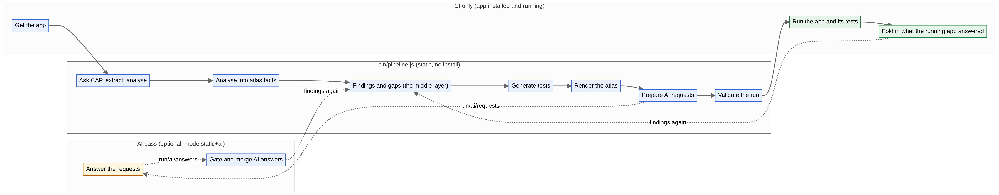
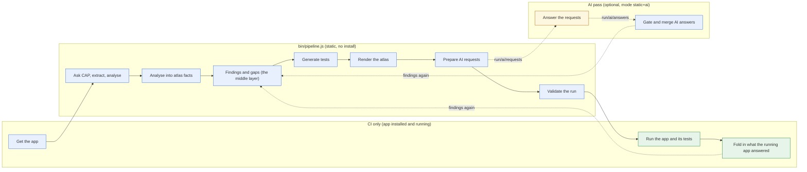

# Stages: what runs when, what it reads and writes

Every run is a fixed sequence of stages. Each one is listed here with its inputs, outputs and the switch that turns it off. A run records what really happened in `<out>/manifest.json` (status, start, seconds, outputs with sha256); `node bin/stages.js show <out>` prints it.

## Modes

| Mode | What it means |
| --- | --- |
| `static` | Static analysis only. No AI request files, AI answers are ignored even when present. Complete and valid on its own. |
| `static+ai` | Static analysis, plus AI request files for the open gaps, plus the AI answers that passed the evidence gate (method "ai" in the findings). |

Set it with `--mode`, `DISCOVERY_MODE`, or `"mode"` in `discovery.config.json` (in that order). The default is `static`. Measured results (CI) are independent of the mode: they come from the running app, not from an AI.

## Stage table

| # | Stage | When | Method | Switch | Reads | Writes |
| --- | --- | --- | --- | --- | --- | --- |
| 1 | **intake** Get the app | CI only | static | always | repository URL, ref, optional app folder and UI folders | the app checkout with node_modules |
| 2 | **discover** Ask CAP, extract, analyse | bin/pipeline.js | static | always | app folder, --ui folders | run/project.json, run/csn.json, run/edmx/, run/graph/nodes.jsonl, run/graph/edges.jsonl, run/slices/catalog.json, run/tests/class-seeds.json, run/metrics.json, run/discovery-report.md |
| 3 | **facts** Analyse into atlas facts | bin/pipeline.js | static | always | run/, curated/<app>.json (optional) | atlas-data.json, run/measured/plan.json, pr/*.md |
| 4 | **findings** Findings and gaps (the middle layer) | bin/pipeline.js | static | `stages.findings` | run/graph/, run/csn.json, run/project.json, run/metrics.json, atlas-data.json, run/findings/ai.jsonl (mode static+ai) | run/findings/findings.jsonl, run/findings/gaps.jsonl, run/findings/summary.json, run/findings/README.md, pr/findings.md |
| 5 | **tests** Generate tests | bin/pipeline.js | static | always | run/ | run/tests/generated/*.test.js, run/tests/generated/manifest.json |
| 6 | **atlas** Render the atlas | bin/pipeline.js | static | always | atlas-data.json | atlas/README.md, atlas/topics/*.md, atlas/images/*.png, atlas/index.html |
| 7 | **ai-requests** Prepare AI requests | bin/pipeline.js | static | `mode` | run/findings/gaps.jsonl, run/findings/findings.jsonl, run/graph/ | run/ai/requests/<gap>.md, run/ai/requests/index.json, run/ai/README.md |
| 8 | **validate** Validate the run | bin/pipeline.js | static | always | manifest.json, run/findings/, run/ai/answers/, run/graph/ | exit code, problems on stderr |
| 9 | **run-tests** Run the app and its tests | CI only | **measured** | `addons.measured, addons.runtime` | run/tests/generated/, run/measured/plan.json, the installed app | jest-generated.json, run/runtime.json, run/measured/authz.json, run/measured/requests*.jsonl, run/measured/coverage-*/ |
| 10 | **after-tests** Fold in what the running app answered | CI only | **measured** | always | jest-generated.json, run/runtime.json, run/measured/ | atlas-data.json, atlas/, run/findings/, manifest.json |
| 11 | **ai-answer** Answer the requests | by an AI agent or a person | **AI** | `mode` | run/ai/requests/, the app source | run/ai/answers/<gap>.json |
| 12 | **ai-merge** Gate and merge AI answers | on demand | static | `mode` | run/ai/answers/*.json, the app source | run/findings/ai.jsonl, run/ai/merge-log.json, run/findings/ (rebuilt) |

## Each stage

### intake: Get the app

Clone the repository, find the CAP app and its UI5 projects, install its packages, repair what blocks a test start.

- **When:** CI only · **method:** static · **switch:** always on · **walkthrough:** piece 01
- **Code:** `.github/workflows/discover.yml`, `lib/project/detect.js`
- **Reads:** `repository URL, ref, optional app folder and UI folders`
- **Writes:** `the app checkout with node_modules`

### discover: Ask CAP, extract, analyse

Ask CAP how it sees the project (config per profile, model files, services, implementations, seed data), compile the model once, parse handlers, UI5 apps, config, tests, CDS layers, HANA artifacts, lint, git history; cut and rank slices.

- **When:** bin/pipeline.js · **method:** static · **switch:** always on · **walkthrough:** piece 02-06
- **Code:** `bin/discover.js`, `lib/project/`, `lib/extract/`, `lib/analyse/slices.js`, `lib/analyse/classes.js`
- **Reads:** `app folder`, `--ui folders`
- **Writes:** `run/project.json`, `run/csn.json`, `run/edmx/`, `run/graph/nodes.jsonl`, `run/graph/edges.jsonl`, `run/slices/catalog.json`, `run/tests/class-seeds.json`, `run/metrics.json`, `run/discovery-report.md`

### facts: Analyse into atlas facts

Authorization matrix, test design, patterns, risks, every atlas section; addons add theirs. A curated base adds reviewed agent risks.

- **When:** bin/pipeline.js · **method:** static · **switch:** always on · **walkthrough:** piece 07-09, 11
- **Code:** `bin/atlas-facts.js`, `lib/atlas/`, `lib/analyse/`, `addons/*/index.js facts()`
- **Reads:** `run/`, `curated/<app>.json (optional)`
- **Writes:** `atlas-data.json`, `run/measured/plan.json`, `pr/*.md`

### findings: Findings and gaps (the middle layer)

Every judgement of the run as one finding with evidence, method and status; every question static analysis could not settle as a gap, with who can settle it (measured, ai, human). Both validated against JSON Schemas.

- **When:** bin/pipeline.js · **method:** static · **switch:** stages.findings · **walkthrough:** piece 13
- **Code:** `bin/findings.js`, `lib/findings/`, `addons/*/index.js findings()`
- **Reads:** `run/graph/`, `run/csn.json`, `run/project.json`, `run/metrics.json`, `atlas-data.json`, `run/findings/ai.jsonl (mode static+ai)`
- **Writes:** `run/findings/findings.jsonl`, `run/findings/gaps.jsonl`, `run/findings/summary.json`, `run/findings/README.md`, `pr/findings.md`
- **Schemas:** `schema/finding.schema.json`, `schema/gap.schema.json`

### tests: Generate tests

Write cds.test suites from the equivalence classes: today: tests pin current behaviour, spec: tests (skipped) state the intended one.

- **When:** bin/pipeline.js · **method:** static · **switch:** always on · **walkthrough:** piece 10
- **Code:** `bin/gen-tests.js`
- **Reads:** `run/`
- **Writes:** `run/tests/generated/*.test.js`, `run/tests/generated/manifest.json`

### atlas: Render the atlas

Markdown topics with PNG images and the interactive HTML page, from atlas-data.json only.

- **When:** bin/pipeline.js · **method:** static · **switch:** always on · **walkthrough:** piece 11
- **Code:** `bin/atlas.js`, `addons/*/view.js`
- **Reads:** `atlas-data.json`
- **Writes:** `atlas/README.md`, `atlas/topics/*.md`, `atlas/images/*.png`, `atlas/index.html`

### ai-requests: Prepare AI requests

One request file per open gap an AI can work on: the question, what static analysis already knows, the files to read, and the exact answer format. No LLM is called.

- **When:** bin/pipeline.js · **method:** static · **switch:** mode · **walkthrough:** piece 12, 13
- **Code:** `bin/ai-requests.js`
- **Reads:** `run/findings/gaps.jsonl`, `run/findings/findings.jsonl`, `run/graph/`
- **Writes:** `run/ai/requests/<gap>.md`, `run/ai/requests/index.json`, `run/ai/README.md`
- **Schemas:** `schema/ai-answer.schema.json`

### validate: Validate the run

Check every findings, gaps, AI answer and manifest file against its schema, and that ids, graph references and evidence files exist. A failed check fails the pipeline.

- **When:** bin/pipeline.js · **method:** static · **switch:** always on · **walkthrough:** piece 13
- **Code:** `bin/validate.js`
- **Reads:** `manifest.json`, `run/findings/`, `run/ai/answers/`, `run/graph/`
- **Writes:** `exit code, problems on stderr`

### run-tests: Run the app and its tests

Start the app under cds.test (records registered handlers), run the generated tests, send the authorization probe, log requests, collect coverage.

- **When:** CI only · **method:** measured · **switch:** addons.measured, addons.runtime · **walkthrough:** piece 10
- **Code:** `.github/workflows/discover.yml`
- **Reads:** `run/tests/generated/`, `run/measured/plan.json`, `the installed app`
- **Writes:** `jest-generated.json`, `run/runtime.json`, `run/measured/authz.json`, `run/measured/requests*.jsonl`, `run/measured/coverage-*/`

### after-tests: Fold in what the running app answered

Addons compare measured results with the static facts and update the atlas; the findings stage runs again, so measured findings settle the gaps they answer.

- **When:** CI only · **method:** measured · **switch:** always on · **walkthrough:** piece 11, 13
- **Code:** `bin/after-tests.js`, `addons/*/index.js afterTests()`
- **Reads:** `jest-generated.json`, `run/runtime.json`, `run/measured/`
- **Writes:** `atlas-data.json`, `atlas/`, `run/findings/`, `manifest.json`

### ai-answer: Answer the requests

An AI agent (Claude Code) reads each request and the app source and writes one answer per gap: findings with file:line and a verbatim quote, or "unknown".

- **When:** by an AI agent or a person · **method:** ai · **switch:** mode · **walkthrough:** piece 12
- **Code:** `agents/gap-resolver.md`, `skills/cap-discovery`
- **Reads:** `run/ai/requests/`, `the app source`
- **Writes:** `run/ai/answers/<gap>.json`
- **Schemas:** `schema/ai-answer.schema.json`

### ai-merge: Gate and merge AI answers

Accept an AI finding only when its file:line exists and its quote is there; rejected ones go to the log. Accepted ones become findings with method ai, and the findings stage marks their gaps answered.

- **When:** on demand · **method:** static · **switch:** mode · **walkthrough:** piece 12, 13
- **Code:** `bin/ai-merge.js`, `lib/evidence.js`
- **Reads:** `run/ai/answers/*.json`, `the app source`
- **Writes:** `run/findings/ai.jsonl`, `run/ai/merge-log.json`, `run/findings/ (rebuilt)`

## The three layers of a finished run

| Layer | Files | For |
| --- | --- | --- |
| Facts | `run/graph/*.jsonl`, `run/csn.json`, `run/project.json`, `run/edmx/` | what the app consists of: every node and edge with `file:line`, source tool and confidence |
| Findings and gaps (middle layer) | `run/findings/findings.jsonl`, `gaps.jsonl`, `summary.json`, `README.md` | every judgement with evidence, method (static, measured, ai, human) and status; every open question with who can settle it |
| Presentation | `atlas/`, `atlas-data.json`, `docs/`, `pr/*.md` | people: Markdown with images, the interactive page, PR comments |

An AI pass reads the middle layer (via `run/ai/requests/`) and writes back into it (`run/findings/ai.jsonl`); it never edits the facts or the atlas directly.
