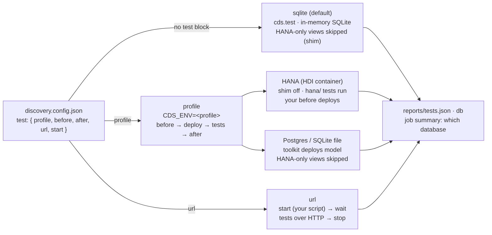

# Which database the generated tests run on

By default the generated tests start your app in-process with `cds.test` on **in-memory SQLite**. That needs no setup, but SQLite cannot hold HANA-only views (parameterized views, and every view built on one). The toolkit then skips those views (the *SQLite shim*), and their tests are not run.

If your team has a test database, point the toolkit at it with a `test` block in your project's `discovery.config.json`. Your app's own CDS profile picks the database, and your own npm script prepares it. Nothing about the database is hard-coded in the toolkit.



## The three modes

| Mode | You set | Database | HANA-only tests | Setup |
| --- | --- | --- | --- | --- |
| **sqlite** (default) | nothing | in-memory SQLite, one per test file | skipped (shim) | none |
| **profile** | `"profile": "hybrid"` (+ `before`, `after`) | whatever `[hybrid]` configures: HANA HDI container, Postgres, SQLite file | **run on HANA only** | your profile, your script |
| **url** | `"url"` (+ `start`) | whatever the app you started uses | run on HANA only (needs `profile` too) | you start the app |

## Configuration

```json
{
  "test": {
    "profile": "hybrid",
    "before": "test:db:up",
    "after": "test:db:down"
  }
}
```

| Key | Meaning | Default |
| --- | --- | --- |
| `profile` | CDS profile for the test run (`CDS_ENV`). The database comes from `cds.requires.db` in that profile. | none (sqlite mode) |
| `before` | Runs first. The name of an npm script in your app, or a shell command. Typical: create a throwaway HDI container, start Postgres, seed data. | none |
| `after` | Runs at the end, also when tests failed. Typical: drop the container, stop Postgres. | none |
| `deploy` | `"auto"`: the toolkit deploys the model itself when the database is not HANA (drops and re-creates the tables, loads your CSV data, skips HANA-only views). On HANA your `before` deploys (HDI). `true` or `false` to force it. | `"auto"` |
| `auth` | `"mocked"`: the tests use CAP mock users, even when the profile says `xsuaa`. `"app"`: keep the profile's auth. | `"mocked"` |
| `url` | Test an app that is already running (over HTTP) instead of starting it in-process. | none |
| `start` | For `url`: an npm script or command that starts the app. It runs in the background, and the run waits until `url` answers. | none |
| `wait` | Seconds to wait for `url`. | `180` |

Environment variables override the file. They are useful in CI and for secrets: `DISCOVERY_TEST_PROFILE`, `DISCOVERY_TEST_BEFORE`, `DISCOVERY_TEST_AFTER`, `DISCOVERY_TEST_DEPLOY`, `DISCOVERY_TEST_AUTH`, `DISCOVERY_TEST_URL`, `DISCOVERY_TEST_START`, `DISCOVERY_TEST_WAIT`.

When there is no `test` block, nothing changes: SQLite plus the shim, as before.

## What happens in each mode

1. **The profile is read** with your app's own `@sap/cds` (`CDS_ENV=<profile>`) to learn the database kind. If the app lacks the database package (`@cap-js/hana`, `@cap-js/postgres`), it is added to the test runtime folder above the project, the same way Jest and SQLite are. Your `package.json` is not changed. A package that is not in your `package.json` is not a CDS plugin of the app, so its database kind is passed to CAP through `CDS_CONFIG`. Add the package as a devDependency to skip this.
2. **`before` runs** with `CDS_ENV` set.
3. **Deploy:** for a database that is not HANA, the toolkit runs `cds.deploy` itself (`lib/runtime/deploy.js`). For HANA, your `before` script does it.
4. **Startup check, generated tests, measured addon** run with `CDS_ENV=<profile>`. Test files run one after another (`--runInBand`), because they share one database.
5. **On HANA** the shim is off, and the tests in `run/tests/generated/hana/` (requests to HANA-only views) are added. On any other database they are reported as *HANA only, not run*.
6. **`after` runs**, whatever happened before.

The run report (`reports/tests.json` → `db`) and the job summary show which database was used: mode, profile, kind, whether the toolkit deployed, and whether the HANA-only tests ran.

## Examples

### SAP HANA Cloud, a dedicated test HDI container (CI)

Create one HDI container only for these tests, and store its service binding as a repository secret. `VCAP_SERVICES` is the JSON that Cloud Foundry gives an app bound to the container. CAP reads the credentials from it, and so does SAP's HDI deployer.

`package.json` of your app (the `[hybrid]` profile says `"db": "hana"`):

```json
{
  "scripts": {
    "test:db:up": "cds build --for hana --production && cd gen/db && npm install --no-audit --no-fund && npm start"
  }
}
```

`npm start` in `gen/db` is `@sap/hdi-deploy`, from your own build. The toolkit does not ship it. The script deploys the model into the container and loads the CSV data.

`discovery.config.json`:

```json
{ "test": { "profile": "hybrid", "before": "test:db:up" } }
```

Workflow:

```yaml
- uses: BUCP/cap-discovery-toolkit@main
  env:
    VCAP_SERVICES: ${{ secrets.HANA_TEST_VCAP_SERVICES }}
```

A fresh container per run (`cf create-service hana hdi-shared …` in `before`, `cf delete-service` in `after`) works too. It adds a Cloud Foundry login and about one to two minutes per run. The scripts are yours, so the toolkit makes no assumptions about them.

### Postgres in Docker (laptop) or as a CI service

```json
{
  "cds": { "requires": { "[pg]": { "db": { "kind": "postgres", "credentials": {
    "host": "localhost", "port": 5432, "user": "postgres", "password": "postgres", "database": "discovery" } } } } },
  "scripts": {
    "test:db:up": "docker run -d --rm --name discovery-pg -p 5432:5432 -e POSTGRES_PASSWORD=postgres -e POSTGRES_DB=discovery postgres:16 && sleep 5",
    "test:db:down": "docker stop discovery-pg"
  }
}
```

```json
{ "test": { "profile": "pg", "before": "test:db:up", "after": "test:db:down" } }
```

In GitHub Actions, use a `services: postgres:` container instead and leave out `before` and `after`. [.github/workflows/test-database.yml](../.github/workflows/test-database.yml) does exactly this on the synthetic app [test/fixtures/db-app](../test/fixtures/db-app).

### The app is started your way (url mode)

```json
{ "test": { "profile": "hybrid", "url": "http://localhost:4004", "start": "start:test" } }
```

The toolkit runs `npm run start:test` in the background, waits for `http://localhost:4004`, runs the generated tests against it over HTTP, and stops the app afterwards. If you leave out `start`, the app must already be running (for example from an earlier CI step). The synthetic role users (`discovery-<role>`) are passed to the started app through `CDS_CONFIG`, unless you set `CDS_CONFIG` yourself.

### In the GitHub Action

Put the `test` block in `discovery.config.json`, and pass secrets as `env` on the step that uses the action (see the HANA example). The action's own steps inherit that `env`. The `DISCOVERY_TEST_*` variables work the same way.

## Caveats

- **Only real HANA covers HANA-only views.** Postgres and SQLite cannot hold parameterized views. On them the toolkit skips the views, just as on SQLite, and the HANA-only tests are not run. Postgres still helps: it runs native SQL, locking and type behaviour closer to a real database than in-memory SQLite.
- **Use a throwaway database only.** The generated tests and the measured addon send writes (POST, PATCH, DELETE, actions). When `deploy` is on, the toolkit drops and re-creates every table. Never point a profile at a shared, development or production database.
- **Credentials belong in CI secrets** of your own repository (your HANA, your Postgres). Do not commit them in `.cdsrc.json` or `package.json`. The toolkit does not store, print or upload them. It only passes `CDS_ENV` through.
- **Costs and time:** an HDI deploy takes minutes on a big model, and a fresh container per run takes longer. One dedicated test container that `before` redeploys into is the cheaper start.
- **Data:** the tests expect the data from your CSV files (`db/data`, `test/data`). With `deploy: false`, the database must already hold equivalent data, or the `today:` tests that expect rows will fail.
- **url mode does not measure.** The authorization probe, the request log and coverage need the app in the test process, so the measured addon is skipped. The startup check only asks whether the app answers.
- **Auth:** `auth: "mocked"` (default) replaces xsuaa or IAS with CAP mock users, because the generated tests send basic-auth users. Use `"app"` only if your profile already uses mocked or basic auth with the same users.
