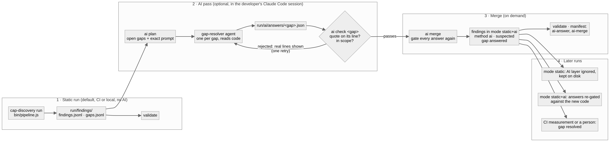

# Piece 12: The AI loop

Pieces 1 to 11 and 13 use no AI. This piece is the only place where an LLM works, and it is optional. The pipeline, the workflows and the atlas all run without it.

There are two ways in, both reading the run's artifacts and writing back only through the evidence gate:

| | Gap pass (D8, since 2026-11-01) | Slice pass (D1 to D7) |
|---|---|---|
| Unit of work | one open gap from `run/findings/gaps.jsonl` | one slice, 10 fixed questions |
| Brief | `run/ai/requests/<gap>.md` (`bin/ai-requests.js`) | `run/slices/<id>/brief.md` (`bin/brief.js`) |
| Agent | `gap-resolver` | flow-tracer, behaviour-analyst, event-integration-analyst, risk-reviewer |
| Answer | `run/ai/answers/<gap>.json` (`schema/ai-answer.schema.json`) | `slices/<id>/facts/<agent>.json` (`schema/facts.md`) |
| Gate and merge | `bin/ai-merge.js` → `run/findings/ai.jsonl` | `bin/merge.js` → graph, merge log |
| Lands in | the findings layer, method `ai`, gap `answered` | the graph (source `agent:*`), dossier, curated risks |

The gap pass is the default: it only spends AI on what static analysis could not settle, and every answer is tied to one question. The slice pass goes deeper on a whole feature; its `slice-review` gap in the findings points at it.

Goal: find what fixed rules cannot see, such as crashes on unusual paths, races, hard-coded values, a FIXME that changes behaviour, or an ownership field a user can overwrite. Then turn each kind of finding into a rule, so it never needs AI again.

## Decisions, in run order

### D1. One slice at a time (`bin/brief.js`)
- **What:** for one slice (piece 6), a brief with its members, files, rules and handlers, the CDS files that annotate its entities, and 10 fixed questions:

| Q | Question | Agent |
|---|---|---|
| Q1 | Entry points: UI routes, OData operations, actions | flow-tracer |
| Q2 | Path: which handlers run in which phase, what is read or written | flow-tracer |
| Q3 | Authorization: who may do what, where is it enforced | behaviour-analyst |
| Q4 | Rules in business terms | behaviour-analyst |
| Q5 | States and transitions | behaviour-analyst |
| Q6 | Events and integrations, failure handling | event-integration-analyst |
| Q7 | Errors that reach the caller | behaviour-analyst |
| Q8 | Dependencies on other slices | flow-tracer |
| Q9 | Deviations from the project's own patterns | risk-reviewer |
| Q10 | What existing tests cover, and where they are weak | risk-reviewer |

- **Why fixed questions:** every slice gets the same checklist, so "unknown" answers are visible, and two runs can be compared.

### D2. Agents write facts, not prose
- The agents in `agents/` (Claude Code subagents with read-only tools, except the curated file) write `slices/<id>/facts/<agent>.json` in the format of `schema/facts.md`: nodes, edges, classes, risks and answers, each with `evidence` (`file:line`) and a verbatim `quote`.

### D3. The evidence gate (`bin/merge.js`)
- A fact is accepted only when its `file:line` exists **and** its quote appears within two lines of that line (whitespace ignored). An edge also needs both of its ends in the graph.
- Rejected facts go to `merge-log.json` with the reason, so the agent can be asked again. They never reach the graph.
- **Why:** this stops invented facts from going into the atlas. It does not prove that the reasoning is right, only that the cited code exists.

### D4. Dossier (`bin/dossier.js`)
- Generated from the merged graph and the merge log, never written by hand. It shows the answers to the 10 questions, request-flow and save diagrams, and the open questions.

### D5. Risks for the atlas (`risk-reviewer` → `curated/<app>.json`)
- Each risk has impact and likelihood (1..5), a layer, real `file:line` evidence, and the test that would catch it.
- `gen` names the rule key when a generated rule (piece 9b) already covers the risk. The atlas then drops the agent risk.
- `bin/pipeline.js --base curated/<app>.json` merges the risks. They show as `agent` in RSK. In CI, the curated file is picked automatically when its `META.app` equals the repo (piece 1 D8).
- **Today:** curated files exist for cap-sflight (3 agent-only risks) and ui5-cap-event-app (2).

### D6. From finding to rule (`rule-drafter` → `addons/rules/library/`)
- An agent finding is generalised into a detector with a unit test (positive and negative example). It starts as `draft`. Once a person sets it to `accepted`, it adds risks by itself and retires the agent finding.
- **This is how AI use shrinks over time:** each new kind of risk needs an agent once, and is then code.

### D7. Test review (`test-reviewer`)
- Reviews the test design: corrects classes marked `verify`, adds missing classes and tests. Its output is a Markdown review plus test files, which a person merges.

### D8. Gap pass: answer what static analysis left open (`bin/ai-requests.js`, `gap-resolver`, `bin/ai-merge.js`)
- **Requests:** one request per open gap that lists `ai` among its resolvers (piece 13 D9): self-contained, with code excerpts and the answer format. `index.json` orders them by priority. Mode `static+ai` writes them in the pipeline; `ai plan` writes them on demand, also after a static run.
- **Answers:** the `gap-resolver` agent reads the request and the code and writes `answers/<gap>.json`: `answered` with findings (each with `file`, `line`, verbatim `quote`), or `unknown` with what would settle it.
- **Gate (`lib/ai/gate.js`):** an answer must match its schema and name a gap this run has; a finding is accepted only when every evidence `file:line` exists, its quote is within two lines of it (`lib/evidence.js`, the same check as D3) and the file is in scope (CAP Java sources are rejected: the scope is CAP Node.js). Accepted findings get method `ai`, status `suspected` and `resolves: [gap]`; the gap becomes `answered`.
- **Re-gated on every rebuild:** the findings stage itself runs the gate in mode `static+ai`, so the pipeline, `after-tests` and `ai merge` all check every answer against the current code. An answer whose quote moved away, or whose gap is gone, drops out and the gap reopens; nothing is guessed onto another line. `ai.jsonl` and `merge-log.json` are outputs of that rebuild, never edited.
- **Not trusted further than the gate:** an AI finding never becomes `confirmed` by itself; a measurement (CI) or a person does that. Switching back to mode `static` hides the AI layer without deleting it.

### D9. Running the pass in Claude Code (`/cap-discovery:fill-gaps`, `bin/ai-pass.js`)
The plugin's `fill-gaps` skill drives the pass in the developer's own Claude Code session. Code decides what is asked and what is accepted; the model only reads code and writes answer files.

| Step | Command | Who | What it does |
|---|---|---|---|
| 1 | `cap-discovery run` | pipeline (CI or local) | Static run, mode `static`. Complete without AI. |
| 2 | `cap-discovery ai plan [--limit N] [--priority ..] [--kind ..] [--redo]` | code | The pending gaps, highest priority first, each with its request, its answer path and the exact agent prompt (JSON). `--redo` adds gaps whose answer was rejected or `unknown`. |
| 3 | `gap-resolver` agent, one per gap, up to 4 at once | AI (the session's model) | Reads the request and the app source (Read, Grep, Glob only) and writes one answer file. |
| 4 | `cap-discovery ai check <gap>` | code | Gates that one answer now. On a rejection it prints the reason and the real lines at the citation; the skill sends that back to the agent once. |
| 5 | `cap-discovery ai merge` | code | Rebuilds the findings in mode `static+ai` (gate again for all answers), records the stages `ai-answer` (how many answers, by which agent, last answer time) and `ai-merge` in `manifest.json`, validates. |
| 6 | `cap-discovery ai status [--json]` | code | Every gap an AI can work on: `pending`, `unmerged`, `accepted`, `rejected`, `unknown`; and answers for gaps the run no longer has (`stale`). |

- **Optional and separate:** nothing in CI calls a model, and no API key is needed: the developer's Claude Code subscription does the work. Without the plugin, any tool that writes the answer files in the same format works with steps 4 to 6.
- **Same prompt every time:** the prompt comes from `ai plan`, not from the conversation, so two developers asking the same gap give their agents the same brief.

**Tried on SFlight (2026-11-01, pinned commit `7f42e85`):** 20 requests (8 high, 7 medium, 5 low). One `gap-resolver` agent per request answered all 20 in about a minute: 19 with findings, 1 `unknown` (whether Travel's `@restrict` covers Booking and BookingSupplement via the draft is framework behaviour; a request as rose and martha would settle it). `ai check` rejected 5 findings in 5 answers that cited the Java handlers (`AcceptRejectHandler.java` and others) as enforcement; after one retry, 2 agents dropped them and 3 left them in, so the merge accepted the Node findings and logged the Java ones as out of scope. Result: 37 AI findings accepted, 3 rejected, 19 of 20 gaps `answered`; 4 of the run's 23 gaps stay open: the `unknown` one and 3 that only a measurement or a person can settle. New since the hand-written demo: deductDiscount's 404 branch dereferences an undefined `travel` (TypeError instead of 404), deductDiscount blocks Accepted but not Canceled travels, and the analytics service is open to anonymous reads because its `@restrict` is commented out.

## What is assumed

- Claude Code with the cap-discovery plugin (`cap-discovery init` offers it in `.claude/settings.json`), or the subagent files copied to `.claude/agents/`.
- A person picks the slices and reviews what gets merged, the curated file and the rule status.
- The quote check is literal: a reformatted file after the run invalidates old facts. That is intended.

## Every hard-coded fact in this piece

| Value | Where |
|---|---|
| 10 questions and their agent | bin/brief-questions.js |
| quote must be within ±2 lines of the evidence line | bin/merge.js |
| fact kinds `node`, `edge`, `classes`, `risk` | bin/merge.js, schema/facts.md |
| curated file chosen by `META.app` = owner/repo | lib/project/detect.js `curatedFor` |
| which gaps get a request: open, `ai` in `resolvableBy` | bin/ai-requests.js |
| evidence in `*.java` / `*.kt` is out of scope | lib/ai/gate.js `OUT_OF_SCOPE` |
| one retry per rejected answer, up to 4 agents at once, default limit 10 | skills/fill-gaps/SKILL.md |
| AI findings are `suspected`, gaps `answered` (never `resolved`) | lib/ai/gate.js, lib/findings/book.js |
| agent risk dropped when `gen` names a rule key that fired | lib/atlas/index.js |

## Output
`run/ai/requests/`, `run/ai/answers/`, `run/ai/merge-log.json`, `run/findings/ai.jsonl`; `run/slices/<id>/brief.md`, `facts/*.json`, `merge-log.json`, `dossier.md`; `curated/<app>.json`; new drafts in `addons/rules/library/`.
