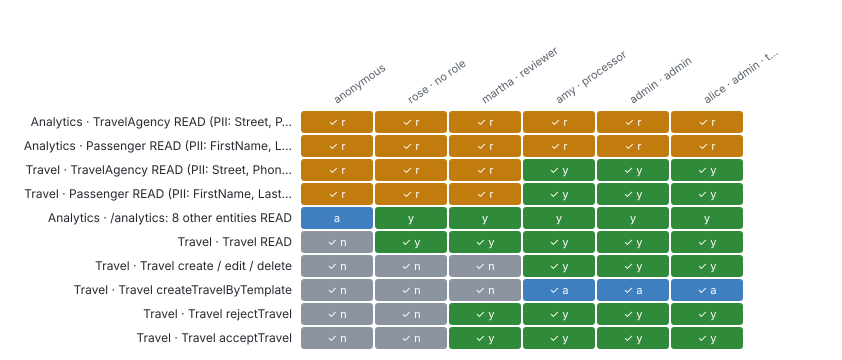

# Access map

_Authorization_ · Who can do what: operation × user/role, declared in CDS, and measured against the running app when the CI run sent the probe.

13 operations × 6 users. 4 operations are open to users without a role. **Measured in CI:** 61 cells agree, 0 differ, 5 were unclear and are now settled.

First the operations that need attention (measured differs, then open without a role).

### Who may do what, and does the running app agree?

_Authorization mistakes are the costliest bugs here; the model says what should happen, CI measures what does._ **Next:** Fix every ≠ cell; confirm every "r" (no role needed) is meant to be open.

| Service | Operation | Open without role | Measured | Where | anonymous | rose · no role | martha · reviewer | amy · processor | admin · admin | alice · admin · tests |
| --- | --- | --- | --- | --- | --- | --- | --- | --- | --- | --- |
| AnalyticsService | TravelAgency READ (PII: Street, PhoneNumber, EMailAddress) | yes | agrees | db/master-data.cds:86 | ✓ r | ✓ r | ✓ r | ✓ r | ✓ r | ✓ r |
| AnalyticsService | Passenger READ (PII: FirstName, LastName, Street, …) | yes | agrees | db/master-data.cds:73 | ✓ r | ✓ r | ✓ r | ✓ r | ✓ r | ✓ r |
| TravelService | TravelAgency READ (PII: Street, PhoneNumber, EMailAddress) | yes | agrees | db/master-data.cds:86 | ✓ r | ✓ r | ✓ r | ✓ y | ✓ y | ✓ y |
| TravelService | Passenger READ (PII: FirstName, LastName, Street, …) | yes | agrees | db/master-data.cds:73 | ✓ r | ✓ r | ✓ r | ✓ y | ✓ y | ✓ y |
| AnalyticsService | /analytics: 8 other entities READ | no | agrees | srv/analytics-service.cds:9 | a | y | y | y | y | y |
| TravelService | Travel READ | no | agrees | srv/travel-service.cds:11 | ✓ n | ✓ y | ✓ y | ✓ y | ✓ y | ✓ y |
| TravelService | Travel create / edit / delete | no | agrees | srv/travel-service.cds:11 | ✓ n | ✓ n | ✓ n | ✓ y | ✓ y | ✓ y |
| TravelService | Travel createTravelByTemplate | no | agrees | srv/travel-service.cds:11 | ✓ n | ✓ n | ✓ n | ✓ a | ✓ a | ✓ a |
| TravelService | Travel rejectTravel | no | agrees | srv/travel-service.cds:11 | ✓ n | ✓ n | ✓ y | ✓ y | ✓ y | ✓ y |
| TravelService | Travel acceptTravel | no | agrees | srv/travel-service.cds:11 | ✓ n | ✓ n | ✓ y | ✓ y | ✓ y | ✓ y |

**Top 10 of 13 operations** by attention. [Browse all 13 with filters](browse.html#matrix) · [matrix.json](data/lists/matrix.json)

Ask: `node bin/query.js <out> who-can <operation text>`.

**Deeper:** [browse.html](browse.html) · [access.json](data/access.json)

Read from: `atlas-data.json AUTH, ROLES, MEASURED` · [all products](../index.md)
