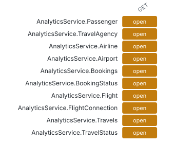

# API surface

_EDMX, OpenAPI, AsyncAPI_ · Every service, entity set, operation and action as standard API documents (OData EDMX, OpenAPI 3, AsyncAPI), with the guard on each.

2 services · 23 entity sets · 137 OpenAPI paths · 0 AsyncAPI channels.

- **AnalyticsService** `/analytics`: [edmx](data/edmx/AnalyticsService.xml) · [openapi](data/openapi/AnalyticsService.json) · [read it in Redoc](openapi-AnalyticsService.html)
- **TravelService** `/processor`: [edmx](data/edmx/TravelService.xml) · [openapi](data/openapi/TravelService.json) · [read it in Redoc](openapi-TravelService.html)

### Service surface

Open entity sets first.

| Service | Entity set | Guard | Note | GET |
| --- | --- | --- | --- | --- |
| AnalyticsService | Passenger | open | PII: FirstName, LastName, Street, PhoneNumber, EMailAddress · auto-exposed | open |
| AnalyticsService | TravelAgency | open | PII: Street, PhoneNumber, EMailAddress · auto-exposed | open |
| AnalyticsService | Airline | open | auto-exposed | open |
| AnalyticsService | Airport | open | auto-exposed | open |
| AnalyticsService | Bookings | open |  | open |
| AnalyticsService | BookingStatus | open |  | open |
| AnalyticsService | Flight | open | auto-exposed | open |
| AnalyticsService | FlightConnection | open | auto-exposed | open |
| AnalyticsService | Travels | open |  | open |
| AnalyticsService | TravelStatus | open | auto-exposed | open |

**Top 10 of 23 entity sets** by open without role. [Browse all 23 with filters](browse.html#surface) · [surface.json](data/lists/surface.json)

_No events declared: nothing for AsyncAPI to describe._

Not produced: @cap-js/asyncapi: No events found in the service.; @cap-js/asyncapi: No events found in the service.

**Deeper:** [openapi-AnalyticsService.html](openapi-AnalyticsService.html) · [openapi-TravelService.html](openapi-TravelService.html) · [browse.html](browse.html) · [edmx/AnalyticsService.xml](data/edmx/AnalyticsService.xml) · [edmx/TravelService.xml](data/edmx/TravelService.xml) · [openapi/AnalyticsService.json](data/openapi/AnalyticsService.json) · [openapi/TravelService.json](data/openapi/TravelService.json)

Read from: `run/csn.json`, `run/edmx/`, `atlas-data.json API` · [all products](../index.md)
