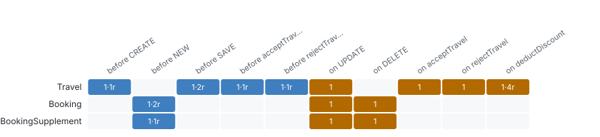
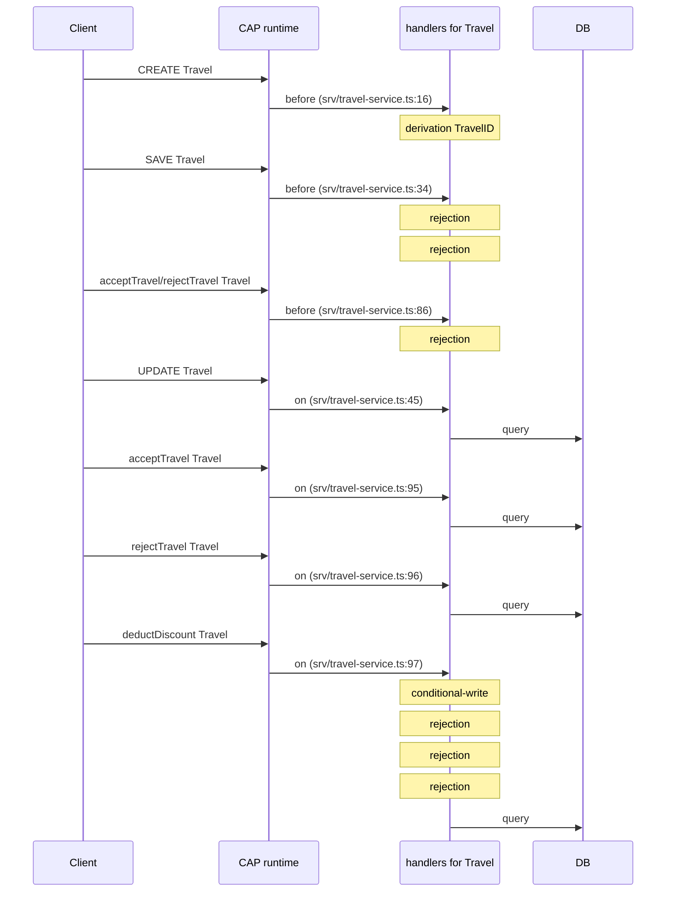

# Behaviour matrix

_Handler AST_ · Which code runs for which entity, event and phase, which rules it applies and which helpers it calls.

13 handlers on 3 entities · 11 rules (4 derivation, 6 rejection, 1 conditional-write) · 2 helpers.

### Where does custom code run: for which entity, phase and event?

_Everything without a handler is generic CAP behaviour; the code that differs from it is where bugs and business rules live._ **Next:** Read the handlers of the busiest cells first; give each rule a test.

| Entity | Service | Handlers | Rules | before CREATE | before NEW | before SAVE | before acceptTravel | before rejectTravel | on UPDATE | on DELETE | on acceptTravel | on rejectTravel | on deductDiscount |
| --- | --- | --- | --- | --- | --- | --- | --- | --- | --- | --- | --- | --- | --- |
| Travel | TravelService | 7 | 8 | 1·1r |  | 1·2r | 1·1r | 1·1r | 1 |  | 1 | 1 | 1·4r |
| Booking | TravelService | 3 | 2 |  | 1·2r |  |  |  | 1 | 1 |  |  |  |
| BookingSupplement | TravelService | 3 | 1 |  | 1·1r |  |  |  | 1 | 1 |  |  |  |

_3 entities_ · [browse with filters](browse.html#matrix) · [matrix.json](data/lists/matrix.json)

### Which handler does what, and where is it?

_Reviews and tests need the exact code location and the rules inside each handler._ **Next:** Filter by entity before changing it; every rule here should have a test in Coverage.

| Phase | Events | Entity | Rules | Where |
| --- | --- | --- | --- | --- |
| on | deductDiscount | Travel | conditional-write, rejection, rejection, rejection | srv/travel-service.ts:97 |
| before | NEW | Booking | derivation BookingID, derivation BookingDate | srv/travel-service.ts:21 |
| before | SAVE | Travel | rejection, rejection | srv/travel-service.ts:34 |
| before | CREATE | Travel | derivation TravelID | srv/travel-service.ts:16 |
| before | NEW | BookingSupplement | derivation BookingSupplementID | srv/travel-service.ts:27 |
| before | acceptTravel, rejectTravel | Travel | rejection | srv/travel-service.ts:86 |
| on | UPDATE | Travel |  | srv/travel-service.ts:45 |
| on | UPDATE | Booking |  | srv/travel-service.ts:46 |
| on | UPDATE | BookingSupplement |  | srv/travel-service.ts:47 |
| on | DELETE | Booking |  | srv/travel-service.ts:48 |

**Top 10 of 13 handlers** by rule count. [Browse all 13 with filters](browse.html#handlers) · [handlers.json](data/lists/handlers.json)

### In which order does code run for the busiest entity?

_Before, on and after handlers run in a fixed order; a value set in one phase and overwritten in another is a common surprise._ **Next:** Check that no later phase undoes what an earlier one enforced.

**Deeper:** [browse.html](browse.html) · [handlers.json](data/handlers.json)

Read from: `run/graph/ (Handler, Rule, Helper)` · [all products](../index.md)
