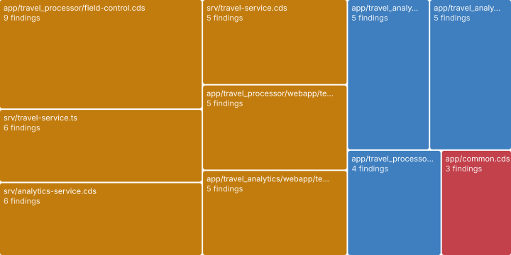

# Code findings

_Lint, Opengrep, rules_ · Every static finding with a code location in one standard format (SARIF), by file and by rule.

71 findings in 21 files · 36 critical or warning. Full list as SARIF: [checks.sarif](data/checks.sarif) (open it in VS Code's SARIF Viewer or upload it to code scanning).

### In which files do findings pile up?

_Findings concentrate; fixing the worst few files removes most of the noise and risk._ **Next:** Start with red, then large amber tiles.

| File | Folder | Worst | Kinds | Findings |
| --- | --- | --- | --- | --- |
| app/travel_processor/field-control.cds | app/travel_processor | warning | layer-violation, pattern, risk, state-transition | 9 |
| srv/travel-service.ts | srv | warning | agent-risk, native-sql, pattern, rule-hit | 6 |
| srv/analytics-service.cds | srv | warning | agent-risk, layer-violation, risk, rule-hit | 6 |
| srv/travel-service.cds | srv | warning | action-without-handler, pattern, risk | 5 |
| app/travel_processor/webapp/test/integration/Opa.qunit.html | app/travel_processor/webapp/test/integration | warning | lint | 5 |
| app/travel_analytics/webapp/test/integration/Opa.qunit.html | app/travel_analytics/webapp/test/integration | warning | lint | 5 |
| app/travel_analytics/webapp/index.html | app/travel_analytics/webapp | info | lint | 5 |
| app/travel_analytics/webapp/test/flpSandbox.html | app/travel_analytics/webapp/test | info | lint | 5 |
| app/travel_processor/webapp/index.html | app/travel_processor/webapp | info | lint | 4 |
| app/common.cds | app | critical | layer-violation, pattern, risk | 3 |

**Top 10 of 21 files** by findings. [Browse all 21 with filters](browse.html#files) · [files.json](data/lists/files.json)

### What exactly was found, and where?

_Each finding needs a location and a kind before someone can fix or dismiss it._ **Next:** Open the location; dismissals go into the rules library so they do not come back.

| Severity | Kind | Title | Where | Folder |
| --- | --- | --- | --- | --- |
| critical | pattern | Auto-exposed master data | db/master-data.cds:5 | db |
| critical | pattern | Annotations placed outside their layer | app/common.cds:5 | app |
| critical | risk | Passenger personal data open to any caller | db/master-data.cds:73 | db |
| critical | risk | TravelAgency personal data open to any caller | db/master-data.cds:86 | db |
| warning | action-without-handler | createTravelByTemplate: no handler found | srv/travel-service.cds:12 | srv |
| warning | layer-violation | srv/analytics-service.cds annotates sap.fe.cap.travel.FlightConnection | srv/analytics-service.cds:77 | srv |
| warning | layer-violation | app/travel_processor/field-control.cds extends sap.fe.cap.travel.TravelStatus | app/travel_processor/field-control.cds:12 | app/travel_processor |
| warning | layer-violation | app/common.cds annotates cds.UUID | app/common.cds:5 | app |
| warning | layer-violation | srv/analytics-service.cds annotates sap.fe.cap.travel.Airport | srv/analytics-service.cds:76 | srv |
| warning | lint | ui5-lint no-deprecated-api | app/travel_processor/webapp/test/integration/Opa.qunit.html:12 | app/travel_processor/webapp/test/integration |

**Top 10 of 71 findings** by severity rank. [Browse all 71 with filters](browse.html#findings) · [findings.json](data/lists/findings.json)

**Deeper:** [browse.html](browse.html) · [checks.sarif](data/checks.sarif)

Read from: `run/findings/findings.jsonl` · [all products](../index.md)
