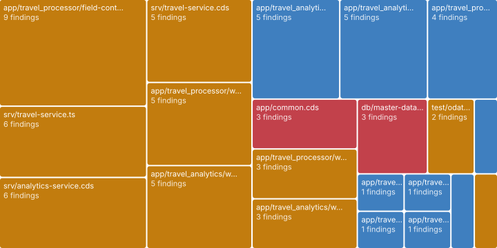
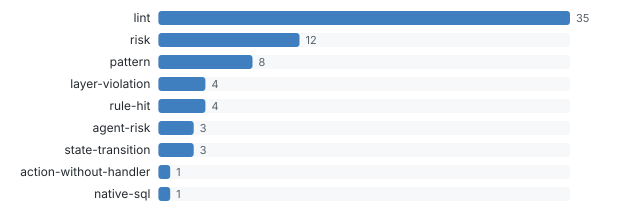

# Code findings

_Lint, Opengrep, rules_ · Every static finding with a code location in one standard format (SARIF), by file and by rule.

71 findings in 21 files · 36 critical or warning. Full list as SARIF: [checks.sarif](data/checks.sarif) (open it in VS Code's SARIF Viewer or upload it to code scanning).

### Critical and warnings

| Severity | Kind | Title | Where |
| --- | --- | --- | --- |
| critical | pattern | Auto-exposed master data | db/master-data.cds:5 |
| critical | pattern | Annotations placed outside their layer | app/common.cds:5 |
| critical | risk | Passenger personal data open to any caller | db/master-data.cds:73 |
| critical | risk | TravelAgency personal data open to any caller | db/master-data.cds:86 |
| warning | action-without-handler | createTravelByTemplate: no handler found | srv/travel-service.cds:12 |
| warning | layer-violation | srv/analytics-service.cds annotates sap.fe.cap.travel.FlightConnection | srv/analytics-service.cds:77 |
| warning | layer-violation | app/travel_processor/field-control.cds extends sap.fe.cap.travel.TravelStatus | app/travel_processor/field-control.cds:12 |
| warning | layer-violation | app/common.cds annotates cds.UUID | app/common.cds:5 |
| warning | layer-violation | srv/analytics-service.cds annotates sap.fe.cap.travel.Airport | srv/analytics-service.cds:76 |
| warning | lint | ui5-lint no-deprecated-api | app/travel_processor/webapp/test/integration/Opa.qunit.html:12 |
| warning | lint | ui5-lint no-deprecated-api | app/travel_processor/webapp/manifest.json:97 |
| warning | lint | ui5-lint no-deprecated-api | app/travel_processor/webapp/manifest.json:70 |
| warning | lint | ui5-lint no-outdated-manifest-version | app/travel_analytics/webapp/manifest.json:2 |
| warning | lint | ui5-lint no-deprecated-api | app/travel_processor/webapp/test/integration/Opa.qunit.html:9 |
| warning | lint | ui5-lint no-deprecated-api | app/travel_analytics/webapp/test/integration/Opa.qunit.html:12 |
| warning | lint | ui5-lint no-deprecated-api | app/travel_analytics/webapp/manifest.json:99 |
| warning | lint | ui5-lint no-deprecated-api | app/travel_analytics/webapp/test/integration/Opa.qunit.html:9 |
| warning | lint | ui5-lint no-outdated-manifest-version | app/travel_processor/webapp/manifest.json:2 |
| warning | pattern | Declarative authorization (@requires / @restrict) | srv/travel-service.cds:11 |
| warning | pattern | Raw SQL via cds.run | srv/travel-service.ts:57 |
| … 16 more rows in the data file | | | |

**Deeper:** [checks.sarif](data/checks.sarif)

Read from: `run/findings/findings.jsonl` · [all products](../index.md)
