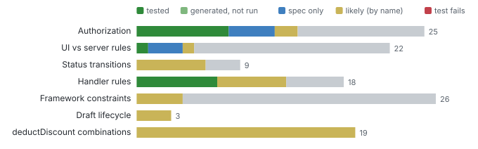

# Coverage by class

_Coverage_ · Which business cases are tested (per equivalence class), and which handler rules a test executed in CI.

**16 of 122 classes tested (13%)**. Handler rules reached by any test: **9 of 11**.

### How much of each category is tested, and how?

_Line coverage says which code ran; class coverage says which business cases are checked, which is what matters for a change._ **Next:** Pick from the largest grey part.

### Which untested case should be tested next?

_Effort goes furthest on cases that are both risky and valuable._ **Next:** Write or generate the test; rerun to see the class turn green.

| Class | Category | Status | Score |
| --- | --- | --- | --- |
| /analytics: 8 other entities READ as anonymous | Authorization | none | 45 |
| /analytics: 8 other entities READ as rose/martha/amy/admin/alice | Authorization | none | 45 |
| /processor: 8 other entities READ as anonymous | Authorization | none | 45 |
| /processor: 8 other entities READ as rose/martha/amy/admin/alice | Authorization | none | 45 |
| Travel acceptTravel as anonymous/rose | Authorization | none | 45 |
| Travel acceptTravel as martha/amy/admin/alice | Authorization | likely | 45 |
| Travel create / edit / delete as anonymous/rose/martha | Authorization | none | 45 |
| Travel createTravelByTemplate as amy/admin/alice | Authorization | likely | 45 |
| Travel createTravelByTemplate as anonymous/rose/martha | Authorization | none | 45 |
| Travel deductDiscount as anonymous/rose | Authorization | none | 45 |

**Top 10 of 15 classes** by score. [Browse all 15 with filters](browse.html#next) · [next.json](data/lists/next.json)

### Which handler rules does no test ever run?

_A rule no test runs can break silently._ **Next:** Write a test that triggers each rule.

| Rule | Kind | Guard | Where |
| --- | --- | --- | --- |
| rule:srv/travel-service.ts:29 | derivation | BookingSupplementID | srv/travel-service.ts:29 |
| rule:srv/travel-service.ts:107 | rejection | !succeeded && travel.BookingFee == null | srv/travel-service.ts:107 |

_2 rules_ · [browse with filters](browse.html#never) · [never.json](data/lists/never.json)

**Deeper:** [browse.html](browse.html) · [coverage.json](data/coverage.json)

Read from: `atlas-data.json COVERAGE`, `atlas-data.json MEASURED.rules (CI)` · [all products](../index.md)
