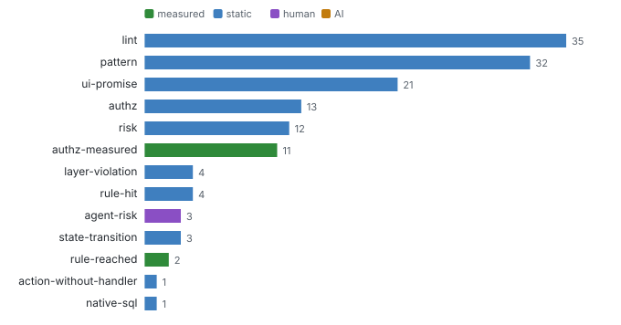
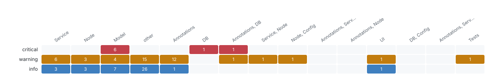

# Evidence ledger

_Findings and gaps_ · Every claim with how it was found (static, measured, AI, human), its status and evidence, and every open question with who can answer it.

142 findings (13 measured, 126 static, 3 human, 0 AI) · 21 questions, **19 open**.

### Open questions by who can answer them

**measured** (11): Does anything on the server enforce "TravelStatus != A" for Travel.acceptTravel: another h? · Does anything on the server enforce "5 fields controlled by TravelStatus.fieldControl" for? · Does anything on the server enforce "TravelStatus != X" for Travel.rejectTravel: another h? · Does anything on the server enforce "hidden when [object Object]" for Booking: another han? · Does anything on the server enforce "6 fields controlled by to_Travel.TravelStatus.fieldCo? · Does anything on the server enforce "hidden when [object Object]" for Booking: another han? · … 5 more

**ai** (2): Slice S01 Travel in AnalyticsService, TravelService: answer the 10 fixed questions (entry ? · Which entities and fields does this SQL read and write, and under which condition?

**human** (6): How critical is AnalyticsService for the business (1 to 5)? · How critical is TravelService for the business (1 to 5)? · Is the draft rule hard-coded-currency right here (srv/analytics-service.cds:24), and shoul? · Is the draft rule null-deref-in-guard right here (srv/travel-service.ts:105), and should i? · Is the draft rule commented-out-grant right here (srv/analytics-service.cds:5), and should? · Is the draft rule max-plus-one-id right here (srv/travel-service.ts:18), and should it be ?

### All questions

Open ones first.

| Gap | Question | Kind | Priority | Status | Can answer |
| --- | --- | --- | --- | --- | --- |
| G-enforcement-elsewhere-070d05fefb | Does anything on the server enforce "TravelStatus != A" for Travel.acceptTravel: another handler, a database constraint, a plugin, a reverse proxy? | enforcement-elsewhere | high | open | measured, ai |
| G-enforcement-elsewhere-270962cf80 | Does anything on the server enforce "5 fields controlled by TravelStatus.fieldControl" for Travel (BeginDate, EndDate, BookingFee, to_Agency, …): another handle | enforcement-elsewhere | high | open | measured, ai |
| G-enforcement-elsewhere-33ac0981f8 | Does anything on the server enforce "TravelStatus != X" for Travel.rejectTravel: another handler, a database constraint, a plugin, a reverse proxy? | enforcement-elsewhere | high | open | measured, ai |
| G-enforcement-elsewhere-464979f637 | Does anything on the server enforce "hidden when [object Object]" for Booking: another handler, a database constraint, a plugin, a reverse proxy? | enforcement-elsewhere | high | open | measured, ai |
| G-enforcement-elsewhere-47e9076f20 | Does anything on the server enforce "6 fields controlled by to_Travel.TravelStatus.fieldControl" for Booking (ConnectionID, FlightDate, FlightPrice, BookingStat | enforcement-elsewhere | high | open | measured, ai |
| G-enforcement-elsewhere-48811c9e6d | Does anything on the server enforce "hidden when [object Object]" for Booking: another handler, a database constraint, a plugin, a reverse proxy? | enforcement-elsewhere | high | open | measured, ai |
| G-enforcement-elsewhere-bb8f6ea400 | Does anything on the server enforce "4 fields controlled by to_Travel.TravelStatus.fieldControl" for BookingSupplement (Price, to_Booking, to_Travel, to_Supplem | enforcement-elsewhere | high | open | measured, ai |
| G-slice-review-e4efc65cb2 | Slice S01 Travel in AnalyticsService, TravelService: answer the 10 fixed questions (entry points, path, authorization, rules in business terms, states, events,  | slice-review | high | open | ai |
| G-authz-unclear-c16e566bdc | Is /analytics: 8 other entities READ allowed for anonymous? | authz-unclear | medium | open | measured, ai |
| G-authz-unclear-d84c33237f | Is /processor: 8 other entities READ allowed for anonymous? | authz-unclear | medium | open | measured, ai |

**Top 10 of 21 questions** by open first. [Browse all 21 with filters](browse.html#gaps) · [gaps.json](data/lists/gaps.json)

### All findings

| Severity | Kind | Found by | Status | Layer | Title | Where |
| --- | --- | --- | --- | --- | --- | --- |
| critical | authz | static | detected | Model | TravelService: TravelAgency READ (PII: Street, PhoneNumber, EMailAddress) | db/master-data.cds:86 |
| critical | authz | static | detected | Model | AnalyticsService: Passenger READ (PII: FirstName, LastName, Street, …) | db/master-data.cds:73 |
| critical | authz | static | detected | Model | TravelService: Passenger READ (PII: FirstName, LastName, Street, …) | db/master-data.cds:73 |
| critical | authz | static | detected | Model | AnalyticsService: TravelAgency READ (PII: Street, PhoneNumber, EMailAddress) | db/master-data.cds:86 |
| critical | pattern | static | detected | DB | Auto-exposed master data | db/master-data.cds:5 |
| critical | pattern | static | detected | Annotations, DB | Annotations placed outside their layer | app/common.cds:5 |
| critical | risk | static | detected | Model | Passenger personal data open to any caller | db/master-data.cds:73 |
| critical | risk | static | detected | Model | TravelAgency personal data open to any caller | db/master-data.cds:86 |
| warning | action-without-handler | static | suspected | Service | createTravelByTemplate: no handler found | srv/travel-service.cds:12 |
| warning | authz | static | suspected | Model | TravelService: Booking / BookingSupplement (via Travel draft) | srv/travel-service.cds:11 |

**Top 10 of 142 findings** by severity rank. [Browse all 142 with filters](browse.html#findings) · [findings.json](data/lists/findings.json)

Full data: [findings.jsonl](data/findings.jsonl), [gaps.jsonl](data/gaps.jsonl) (JSON Schemas in `schema/`).

**Deeper:** [browse.html](browse.html) · [findings.jsonl](data/findings.jsonl) · [gaps.jsonl](data/gaps.jsonl)

Read from: `run/findings/findings.jsonl`, `run/findings/gaps.jsonl` · [all products](../index.md)
