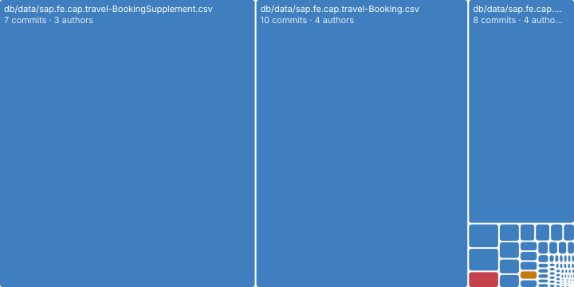
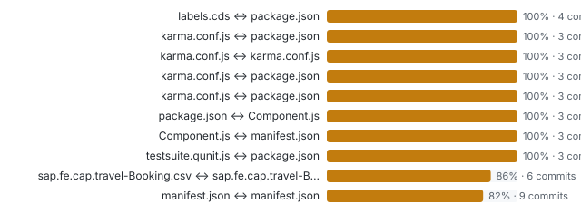

# Hotspots and change coupling

_Git history_ · Where the code changes most, which files change in the same commits, and how many people touch each file.

1238 commits · 113 source files · 47 authors · last change 2026-10-14.

### Where does the code change most?

_Files that change often and a lot are where new bugs appear; with the findings they show where to invest first._ **Next:** Review and test hotspots first, especially those with findings.

| File | Folder | Commits | Lines changed | Authors | Last change |
| --- | --- | --- | --- | --- | --- |
| package.json | . | 83 | 999 | 16 | 2026-10-14 |
| app/travel_processor/package.json | app/travel_processor | 42 | 315 | 7 | 2026-08-19 |
| app/travel_analytics/package.json | app/travel_analytics | 25 | 190 | 7 | 2026-08-19 |
| app/travel_processor/webapp/manifest.json | app/travel_processor/webapp | 25 | 1480 | 8 | 2025-08-26 |
| srv/travel-service.js | srv | 21 | 532 | 10 | 2024-12-02 |
| srv/travel-service.ts | srv | 19 | 349 | 5 | 2025-10-17 |
| app/travel_processor/webapp/test/integration/OpaJourney.js | app/travel_processor/webapp/test/integration | 18 | 702 | 8 | 2025-05-14 |
| app/travel_processor/layouts.cds | app/travel_processor | 17 | 447 | 7 | 2025-07-03 |
| app/travel_processor/field-control.cds | app/travel_processor | 16 | 286 | 6 | 2025-07-03 |
| db/schema.cds | db | 14 | 202 | 7 | 2025-07-03 |

**Top 10 of 113 files** by commits. [Browse all 113 with filters](browse.html#hotspots) · [hotspots.json](data/lists/hotspots.json)

### Which files change together?

_If two files almost always change in the same commit, a change to one usually needs the other: impact from history, next to impact from the model._ **Next:** When you change file A, check file B; if the model shows no link between them, look for a hidden one.

| File A | File B | Shared commits | Coupling % |
| --- | --- | --- | --- |
| app/labels.cds | package.json | 4 | 100 |
| app/travel_analytics/karma.conf.js | app/travel_analytics/package.json | 3 | 100 |
| app/travel_analytics/karma.conf.js | app/travel_processor/karma.conf.js | 3 | 100 |
| app/travel_analytics/karma.conf.js | app/travel_processor/package.json | 3 | 100 |
| app/travel_analytics/karma.conf.js | package.json | 3 | 100 |
| app/travel_analytics/package.json | app/travel_analytics/webapp/Component.js | 3 | 100 |
| app/travel_analytics/webapp/Component.js | app/travel_analytics/webapp/manifest.json | 3 | 100 |
| app/travel_analytics/webapp/test/testsuite.qunit.js | package.json | 3 | 100 |
| db/data/sap.fe.cap.travel-Booking.csv | db/data/sap.fe.cap.travel-BookingSupplement.csv | 6 | 86 |
| app/travel_analytics/webapp/manifest.json | app/travel_processor/webapp/manifest.json | 9 | 82 |

**Top 10 of 39 pairs** by coupling %. [Browse all 39 with filters](browse.html#coupling) · [coupling.json](data/lists/coupling.json)

**Deeper:** [browse.html](browse.html) · [hotspots.json](data/hotspots.json) · [coupling.json](data/coupling.json)

Read from: `git log of the app checkout` · [all products](../index.md)
