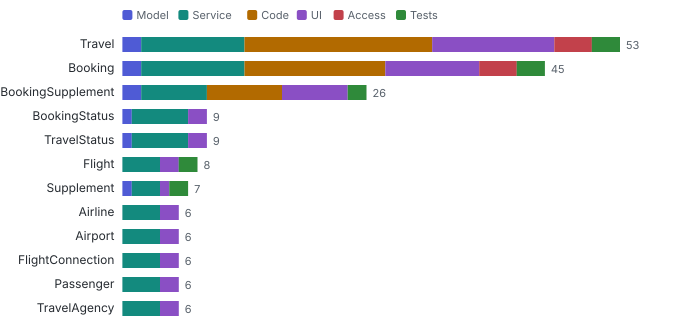
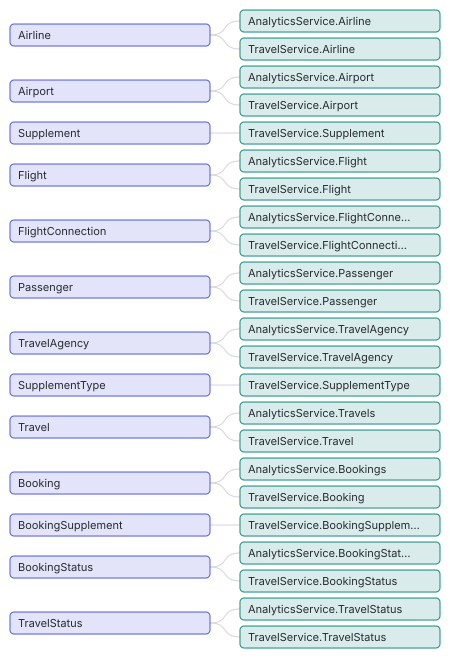
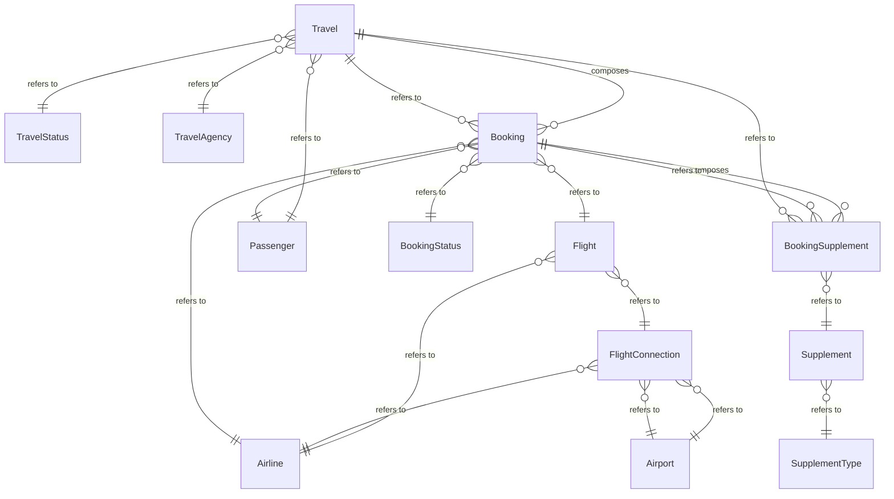

# Model map

_cds compile (CSN)_ · Entities, compositions, associations and the projection chain from database to service, plus what depends on each entity when it changes.

13 database entities in `sap.fe.cap.travel` · 29 service entities · 6 compositions · 21 associations.

**Explore it:** [interactive model and impact explorer](explorer.html) (click an entity to see what it affects; graph, rings or layers).

### What depends on each entity

| Entity | Depends on it | Model | Service | Code | UI | Access | Tests | Detail |
| --- | --- | --- | --- | --- | --- | --- | --- | --- |
| Travel | 53 | 2 | 11 | 20 | 13 | 4 | 3 | [impact](data/impact/Travel.md) |
| Booking | 45 | 2 | 11 | 15 | 10 | 4 | 3 | [impact](data/impact/Booking.md) |
| BookingSupplement | 26 | 2 | 7 | 8 | 7 |  | 2 | [impact](data/impact/BookingSupplement.md) |
| BookingStatus | 9 | 1 | 6 |  | 2 |  |  | [impact](data/impact/BookingStatus.md) |
| TravelStatus | 9 | 1 | 6 |  | 2 |  |  | [impact](data/impact/TravelStatus.md) |
| Flight | 8 |  | 4 |  | 2 |  | 2 | [impact](data/impact/Flight.md) |
| Supplement | 7 | 1 | 3 |  | 1 |  | 2 | [impact](data/impact/Supplement.md) |
| Airline | 6 |  | 4 |  | 2 |  |  | [impact](data/impact/Airline.md) |
| Airport | 6 |  | 4 |  | 2 |  |  | [impact](data/impact/Airport.md) |
| FlightConnection | 6 |  | 4 |  | 2 |  |  | [impact](data/impact/FlightConnection.md) |
| Passenger | 6 |  | 4 |  | 2 |  |  | [impact](data/impact/Passenger.md) |
| TravelAgency | 6 |  | 4 |  | 2 |  |  | [impact](data/impact/TravelAgency.md) |
| SupplementType | 5 | 1 | 3 |  | 1 |  |  | [impact](data/impact/SupplementType.md) |

### Projection chain

Each database entity and the service entities that project on it (a change to the left reaches everything to its right).

### Entity relationships

Ask the same from the command line: `node bin/query.js <out> impact <Entity> [--depth 3] [--assoc]`.

**Deeper:** [explorer.html](explorer.html) · [model-graph.json](data/model-graph.json) · [impact.json](data/impact.json)

Read from: `run/csn.json`, `run/graph/` · [all products](../index.md)
