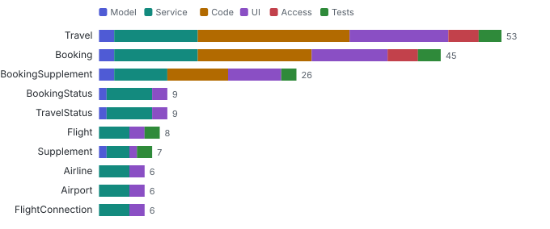
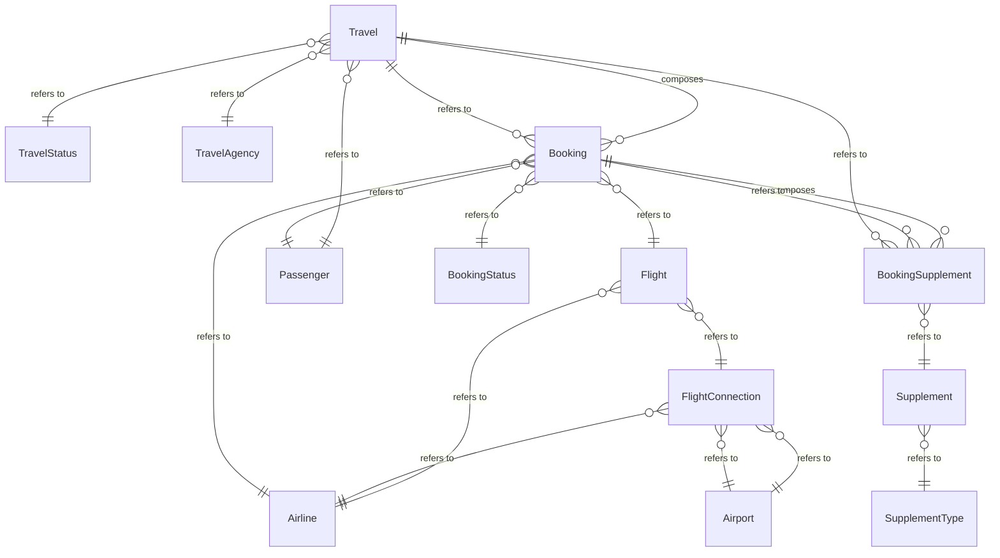

# Model map

_cds compile (CSN)_ · Entities, compositions, associations and the projection chain from database to service, plus what depends on each entity when it changes.

13 database entities in `sap.fe.cap.travel` · 29 service entities · 6 compositions · 21 associations.

**Explore it:** [interactive model and impact explorer](explorer.html) (pick any entity, see what it affects; graph, rings or layers).

### Which entities spread a change furthest?

_Changing a widely used entity touches projections, handlers, screens and tests at once; knowing the reach before a change is cheaper than finding it after._ **Next:** Open "impact" for the entity, or the explorer to walk it, before changing it.

| Entity | Exposed by | Depends on it | Model | Service | Code | UI | Access | Tests | Detail |
| --- | --- | --- | --- | --- | --- | --- | --- | --- | --- |
| Travel | AnalyticsService, TravelService | 53 | 2 | 11 | 20 | 13 | 4 | 3 | [impact](data/impact/Travel.md) |
| Booking | AnalyticsService, TravelService | 45 | 2 | 11 | 15 | 10 | 4 | 3 | [impact](data/impact/Booking.md) |
| BookingSupplement | TravelService | 26 | 2 | 7 | 8 | 7 | 0 | 2 | [impact](data/impact/BookingSupplement.md) |
| BookingStatus | AnalyticsService, TravelService | 9 | 1 | 6 | 0 | 2 | 0 | 0 | [impact](data/impact/BookingStatus.md) |
| TravelStatus | AnalyticsService, TravelService | 9 | 1 | 6 | 0 | 2 | 0 | 0 | [impact](data/impact/TravelStatus.md) |
| Flight | AnalyticsService, TravelService | 8 | 0 | 4 | 0 | 2 | 0 | 2 | [impact](data/impact/Flight.md) |
| Supplement | TravelService | 7 | 1 | 3 | 0 | 1 | 0 | 2 | [impact](data/impact/Supplement.md) |
| Airline | AnalyticsService, TravelService | 6 | 0 | 4 | 0 | 2 | 0 | 0 | [impact](data/impact/Airline.md) |
| Airport | AnalyticsService, TravelService | 6 | 0 | 4 | 0 | 2 | 0 | 0 | [impact](data/impact/Airport.md) |
| FlightConnection | AnalyticsService, TravelService | 6 | 0 | 4 | 0 | 2 | 0 | 0 | [impact](data/impact/FlightConnection.md) |

**Top 10 of 13 entities** by depends on it. [Browse all 13 with filters](browse.html#entities) · [entities.json](data/lists/entities.json)

### Which service entities change when a database entity changes?

_A field added or removed on the database entity shows up (or breaks) in every projection on it._ **Next:** Check each projection on the right when you change the entity on the left.

| Database entity | Service entity | Service |
| --- | --- | --- |
| Airline | AnalyticsService.Airline | AnalyticsService |
| Airline | TravelService.Airline | TravelService |
| Airport | AnalyticsService.Airport | AnalyticsService |
| Airport | TravelService.Airport | TravelService |
| Booking | AnalyticsService.Bookings | AnalyticsService |
| Booking | TravelService.Booking | TravelService |
| BookingStatus | AnalyticsService.BookingStatus | AnalyticsService |
| BookingStatus | TravelService.BookingStatus | TravelService |
| BookingSupplement | TravelService.BookingSupplement | TravelService |
| Flight | AnalyticsService.Flight | AnalyticsService |

**Top 10 of 23 projections** by database entity (ascending). [Browse all 23 with filters](browse.html#projections) · [projections.json](data/lists/projections.json)

### How are the entities related?

_Compositions delete and deep-insert together; associations only refer. That decides what a change or a delete takes with it._ **Next:** Treat a composition parent and its children as one unit in changes and tests.

Ask the same from the command line: `node bin/query.js <out> impact <Entity> [--depth 3] [--assoc]`.

**Deeper:** [explorer.html](explorer.html) · [browse.html](browse.html) · [model-graph.json](data/model-graph.json) · [impact.json](data/impact.json)

Read from: `run/csn.json`, `run/graph/` · [all products](../index.md)
