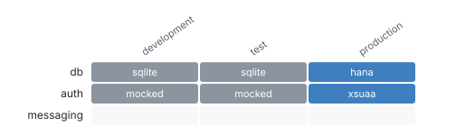

# Project passport

_Probe and intake_ · How CAP sees the project: profiles, database, auth and messaging per profile, plugins, model files, services and their implementations.

CAP 10.1.0 (app) · TypeScript · 14 model files · 2 services · 20 seed files

### What runs in development, test and production: database, auth, messaging?

_Mocked auth or SQLite in production, or a test profile that differs from production, makes tests prove less than they seem._ **Next:** If production shows a mock, treat every access result as unproven until it is fixed.

### Which services exist, where are they served, and which have their own code?

_A service without its own code is generic CAP: its behaviour comes from the model alone, so tests and review focus elsewhere._ **Next:** Open the Behaviour matrix for services with code, the API surface for the others.

| Service | Protocols | Endpoints | Own code | Implementation |
| --- | --- | --- | --- | --- |
| AnalyticsService | odata | odata /analytics | no | none (generic CAP) |
| TravelService | odata | odata /processor | yes | srv/travel-service.ts |

_2 services_ · [browse with filters](browse.html#services) · [services.json](data/lists/services.json)

### Which CAP plugins change behaviour without code in this repository?

_Plugins add handlers, protocols or database behaviour that no source file shows._ **Next:** Read the plugin docs for anything the Behaviour matrix cannot explain.

| Plugin |
| --- |
| `@cap-js/cds-typer` |
| `@cap-js/hana` |
| `@cap-js/sqlite` |
| `@sap/cds-fiori` |
| `cds-plugin-ui5` |

_5 plugins_ · [browse with filters](browse.html#plugins) · [plugins.json](data/lists/plugins.json)

### Doctor

CAP answered every probe question.

**Deeper:** [browse.html](browse.html) · [project.json](data/project.json)

Read from: `run/project.json` · [all products](../index.md)
