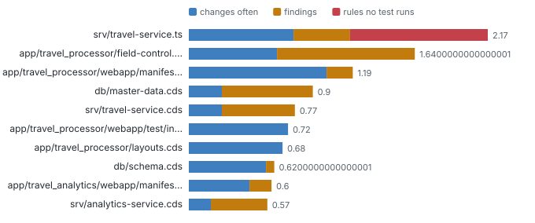

# Risk list

_History × findings × tests_ · One ranking per file joining how often it changes, what was found in it, and which of its rules no test runs.

73 files carry at least one signal; 3 source files score 1 or more (out of 3). History: 1238 commits. Rules measured in CI: 9 of 11 reached.

### Which files are most likely to break unnoticed when changed?

_A file that changes often, already has findings and has rules no test runs combines the three reasons bugs ship; each signal alone over- or under-rates it._ **Next:** Before changing a top file, add the missing tests for its rules; filter "Kind: code" to skip UI and test files.

| File | Risk (0-3) | changes often | findings | rules no test runs | Because | Main driver | Kind | Folder |
| --- | --- | --- | --- | --- | --- | --- | --- | --- |
| srv/travel-service.ts | 2.17 | 0.76 | 0.41 | 1 | 19 commits · 5 warnings, 3 info · 2 of 11 rules never run | rules no test runs | code | srv |
| app/travel_processor/field-control.cds | 1.64 | 0.64 | 1 | 0 | 16 commits · 15 warnings, 2 info | findings | ui | app/travel_processor |
| app/travel_processor/webapp/manifest.json | 1.19 | 1 | 0.19 | 0 | 25 commits · 3 warnings | changes often | ui | app/travel_processor/webapp |
| db/master-data.cds | 0.9 | 0.24 | 0.66 | 0 | 6 commits · 7 critical | findings | model | db |
| srv/travel-service.cds | 0.77 | 0.24 | 0.53 | 0 | 6 commits · 5 warnings, 7 info | findings | model | srv |
| app/travel_processor/webapp/test/integration/OpaJourney.js | 0.72 | 0.72 | 0 | 0 | 18 commits | changes often | test | app/travel_processor/webapp/test/integration |
| app/travel_processor/layouts.cds | 0.68 | 0.68 | 0 | 0 | 17 commits | changes often | ui | app/travel_processor |
| db/schema.cds | 0.62 | 0.56 | 0.06 | 0 | 14 commits · 1 warnings | changes often | model | db |
| app/travel_analytics/webapp/manifest.json | 0.6 | 0.44 | 0.16 | 0 | 11 commits · 2 warnings, 1 info | changes often | ui | app/travel_analytics/webapp |
| srv/analytics-service.cds | 0.57 | 0.16 | 0.41 | 0 | 4 commits · 6 warnings, 1 info | findings | model | srv |

**Top 10 of 73 files** by risk (0-3). [Browse all 73 with filters](browse.html#files) · [files.json](data/lists/files.json)

**Deeper:** [browse.html](browse.html) · [risk.json](data/risk.json)

Read from: `git log`, `run/findings/findings.jsonl`, `run/graph/ (Rule)`, `atlas-data.json MEASURED.rules (CI)` · [all products](../index.md)
