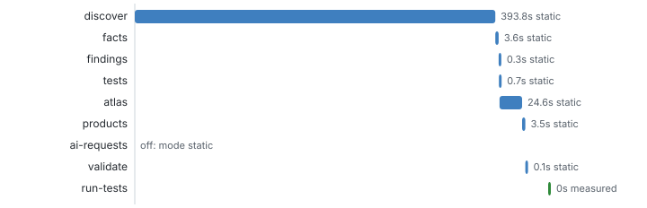

# Run timeline

_The run itself_ · Which stages ran, in which mode, how long each took and what it reported.

Mode **static** · toolkit 1.0.0 @ effe0e7 · CAP 9.9.4 · app @capire/sflight @ 7f42e85

### Where did the run spend its time, and which stage failed or was skipped?

_A failed or skipped stage leaves every product after it incomplete, so its numbers must not be trusted._ **Next:** Read what the failed or skipped stage said in the list below before trusting later cards.

### What did each stage report?

_The one-line message of each stage is the first place to look when a number seems off._ **Next:** Follow a stage to its product card, or rerun with that stage switched on.

| Stage | Status | Method | Seconds | Said |
| --- | --- | --- | --- | --- |
| discover | ran | static | 393.8 | @capire/sflight: 261 nodes, 406 edges, 1 slices, coverage 99%, 8 diagrams rendered |
| facts | ran | static | 3.6 | atlas facts written: /home/runner/work/discovery-agents-test/discovery-agents-test/out/sap-samples-cap-sflight-7f42e8577c9bdbc2e51d1844ffc64ff00dd724f1/atlas-data.json (14 sections; ARC generated, DAT generated, DEP generated, FLW generated, STA generated, AUT generated, PAT generated, UIS generated, TST generated, API generated, RSK generated + agent, COV generated, RLS generated (rules library), UIT generated; 15 risks, 32 patterns, 122 classes) |
| findings | ran | static | 0.3 | findings (static): 129 findings (126 static, 3 human), 21 open gaps of 21 → /home/runner/work/discovery-agents-test/discovery-agents-test/out/sap-samples-cap-sflight-7f42e8577c9bdbc2e51d1844ffc64ff00dd724f1/run/findings |
| tests | ran | static | 0.7 | generated 19 tests in 2 files → /home/runner/work/discovery-agents-test/discovery-agents-test/out/sap-samples-cap-sflight-7f42e8577c9bdbc2e51d1844ffc64ff00dd724f1/run/tests/generated (syntax OK) |
| atlas | ran | static | 24.6 | atlas written to /home/runner/work/discovery-agents-test/discovery-agents-test/out/sap-samples-cap-sflight-7f42e8577c9bdbc2e51d1844ffc64ff00dd724f1/atlas: 15 topics, 37 images |
| products | ran | static | 3.5 | 15 step products → /home/runner/work/discovery-agents-test/discovery-agents-test/out/sap-samples-cap-sflight-7f42e8577c9bdbc2e51d1844ffc64ff00dd724f1/steps (12 with results, 3 not run here, 0 failed) |
| ai-requests | off | static |  | mode static |
| validate | ran | static | 0.1 | valid (mode static; 129 findings, 21 gaps, manifest with 7 stages) |
| run-tests | ran | measured |  | startup success, generated tests success |

_9 stages_ · [browse with filters](browse.html#stages) · [stages.json](data/lists/stages.json)

Blue: static · green: measured (the running app answered) · amber: AI · red: failed.

**Deeper:** [browse.html](browse.html) · [stages.json](data/stages.json)

Read from: `manifest.json` · [all products](../index.md)
