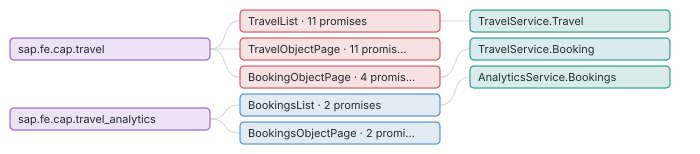

# Screen map

_UI5 and Fiori annotations_ · Apps, pages and the entities they show, and every UI promise with the server verdict (does the backend enforce what the UI shows?).

2 apps · 5 pages · 21 UI promises, **7 only in the UI** (an OData client can bypass them).

Page colour = worst verdict of the promises on the entity it shows (red UI only, amber partial, green consistent, blue CAP).

| Entity | Promise | UI says | Server | Verdict | Where |
| --- | --- | --- | --- | --- | --- |
| Travel | rejectTravel | TravelStatus != X | no rule on this field | ui-only | app/travel_processor/field-control.cds:37 |
| Travel | acceptTravel | TravelStatus != A | no rule on this field | ui-only | app/travel_processor/field-control.cds:41 |
| Travel | field-control | 5 fields controlled by TravelStatus.fieldControl | no update handler checks it | ui-only | app/travel_processor/field-control.cds:29 |
| Booking | field-control | 6 fields controlled by to_Travel.TravelStatus.fieldControl | no update handler checks it | ui-only | app/travel_processor/field-control.cds:65 |
| Booking | CreateHidden | hidden when [object Object] | no before CREATE/NEW rejection | ui-only | app/travel_processor/field-control.cds:60 |
| Booking | DeleteHidden | hidden when [object Object] | no before DELETE rejection | ui-only | app/travel_processor/field-control.cds:61 |
| BookingSupplement | field-control | 4 fields controlled by to_Travel.TravelStatus.fieldControl | no update handler checks it | ui-only | app/travel_processor/field-control.cds:29 |
| Travel | deductDiscount | TravelStatus = O | allows TravelStatus in {X, O}; also X | partial | app/travel_processor/field-control.cds:45 |
| Travel | side-effects | BookingFee → re-read TotalPrice, GreenFee, TreesPlanted | recomputed by 3 handler(s) | consistent | app/travel_processor/field-control.cds:20 |
| Travel | side-effects | GoGreen → re-read TotalPrice, GreenFee, TreesPlanted | recomputed by 3 handler(s) | consistent | app/travel_processor/field-control.cds:20 |
| Travel | side-effects | to_Booking → re-read TotalPrice | recomputed by 5 handler(s) | consistent | app/travel_processor/field-control.cds:51 |
| Travel | deductDiscount | percent in [1, 100] | CAP generic handler | framework | srv/travel-service.cds:20 |
| Travel | readonly | TravelID, TotalPrice, TravelStatus, GreenFee, TreesPlanted | CAP generic handler | framework | db/schema.cds:14 |
| Travel | mandatory | BeginDate, EndDate, to_Agency, to_Customer | CAP generic handler | framework | db/schema.cds:15 |
| Booking | mandatory | ConnectionID, FlightDate, FlightPrice, BookingStatus, to_Carrier, to_Customer | CAP generic handler | framework | db/schema.cds:37 |
| BookingSupplement | mandatory | Price, to_Supplement | CAP generic handler | framework | db/schema.cds:22 |
| Bookings | capabilities | no create / update / delete | CAP rejects with 405 (Capabilities) | framework | srv/analytics-service.cds:9 |
| Bookings | computed | TravelID, BookingID, CombinedID, CurrencyCode_code | CAP ignores client values (Core.Computed / Immutable / ReadOnly) | framework | srv/analytics-service.cds:9 |
| Travels | capabilities | no create / update / delete | CAP rejects with 405 (Capabilities) | framework | srv/analytics-service.cds:68 |
| Travels | computed | TravelID, TotalPrice, TravelStatus_code, GreenFee, TreesPlanted, CustomerName | CAP ignores client values (Core.Computed / Immutable / ReadOnly) | framework | srv/analytics-service.cds:68 |
| Travel | computed | TravelStatus_code | CAP ignores client values (Core.Computed / Immutable / ReadOnly) | framework | srv/travel-service.cds:11 |

**Deeper:** [ui-promises.json](data/ui-promises.json)

Read from: `run/graph/ (UI5App, Route, UiRule)` · [all products](../index.md)
