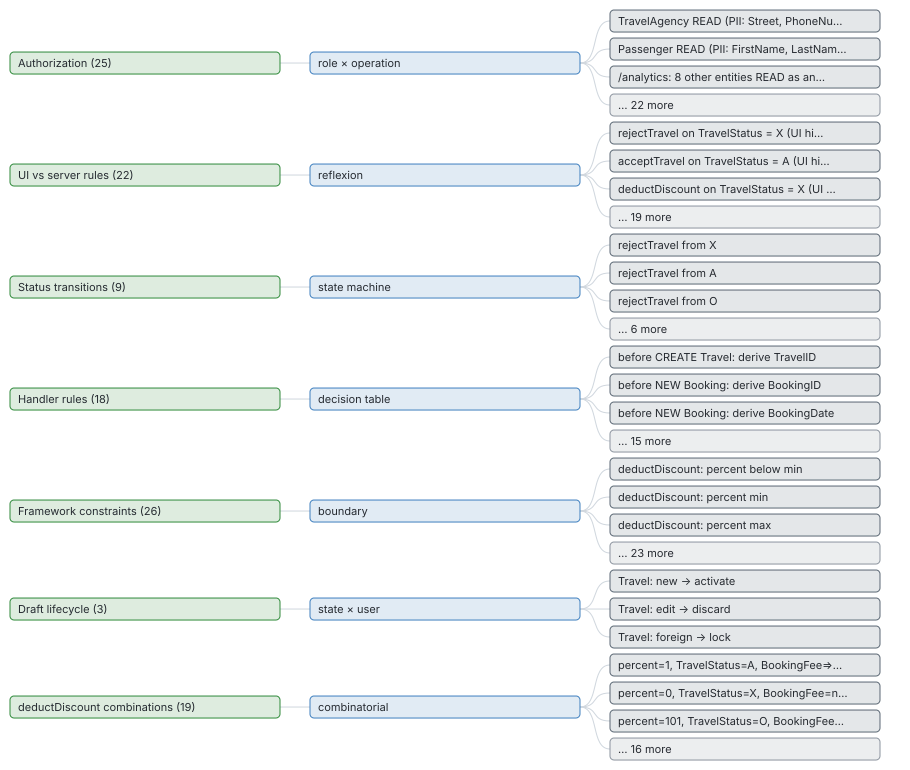

# Classification tree

_Test design_ · Equivalence classes per category (authorization, UI promises, status transitions, handler rules, …) and the pairwise rows that cover the combinations.

122 equivalence classes in 7 categories; 12 covered by a test today.

### How were the tests designed for each category?

_Each category uses a known technique (decision table, state transition, pairwise, …); seeing it explains why these classes and not others._ **Next:** Challenge a technique that does not fit; add a category that is missing.

### How many classes does each category have, and how many are covered today?

_A category with many classes and no coverage is a whole kind of behaviour nobody tests._ **Next:** Start with the largest uncovered category in Coverage.

| Category | Technique | Classes | Covered today | Why |
| --- | --- | --- | --- | --- |
| Framework constraints | boundary | 26 | 0 | @mandatory missing/present, @readonly ignored, @assert.range below/min/max/above |
| Authorization | role × operation | 25 | 6 | 13 operations × 6 users, grouped by outcome |
| UI vs server rules | reflexion | 22 | 3 | one class per UI promise; ui-only and partial ones are negative tests |
| deductDiscount combinations | combinatorial | 19 | 0 | all pairs over 5 factors (216 full) |
| Handler rules | decision table | 18 | 1 | each rejection: guard true and false; each derivation and conditional write: condition true and false |
| Status transitions | state machine | 9 | 1 | each action from each state |
| Draft lifecycle | state × user | 3 | 1 | new → activate, edit → discard, edit while another user holds the draft |

_7 categories_ · [browse with filters](browse.html#categories) · [categories.json](data/lists/categories.json)

### Pairwise: deductDiscount

5 factors, 216 full combinations, **19 pairwise rows** cover every pair.

### Which input combinations must be tested for the action with most factors?

_Testing every combination explodes; pairwise covers every pair of values with a few rows and finds most interaction bugs._ **Next:** Use each row as a test case.

| percent | TravelStatus | BookingFee | target | repeat |
| --- | --- | --- | --- | --- |
| 1 | A | > 0 | active | first |
| 0 | X | null | draft | again |
| 101 | O | > 0 | draft | again |
| null | X | > 0 | active | again |
| 51 | A | 0 | draft | again |
| 100 | O | 0 | active | first |
| 100 | A | null | draft | again |
| 101 | X | null | active | first |
| 0 | A | 0 | draft | first |
| 1 | O | null | draft | again |
| null | O | null | draft | first |
| 51 | X | 0 | active | first |
| 0 | O | > 0 | active | first |
| 1 | X | 0 | active | first |
| 100 | X | > 0 | active | first |
| 101 | A | 0 | active | first |
| 51 | O | > 0 | active | first |
| null | A | 0 | active | first |
| 51 | X | null | active | first |

_19 rows_ · [browse with filters](browse.html#pairwise) · [pairwise.json](data/lists/pairwise.json)

### Which equivalence classes exist, with input and expected outcome?

_An equivalence class is one test worth writing; the list is the test backlog._ **Next:** Pick untested classes from Coverage → Test next.

| Category | Class | Input | Expected | Today |
| --- | --- | --- | --- | --- |
| Authorization | TravelAgency READ (PII: Street, PhoneNumber, EMailAddress) as anonymous/rose/martha/amy/admin/alice | user rose | 403 (today 200: open) |  |
| Authorization | Passenger READ (PII: FirstName, LastName, Street, …) as anonymous/rose/martha/amy/admin/alice | user rose | 403 (today 200: open) |  |
| Authorization | /analytics: 8 other entities READ as anonymous | user anonymous | verify |  |
| Authorization | /analytics: 8 other entities READ as rose/martha/amy/admin/alice | user rose | 200 |  |
| Authorization | Travel READ as anonymous | user anonymous | 401 |  |
| Authorization | Travel READ as rose/martha/amy/admin/alice | user rose | 200 |  |
| Authorization | Travel create / edit / delete as anonymous/rose/martha | user rose | 403 |  |
| Authorization | Travel create / edit / delete as amy/admin/alice | user amy | 200 |  |
| Authorization | Travel createTravelByTemplate as anonymous/rose/martha | user rose | 403 |  |
| Authorization | Travel createTravelByTemplate as amy/admin/alice | user amy | verify |  |

**Top 10 of 122 classes** by category (ascending). [Browse all 122 with filters](browse.html#classes) · [classes.json](data/lists/classes.json)

**Deeper:** [browse.html](browse.html) · [classes.json](data/classes.json) · [class-seeds.json](data/class-seeds.json)

Read from: `atlas-data.json TESTCATS, CLASSES, DD`, `run/tests/class-seeds.json` · [all products](../index.md)
