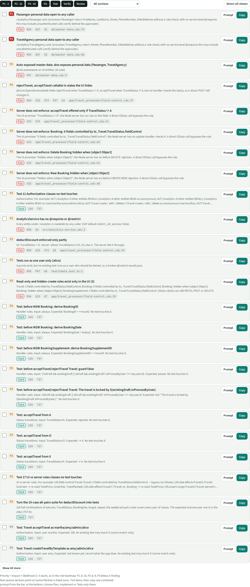
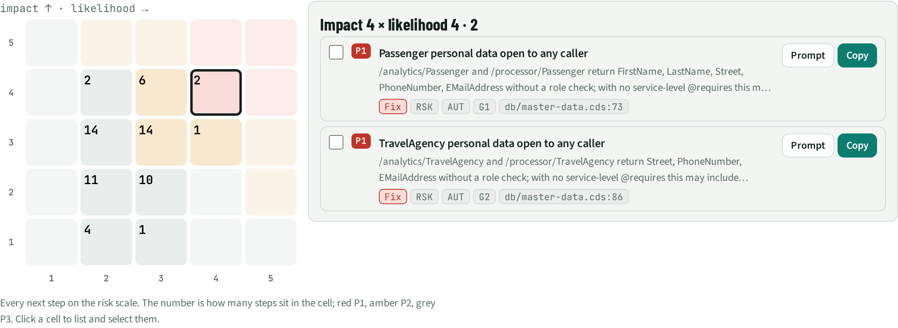
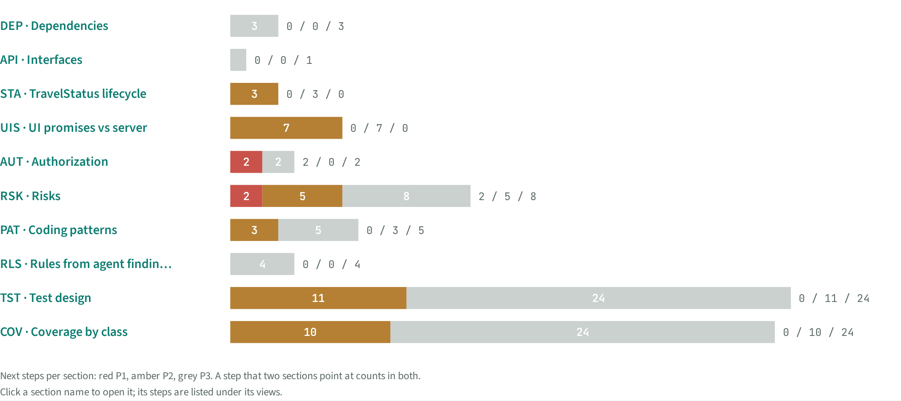

# NXT · Next steps

> 65 next steps from 10 sections, ranked by impact × likelihood: **2 P1** (do now), 21 P2, 42 P3. Tick several and copy one combined prompt for a coding agent, as a plan, a change, or tests only.

## Facts

_Facts generated from the other sections._

Priority = impact × likelihood (1–5 each): P1 ≥ 16, P2 ≥ 9, P3 below. An item that several sections point at (same file:line) is listed once; many similar items (untested classes of one category, access checks in one service) are one step.

The 25 highest-ranked of 65 steps (2 P1, 21 P2, 42 P3). The full ranked list with every prompt is in `atlas-data.json` under `NEXT.items`, and on the NXT page of index.html.

| Priority | Id | Step | What | Sections | Evidence | Score |
| --- | --- | --- | --- | --- | --- | --- |
| P1 | `RSK:G1` | Fix | Passenger personal data open to any caller | RSK, AUT | `db/master-data.cds:73` | 4×4 |
| P1 | `RSK:G2` | Fix | TravelAgency personal data open to any caller | RSK, AUT | `db/master-data.cds:86` | 4×4 |
| P2 | `PAT:Auto-exposed master data` | Fix | Auto-exposed master data: also exposes personal data (Passenger, TravelAgency) | PAT | `db/master-data.cds:5` | 4×3 |
| P2 | `RSK:G3` | Fix | rejectTravel, acceptTravel callable in states the UI hides | RSK, UIS, STA, PAT | `app/travel_processor/field-control.cds:37` | 3×4 |
| P2 | `UIS:acceptTravel offered only if TravelStatus != A` | Fix | Server does not enforce: acceptTravel offered only if TravelStatus != A | UIS, STA | `app/travel_processor/field-control.cds:41` | 4×3 |
| P2 | `UIS:Booking: 6 fields controlled by to_Travel.TravelStatus.fieldControl` | Fix | Server does not enforce: Booking: 6 fields controlled by to_Travel.TravelStatus.fieldControl | UIS | `app/travel_processor/field-control.cds:65` | 4×3 |
| P2 | `UIS:Delete Booking hidden when [object Object]` | Fix | Server does not enforce: Delete Booking hidden when [object Object] | UIS | `app/travel_processor/field-control.cds:61` | 4×3 |
| P2 | `UIS:New Booking hidden when [object Object]` | Fix | Server does not enforce: New Booking hidden when [object Object] | UIS | `app/travel_processor/field-control.cds:60` | 4×3 |
| P2 | `COV:Authorization: 11 untested` | Test | Test 11 Authorization classes no test touches | COV, TST |  | 4×3 |
| P2 | `RSK:G4` | Fix | AnalyticsService has no @requires or @restrict | RSK | `srv/analytics-service.cds:3` | 3×3 |
| P2 | `RSK:G5` | Fix | deductDiscount enforced only partly | RSK, UIS, STA | `app/travel_processor/field-control.cds:45` | 3×3 |
| P2 | `RSK:G6` | Fix | Tests run as one user only (alice) | RSK, PAT | `test/odata.test.ts:1` | 3×3 |
| P2 | `RSK:G7` | Fix | Read-only and hidden-create rules exist only in the UI (5) | RSK, UIS | `app/travel_processor/field-control.cds:29` | 3×3 |
| P2 | `COV:RUL:rule:srv/travel-service.ts:23:t` | Test | Test: before NEW Booking: derive BookingID | COV, TST |  | 3×3 |
| P2 | `COV:RUL:rule:srv/travel-service.ts:24:t` | Test | Test: before NEW Booking: derive BookingDate | COV, TST |  | 3×3 |
| P2 | `COV:RUL:rule:srv/travel-service.ts:29:t` | Test | Test: before NEW BookingSupplement: derive BookingSupplementID | COV, TST |  | 3×3 |
| P2 | `COV:RUL:rule:srv/travel-service.ts:93:f` | Test | Test: before acceptTravel/rejectTravel Travel: guard false | COV, TST |  | 3×3 |
| P2 | `COV:RUL:rule:srv/travel-service.ts:93:t` | Test | Test: before acceptTravel/rejectTravel Travel: The travel is locked by ${existingDraft.InProcessByUser}. | COV, TST |  | 3×3 |
| P2 | `COV:STA:acceptTravel:A` | Test | Test: acceptTravel from A | COV, TST |  | 3×3 |
| P2 | `COV:STA:acceptTravel:O` | Test | Test: acceptTravel from O | COV, TST |  | 3×3 |
| P2 | `COV:STA:acceptTravel:X` | Test | Test: acceptTravel from X | COV, TST |  | 3×3 |
| P2 | `COV:UI vs server rules: 17 untested` | Test | Test 17 UI vs server rules classes no test touches | COV, TST |  | 3×3 |
| P2 | `TST:deductDiscount all-pairs` | Test | Turn the 19-case all-pairs suite for deductDiscount into tests | TST |  | 3×3 |
| P3 | `COV:AUT:Travel acceptTravel:y` | Test | Test: Travel acceptTravel as martha/amy/admin/alice | COV, TST |  | 4×2 |
| P3 | `COV:AUT:Travel createTravelByTemplate:a` | Test | Test: Travel createTravelByTemplate as amy/admin/alice | COV, TST |  | 4×2 |

## Prompts

To hand items to a coding agent, paste the header, then the blocks of the items you want, then one closing instruction.

### Header

```text
You are working in https://github.com/SAP-samples/cap-sflight (analysed at commit 7f42e85), a SAP CAP Node.js app with UI5 / Fiori front ends. The tasks below come from its discovery atlas; each cites file:line evidence in this repository. Read the cited lines before acting. If a finding does not hold any more, say so and skip it. Scope: CAP Node.js only.
```

### Closing: Plan

```text
Do not change code yet. For each task: is the finding true (yes / no, with the line you checked), the change you would make, the test that proves it, and the risk of the change. End with the order you suggest.
```

### Closing: Implement

```text
Work through the tasks in the order given (highest priority first). For each: make the change, add the test named under "Done when", run the tests, and make one commit per task with the task id in the message. End with a table: task id, result (done / not reproducible / blocked), files changed, test added.
```

### Closing: Tests only

```text
Only write tests; do not change app code. For each task add a cds.test that pins the expected behaviour. Where today's code behaves differently, keep the expected test as it.skip with the reason, plus one test that pins today's behaviour. End with a table: task id, test file, passes today (yes / no).
```

### Item blocks (top 25)

```text
### RSK:G1 · Fix · P1 (impact 4 × likelihood 4)
Passenger personal data open to any caller
Finding: /analytics/Passenger and /processor/Passenger return FirstName, LastName, Street, PhoneNumber, EMailAddress without a role check; with no service-level @requires this may include unauthenticated calls (verify behind the approuter).
Evidence: db/master-data.cds:73
Do: Change the app so the finding no longer holds. Keep the change small and in the layer named; do not touch unrelated behaviour.
Done when: A test does this: GET /analytics/Passenger, /processor/Passenger as anonymous and as a user without roles, expect 401/403. It fails on today's code and passes after the fix.
```

```text
### RSK:G2 · Fix · P1 (impact 4 × likelihood 4)
TravelAgency personal data open to any caller
Finding: /analytics/TravelAgency and /processor/TravelAgency return Street, PhoneNumber, EMailAddress without a role check; with no service-level @requires this may include unauthenticated calls (verify behind the approuter).
Evidence: db/master-data.cds:86
Do: Change the app so the finding no longer holds. Keep the change small and in the layer named; do not touch unrelated behaviour.
Done when: A test does this: GET /analytics/TravelAgency, /processor/TravelAgency as anonymous and as a user without roles, expect 401/403. It fails on today's code and passes after the fix.
```

```text
### PAT:Auto-exposed master data · Fix · P2 (impact 4 × likelihood 3)
Auto-exposed master data: also exposes personal data (Passenger, TravelAgency)
Finding: @cds.autoexpose on 10 entities (10 uses).
Evidence: db/master-data.cds:5
Do: Change the app so the finding no longer holds. Keep the change small and in the layer named; do not touch unrelated behaviour.
```

```text
### RSK:G3 · Fix · P2 (impact 3 × likelihood 4)
rejectTravel, acceptTravel callable in states the UI hides
Finding: @Core.OperationAvailable hides rejectTravel when TravelStatus != X; acceptTravel when TravelStatus != A, but no handler checks the status, so a direct POST still changes it.
Evidence: app/travel_processor/field-control.cds:37
Do: Change the app so the finding no longer holds. Keep the change small and in the layer named; do not touch unrelated behaviour.
Done when: A test does this: POST each action on an instance in the hidden state, expect 4xx. It fails on today's code and passes after the fix.
```

```text
### UIS:acceptTravel offered only if TravelStatus != A · Fix · P2 (impact 4 × likelihood 3)
Server does not enforce: acceptTravel offered only if TravelStatus != A
Finding: The UI promises "TravelStatus != A"; the Node server has no rule on this field. A direct OData call bypasses the rule.
Evidence: app/travel_processor/field-control.cds:41
Do: Change the app so the finding no longer holds. Keep the change small and in the layer named; do not touch unrelated behaviour.
Done when: A cds.test sends the request the UI hides or blocks and expects a 4xx rejection.
```

```text
### UIS:Booking: 6 fields controlled by to_Travel.TravelStatus.fieldControl · Fix · P2 (impact 4 × likelihood 3)
Server does not enforce: Booking: 6 fields controlled by to_Travel.TravelStatus.fieldControl
Finding: The UI promises "6 fields controlled by to_Travel.TravelStatus.fieldControl"; the Node server has no update handler checks it. A direct OData call bypasses the rule.
Evidence: app/travel_processor/field-control.cds:65
Do: Change the app so the finding no longer holds. Keep the change small and in the layer named; do not touch unrelated behaviour.
Done when: A cds.test sends the request the UI hides or blocks and expects a 4xx rejection.
```

```text
### UIS:Delete Booking hidden when [object Object] · Fix · P2 (impact 4 × likelihood 3)
Server does not enforce: Delete Booking hidden when [object Object]
Finding: The UI promises "hidden when [object Object]"; the Node server has no before DELETE rejection. A direct OData call bypasses the rule.
Evidence: app/travel_processor/field-control.cds:61
Do: Change the app so the finding no longer holds. Keep the change small and in the layer named; do not touch unrelated behaviour.
Done when: A cds.test sends the request the UI hides or blocks and expects a 4xx rejection.
```

```text
### UIS:New Booking hidden when [object Object] · Fix · P2 (impact 4 × likelihood 3)
Server does not enforce: New Booking hidden when [object Object]
Finding: The UI promises "hidden when [object Object]"; the Node server has no before CREATE/NEW rejection. A direct OData call bypasses the rule.
Evidence: app/travel_processor/field-control.cds:60
Do: Change the app so the finding no longer holds. Keep the change small and in the layer named; do not touch unrelated behaviour.
Done when: A cds.test sends the request the UI hides or blocks and expects a 4xx rejection.
```

```text
### COV:Authorization: 11 untested · Test · P2 (impact 4 × likelihood 3)
Test 11 Authorization classes no test touches
Finding: Authorization. For example: AUT:/analytics: 8 other entities READ:a (/analytics: 8 other entities READ as anonymous); AUT:/analytics: 8 other entities READ:y (/analytics: 8 other entities READ as rose/martha/amy/admin/alice); AUT:Travel create / edit / delete:n (Travel create / edit / delete as anonymous/rose/martha); AUT:Travel createTravelByTemplate:n (Travel createTravelByTemplate as anonymous/rose/martha); AUT:Travel rejectTravel:n (Travel rejectTravel as anonymous/rose); and 6 more (COV / TST topic, atlas-data.json).
Do: Write a cds.test (Jest) for this case. If today's behaviour differs from the expected one, pin today's behaviour in one test and add the intended one as `it.skip` with the reason.
Done when: Passing cds.test cases whose titles start with the class ids, starting with the first 10: AUT:/analytics: 8 other entities READ:a, AUT:/analytics: 8 other entities READ:y, AUT:Travel create / edit / delete:n, AUT:Travel createTravelByTemplate:n, AUT:Travel rejectTravel:n, AUT:Travel acceptTravel:n, AUT:Travel deductDiscount:n, AUT:Booking / BookingSupplement (via Travel draft):n, AUT:Booking / BookingSupplement (via Travel draft):a, AUT:/processor: 8 other entities READ:a.
```

```text
### RSK:G4 · Fix · P2 (impact 3 × likelihood 3)
AnalyticsService has no @requires or @restrict
Finding: Every entity under /analytics is readable by any caller (CAP default restrict_all_services: false).
Evidence: srv/analytics-service.cds:3
Do: Change the app so the finding no longer holds. Keep the change small and in the layer named; do not touch unrelated behaviour.
Done when: A test does this: GET /analytics/$metadata and one entity set as anonymous. It fails on today's code and passes after the fix.
```

```text
### RSK:G5 · Fix · P2 (impact 3 × likelihood 3)
deductDiscount enforced only partly
Finding: UI: TravelStatus = O. Server: allows TravelStatus in {X, O}; also X. The server lets X through.
Evidence: app/travel_processor/field-control.cds:45
Do: Change the app so the finding no longer holds. Keep the change small and in the layer named; do not touch unrelated behaviour.
Done when: A test does this: Call deductDiscount in the states the UI hides, expect 4xx. It fails on today's code and passes after the fix.
```

```text
### RSK:G6 · Fix · P2 (impact 3 × likelihood 3)
Tests run as one user only (alice)
Finding: 4 grants exist, but no existing test runs as a user who should be denied, so a broken @restrict would pass.
Evidence: test/odata.test.ts:1
Do: Change the app so the finding no longer holds. Keep the change small and in the layer named; do not touch unrelated behaviour.
Done when: A test does this: Role × operation tests from the authorization matrix (generated). It fails on today's code and passes after the fix.
```

```text
### RSK:G7 · Fix · P2 (impact 3 × likelihood 3)
Read-only and hidden-create rules exist only in the UI (5)
Finding: Travel: 5 fields controlled by TravelStatus.fieldControl; Booking: 6 fields controlled by to_Travel.TravelStatus.fieldControl; Booking: hidden when [object Object]; Booking: hidden when [object Object]; BookingSupplement: 4 fields controlled by to_Travel.TravelStatus.fieldControl. OData clients can still PATCH, POST or DELETE.
Evidence: app/travel_processor/field-control.cds:29
Do: Change the app so the finding no longer holds. Keep the change small and in the layer named; do not touch unrelated behaviour.
Done when: A test does this: PATCH a locked field and POST/DELETE a child on a non-open instance, expect 4xx. It fails on today's code and passes after the fix.
```

```text
### COV:RUL:rule:srv/travel-service.ts:23:t · Test · P2 (impact 3 × likelihood 3)
Test: before NEW Booking: derive BookingID
Finding: Handler rules. Input: always. Expected: BookingID = ++maxID. No test touches it.
Do: Write a cds.test (Jest) for this case. If today's behaviour differs from the expected one, pin today's behaviour in one test and add the intended one as `it.skip` with the reason.
Done when: A passing cds.test whose title starts with "RUL:rule:srv/travel-service.ts:23:t".
```

```text
### COV:RUL:rule:srv/travel-service.ts:24:t · Test · P2 (impact 3 × likelihood 3)
Test: before NEW Booking: derive BookingDate
Finding: Handler rules. Input: always. Expected: BookingDate = today(). No test touches it.
Do: Write a cds.test (Jest) for this case. If today's behaviour differs from the expected one, pin today's behaviour in one test and add the intended one as `it.skip` with the reason.
Done when: A passing cds.test whose title starts with "RUL:rule:srv/travel-service.ts:24:t".
```

```text
### COV:RUL:rule:srv/travel-service.ts:29:t · Test · P2 (impact 3 × likelihood 3)
Test: before NEW BookingSupplement: derive BookingSupplementID
Finding: Handler rules. Input: always. Expected: BookingSupplementID = ++maxID. No test touches it.
Do: Write a cds.test (Jest) for this case. If today's behaviour differs from the expected one, pin today's behaviour in one test and add the intended one as `it.skip` with the reason.
Done when: A passing cds.test whose title starts with "RUL:rule:srv/travel-service.ts:29:t".
```

```text
### COV:RUL:rule:srv/travel-service.ts:93:f · Test · P2 (impact 3 × likelihood 3)
Test: before acceptTravel/rejectTravel Travel: guard false
Finding: Handler rules. Input: !(!isDraft && existingDraft || isDraft && existingDraft?.InProcessByUser !== req.user.id). Expected: passes. No test touches it.
Do: Write a cds.test (Jest) for this case. If today's behaviour differs from the expected one, pin today's behaviour in one test and add the intended one as `it.skip` with the reason.
Done when: A passing cds.test whose title starts with "RUL:rule:srv/travel-service.ts:93:f".
```

```text
### COV:RUL:rule:srv/travel-service.ts:93:t · Test · P2 (impact 3 × likelihood 3)
Test: before acceptTravel/rejectTravel Travel: The travel is locked by ${existingDraft.InProcessByUser}.
Finding: Handler rules. Input: !isDraft && existingDraft || isDraft && existingDraft?.InProcessByUser !== req.user.id. Expected: 423 "The travel is locked by ${existingDraft.InProcessByUser}.". No test touches it.
Do: Write a cds.test (Jest) for this case. If today's behaviour differs from the expected one, pin today's behaviour in one test and add the intended one as `it.skip` with the reason.
Done when: A passing cds.test whose title starts with "RUL:rule:srv/travel-service.ts:93:t".
```

```text
### COV:STA:acceptTravel:A · Test · P2 (impact 3 × likelihood 3)
Test: acceptTravel from A
Finding: Status transitions. Input: TravelStatus=A. Expected: rejected. No test touches it.
Do: Write a cds.test (Jest) for this case. If today's behaviour differs from the expected one, pin today's behaviour in one test and add the intended one as `it.skip` with the reason.
Done when: A passing cds.test whose title starts with "STA:acceptTravel:A".
```

```text
### COV:STA:acceptTravel:O · Test · P2 (impact 3 × likelihood 3)
Test: acceptTravel from O
Finding: Status transitions. Input: TravelStatus=O. Expected: → A. No test touches it.
Do: Write a cds.test (Jest) for this case. If today's behaviour differs from the expected one, pin today's behaviour in one test and add the intended one as `it.skip` with the reason.
Done when: A passing cds.test whose title starts with "STA:acceptTravel:O".
```

```text
### COV:STA:acceptTravel:X · Test · P2 (impact 3 × likelihood 3)
Test: acceptTravel from X
Finding: Status transitions. Input: TravelStatus=X. Expected: → A. No test touches it.
Do: Write a cds.test (Jest) for this case. If today's behaviour differs from the expected one, pin today's behaviour in one test and add the intended one as `it.skip` with the reason.
Done when: A passing cds.test whose title starts with "STA:acceptTravel:X".
```

```text
### COV:UI vs server rules: 17 untested · Test · P2 (impact 3 × likelihood 3)
Test 17 UI vs server rules classes no test touches
Finding: UI vs server rules. For example: UIS:field-control:Travel (Travel: 5 fields controlled by TravelStatus.fieldControl — bypass via OData); UIS:side-effects:Travel:6 (Travel: GoGreen → re-read TotalPrice, GreenFee, TreesPlanted); UIS:side-effects:Travel:7 (Travel: to_Booking → re-read TotalPrice); UIS:assert.range:Travel:8 (Travel: percent in [1, 100]); UIS:readonly:Travel:9 (Travel: TravelID, TotalPrice, TravelStatus, GreenFee, TreesPlanted); and 12 more (COV / TST topic, atlas-data.json).
Do: Write a cds.test (Jest) for this case. If today's behaviour differs from the expected one, pin today's behaviour in one test and add the intended one as `it.skip` with the reason.
Done when: Passing cds.test cases whose titles start with the class ids, starting with the first 10: UIS:field-control:Travel, UIS:side-effects:Travel:6, UIS:side-effects:Travel:7, UIS:assert.range:Travel:8, UIS:readonly:Travel:9, UIS:mandatory:Travel:10, UIS:field-control:Booking, UIS:CreateHidden:Booking, UIS:DeleteHidden:Booking, UIS:mandatory:Booking:14.
```

```text
### TST:deductDiscount all-pairs · Test · P2 (impact 3 × likelihood 3)
Turn the 19-case all-pairs suite for deductDiscount into tests
Finding: 216 full combinations of percent, TravelStatus, BookingFee, target, repeat; the seeded all-pairs suite covers every pair of values. The expected outcome per row is in the atlas (TST-B).
Do: Write a cds.test (Jest) for this case. If today's behaviour differs from the expected one, pin today's behaviour in one test and add the intended one as `it.skip` with the reason.
Done when: One parameterised cds.test (test.each) with 19 rows, each asserting the expected outcome.
```

```text
### COV:AUT:Travel acceptTravel:y · Test · P3 (impact 4 × likelihood 2)
Test: Travel acceptTravel as martha/amy/admin/alice
Finding: Authorization. Input: user martha. Expected: 200. An existing test may touch it (name match only).
Do: Write a cds.test (Jest) for this case. If today's behaviour differs from the expected one, pin today's behaviour in one test and add the intended one as `it.skip` with the reason.
Done when: A passing cds.test whose title starts with "AUT:Travel acceptTravel:y".
```

```text
### COV:AUT:Travel createTravelByTemplate:a · Test · P3 (impact 4 × likelihood 2)
Test: Travel createTravelByTemplate as amy/admin/alice
Finding: Authorization. Input: user amy. Expected: not known yet, record what the app does. An existing test may touch it (name match only).
Do: Write a cds.test (Jest) for this case. If today's behaviour differs from the expected one, pin today's behaviour in one test and add the intended one as `it.skip` with the reason.
Done when: A passing cds.test whose title starts with "AUT:Travel createTravelByTemplate:a".
```


## Views

**NXT-A Ranked list**



**NXT-B Priority matrix**



**NXT-C By section**



[Back to the index](../README.md)
