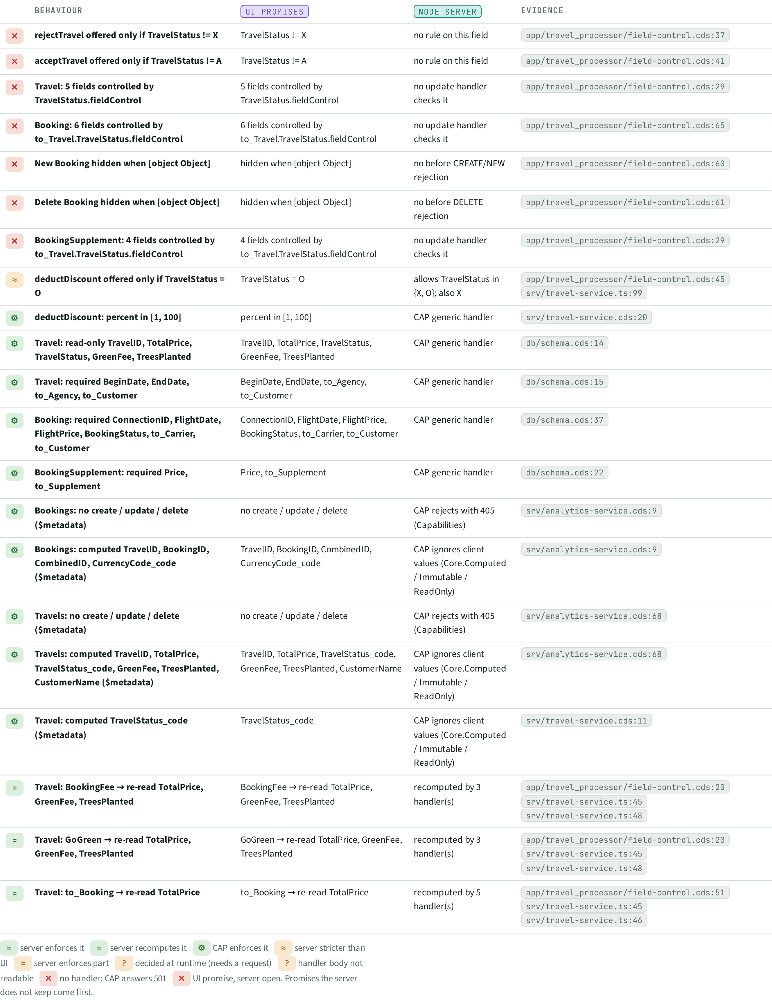
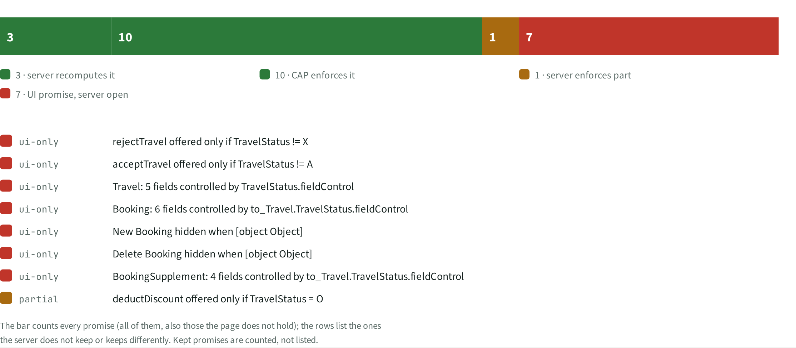

# UIS · UI promises vs server

> 21 rules the UI promises, read from the annotations. 13 are enforced by the server or by CAP, 1 only partly; **7 exist only in the UI** and can be bypassed with a plain OData call.

## Facts

_Facts generated from the knowledge graph._

Verdicts: server enforces it (0), server recomputes it (3), CAP enforces it (10), server stricter than UI (0), server enforces part (1), decided at runtime (needs a request) (0), handler body not readable (0), no handler: CAP answers 501 (0), UI promise, server open (7).

13 promises are kept by the server or by CAP and not listed here (all in atlas-data.json, PARITY).

| Rule | UI promises | Node server | Verdict | Evidence |
| --- | --- | --- | --- | --- |
| rejectTravel offered only if TravelStatus != X | TravelStatus != X | no rule on this field | UI promise, server open | `app/travel_processor/field-control.cds:37` |
| acceptTravel offered only if TravelStatus != A | TravelStatus != A | no rule on this field | UI promise, server open | `app/travel_processor/field-control.cds:41` |
| Travel: 5 fields controlled by TravelStatus.fieldControl | 5 fields controlled by TravelStatus.fieldControl | no update handler checks it | UI promise, server open | `app/travel_processor/field-control.cds:29` |
| Booking: 6 fields controlled by to_Travel.TravelStatus.fieldControl | 6 fields controlled by to_Travel.TravelStatus.fieldControl | no update handler checks it | UI promise, server open | `app/travel_processor/field-control.cds:65` |
| New Booking hidden when [object Object] | hidden when [object Object] | no before CREATE/NEW rejection | UI promise, server open | `app/travel_processor/field-control.cds:60` |
| Delete Booking hidden when [object Object] | hidden when [object Object] | no before DELETE rejection | UI promise, server open | `app/travel_processor/field-control.cds:61` |
| BookingSupplement: 4 fields controlled by to_Travel.TravelStatus.fieldControl | 4 fields controlled by to_Travel.TravelStatus.fieldControl | no update handler checks it | UI promise, server open | `app/travel_processor/field-control.cds:29` |
| deductDiscount offered only if TravelStatus = O | TravelStatus = O | allows TravelStatus in {X, O}; also X | server enforces part | `app/travel_processor/field-control.cds:45`, `srv/travel-service.ts:99` |

## Next steps

Ranked; prompts for each item are in the NXT topic file.

| Priority | Id | Step | What | Sections | Evidence | Score |
| --- | --- | --- | --- | --- | --- | --- |
| P2 | `RSK:G3` | Fix | rejectTravel, acceptTravel callable in states the UI hides | RSK, UIS, STA, PAT | `app/travel_processor/field-control.cds:37` | 3×4 |
| P2 | `UIS:acceptTravel offered only if TravelStatus != A` | Fix | Server does not enforce: acceptTravel offered only if TravelStatus != A | UIS, STA | `app/travel_processor/field-control.cds:41` | 4×3 |
| P2 | `UIS:Booking: 6 fields controlled by to_Travel.TravelStatus.fieldControl` | Fix | Server does not enforce: Booking: 6 fields controlled by to_Travel.TravelStatus.fieldControl | UIS | `app/travel_processor/field-control.cds:65` | 4×3 |
| P2 | `UIS:Delete Booking hidden when [object Object]` | Fix | Server does not enforce: Delete Booking hidden when [object Object] | UIS | `app/travel_processor/field-control.cds:61` | 4×3 |
| P2 | `UIS:New Booking hidden when [object Object]` | Fix | Server does not enforce: New Booking hidden when [object Object] | UIS | `app/travel_processor/field-control.cds:60` | 4×3 |
| P2 | `RSK:G5` | Fix | deductDiscount enforced only partly | RSK, UIS, STA | `app/travel_processor/field-control.cds:45` | 3×3 |
| P2 | `RSK:G7` | Fix | Read-only and hidden-create rules exist only in the UI (5) | RSK, UIS | `app/travel_processor/field-control.cds:29` | 3×3 |

## Views

**UIS-A Reflexion matrix**

**UIS-B Verdict bars**

[Back to the index](../README.md)
