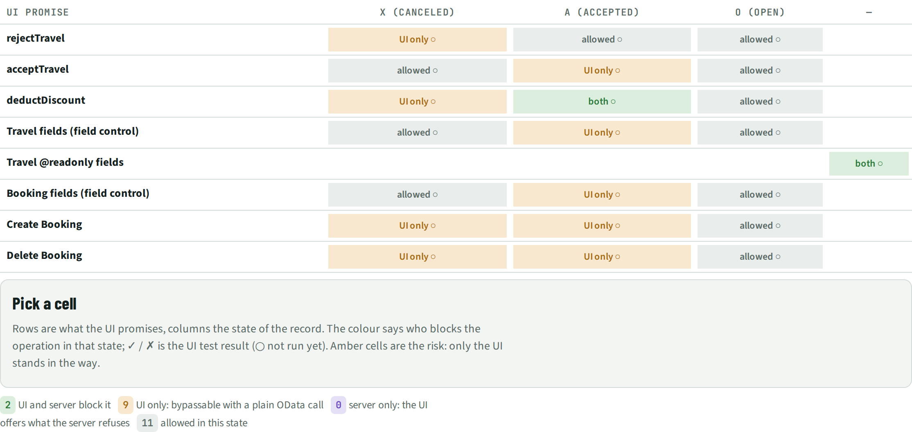
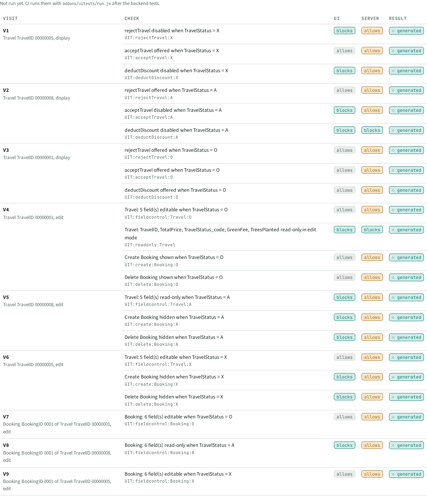
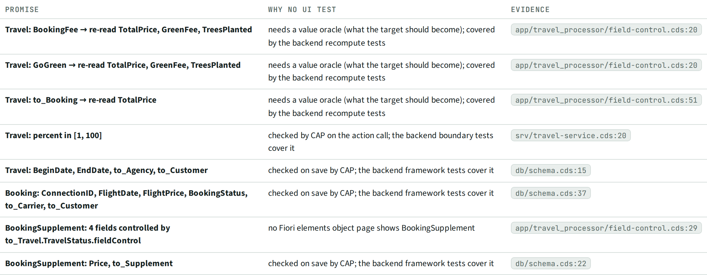

# UIT · UI tests

> 22 UI checks generated from 8 UI promises (9 app starts, OPA5 + sap.fe.test), not run yet. **9 states are guarded by the UI only**; 8 promises are not testable in the UI (reasons listed).

## Facts

_Facts generated from the knowledge graph._

Generated, not run yet: the statuses below are "generated".

Each check opens the Fiori elements app on a seed record in one state (an equivalence class) and asserts what the annotations promise. The journeys are OPA5 with `sap.fe.test`, in `run/tests/ui/<app-id>/`; copy them to `<webapp>/test/discovery/` and open `uitests.qunit.html`, or run `node addons/uitests/run.js <out> <app>`.

### Two locks

Per UI promise and state: who blocks it (UI, server, both) and the UI test result. **UI only** = the UI hides or disables it, but a plain OData call goes through (see the UIS section and the backend spec tests).

| UI promise | X (Canceled) | A (Accepted) | O (Open) | — |
| --- | --- | --- | --- | --- |
| rejectTravel | 🧪 **UI only** | 🧪 allowed | 🧪 allowed |  |
| acceptTravel | 🧪 allowed | 🧪 **UI only** | 🧪 allowed |  |
| deductDiscount | 🧪 **UI only** | 🧪 both block | 🧪 allowed |  |
| Travel fields (field control) | 🧪 allowed | 🧪 **UI only** | 🧪 allowed |  |
| Travel @readonly fields |  |  |  | 🧪 both block |
| Booking fields (field control) | 🧪 allowed | 🧪 **UI only** | 🧪 allowed |  |
| Create Booking | 🧪 **UI only** | 🧪 **UI only** | 🧪 allowed |  |
| Delete Booking | 🧪 **UI only** | 🧪 **UI only** | 🧪 allowed |  |

### Checks

| Check | Visit | Record | Kind | UI | Server | Status | Evidence |
| --- | --- | --- | --- | --- | --- | --- | --- |
| `UIT:rejectTravel:X` rejectTravel disabled when TravelStatus = X | V1 (display) | Travel TravelID 00000005 | action | blocks | allows | 🧪 generated, not run yet | `app/travel_processor/field-control.cds:37` |
| `UIT:rejectTravel:A` rejectTravel offered when TravelStatus = A | V2 (display) | Travel TravelID 00000008 | action | allows | allows | 🧪 generated, not run yet | `app/travel_processor/field-control.cds:37` |
| `UIT:rejectTravel:O` rejectTravel offered when TravelStatus = O | V3 (display) | Travel TravelID 00000001 | action | allows | allows | 🧪 generated, not run yet | `app/travel_processor/field-control.cds:37` |
| `UIT:acceptTravel:X` acceptTravel offered when TravelStatus = X | V1 (display) | Travel TravelID 00000005 | action | allows | allows | 🧪 generated, not run yet | `app/travel_processor/field-control.cds:41` |
| `UIT:acceptTravel:A` acceptTravel disabled when TravelStatus = A | V2 (display) | Travel TravelID 00000008 | action | blocks | allows | 🧪 generated, not run yet | `app/travel_processor/field-control.cds:41` |
| `UIT:acceptTravel:O` acceptTravel offered when TravelStatus = O | V3 (display) | Travel TravelID 00000001 | action | allows | allows | 🧪 generated, not run yet | `app/travel_processor/field-control.cds:41` |
| `UIT:deductDiscount:X` deductDiscount disabled when TravelStatus = X | V1 (display) | Travel TravelID 00000005 | action | blocks | allows | 🧪 generated, not run yet | `app/travel_processor/field-control.cds:45` |
| `UIT:deductDiscount:A` deductDiscount disabled when TravelStatus = A | V2 (display) | Travel TravelID 00000008 | action | blocks | blocks | 🧪 generated, not run yet | `app/travel_processor/field-control.cds:45` |
| `UIT:deductDiscount:O` deductDiscount offered when TravelStatus = O | V3 (display) | Travel TravelID 00000001 | action | allows | allows | 🧪 generated, not run yet | `app/travel_processor/field-control.cds:45` |
| `UIT:fieldcontrol:Travel:O` Travel: 5 field(s) editable when TravelStatus = O | V4 (edit) | Travel TravelID 00000001 | field | allows | allows | 🧪 generated, not run yet | `app/travel_processor/field-control.cds:29` |
| `UIT:fieldcontrol:Travel:A` Travel: 5 field(s) read-only when TravelStatus = A | V5 (edit) | Travel TravelID 00000008 | field | blocks | allows | 🧪 generated, not run yet | `app/travel_processor/field-control.cds:29` |
| `UIT:fieldcontrol:Travel:X` Travel: 5 field(s) editable when TravelStatus = X | V6 (edit) | Travel TravelID 00000005 | field | allows | allows | 🧪 generated, not run yet | `app/travel_processor/field-control.cds:29` |
| `UIT:readonly:Travel` Travel: TravelID, TotalPrice, TravelStatus_code, GreenFee, TreesPlanted read-only in edit mode | V4 (edit) | Travel TravelID 00000001 | readonly | blocks | blocks | 🧪 generated, not run yet | `db/schema.cds:14` |
| `UIT:fieldcontrol:Booking:O` Booking: 6 field(s) editable when TravelStatus = O | V7 (edit) | Booking BookingID 0001 of Travel TravelID 00000001 | field | allows | allows | 🧪 generated, not run yet | `app/travel_processor/field-control.cds:65` |
| `UIT:fieldcontrol:Booking:A` Booking: 6 field(s) read-only when TravelStatus = A | V8 (edit) | Booking BookingID 0001 of Travel TravelID 00000008 | field | blocks | allows | 🧪 generated, not run yet | `app/travel_processor/field-control.cds:65` |
| `UIT:fieldcontrol:Booking:X` Booking: 6 field(s) editable when TravelStatus = X | V9 (edit) | Booking BookingID 0001 of Travel TravelID 00000005 | field | allows | allows | 🧪 generated, not run yet | `app/travel_processor/field-control.cds:65` |
| `UIT:create:Booking:O` Create Booking shown when TravelStatus = O | V4 (edit) | Travel TravelID 00000001 | create | allows | allows | 🧪 generated, not run yet | `app/travel_processor/field-control.cds:60` |
| `UIT:create:Booking:A` Create Booking hidden when TravelStatus = A | V5 (edit) | Travel TravelID 00000008 | create | blocks | allows | 🧪 generated, not run yet | `app/travel_processor/field-control.cds:60` |
| `UIT:create:Booking:X` Create Booking hidden when TravelStatus = X | V6 (edit) | Travel TravelID 00000005 | create | blocks | allows | 🧪 generated, not run yet | `app/travel_processor/field-control.cds:60` |
| `UIT:delete:Booking:O` Delete Booking shown when TravelStatus = O | V4 (edit) | Travel TravelID 00000001 | delete | allows | allows | 🧪 generated, not run yet | `app/travel_processor/field-control.cds:61` |
| `UIT:delete:Booking:A` Delete Booking hidden when TravelStatus = A | V5 (edit) | Travel TravelID 00000008 | delete | blocks | allows | 🧪 generated, not run yet | `app/travel_processor/field-control.cds:61` |
| `UIT:delete:Booking:X` Delete Booking hidden when TravelStatus = X | V6 (edit) | Travel TravelID 00000005 | delete | blocks | allows | 🧪 generated, not run yet | `app/travel_processor/field-control.cds:61` |

### Not generated

| Promise | Why not | Evidence |
| --- | --- | --- |
| Travel: BookingFee → re-read TotalPrice, GreenFee, TreesPlanted | needs a value oracle (what the target should become); covered by the backend recompute tests | `app/travel_processor/field-control.cds:20` |
| Travel: GoGreen → re-read TotalPrice, GreenFee, TreesPlanted | needs a value oracle (what the target should become); covered by the backend recompute tests | `app/travel_processor/field-control.cds:20` |
| Travel: to_Booking → re-read TotalPrice | needs a value oracle (what the target should become); covered by the backend recompute tests | `app/travel_processor/field-control.cds:51` |
| Travel: percent in [1, 100] | checked by CAP on the action call; the backend boundary tests cover it | `srv/travel-service.cds:20` |
| Travel: BeginDate, EndDate, to_Agency, to_Customer | checked on save by CAP; the backend framework tests cover it | `db/schema.cds:15` |
| Booking: ConnectionID, FlightDate, FlightPrice, BookingStatus, to_Carrier, to_Customer | checked on save by CAP; the backend framework tests cover it | `db/schema.cds:37` |
| BookingSupplement: 4 fields controlled by to_Travel.TravelStatus.fieldControl | no Fiori elements object page shows BookingSupplement | `app/travel_processor/field-control.cds:29` |
| BookingSupplement: Price, to_Supplement | checked on save by CAP; the backend framework tests cover it | `db/schema.cds:22` |

## Views

**UIT-A Two locks**

**UIT-B Test runs**

**UIT-C Not generated**

[Back to the index](../README.md)
