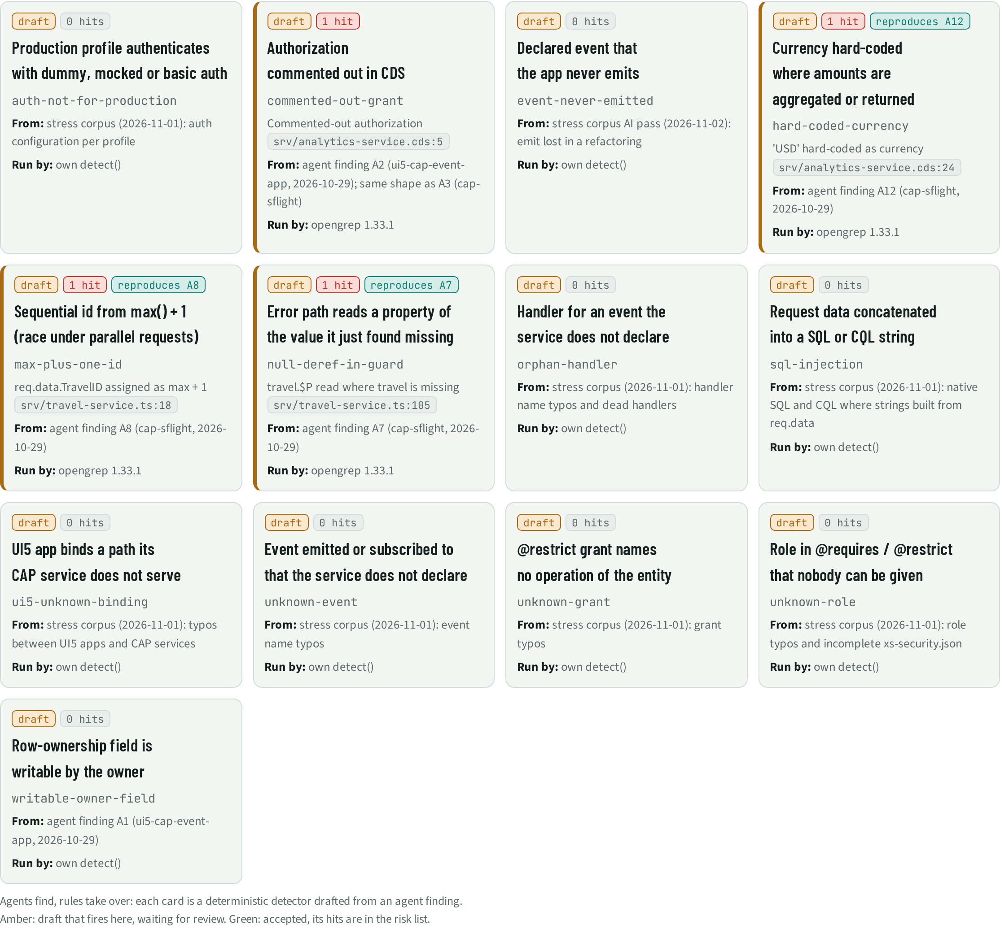

# RLS · Rules from agent findings

> 13 rules drafted from agent findings: 0 accepted, 13 waiting for review. 4 drafts fire on this app, reproducing agent findings **A12, A8, A7** without AI.

## Facts

_Facts generated (rules library)._

Rules drafted by agents from their own findings, reviewed and accepted like code. A draft only reports; an accepted rule adds risks and retires the agent finding it reproduces. Each rule has a unit test in `addons/rules/library/<key>.test.js`.

| Rule | Status | Drafted from | Run by | Hits on this app | Reproduces agent finding |
| --- | --- | --- | --- | --- | --- |
| `auth-not-for-production` Production profile authenticates with dummy, mocked or basic auth | draft | stress corpus (2026-11-01): auth configuration per profile | own detect() | – | – |
| `commented-out-grant` Authorization commented out in CDS | draft | agent finding A2 (ui5-cap-event-app, 2026-10-29); same shape as A3 (cap-sflight) | opengrep 1.33.1 | `srv/analytics-service.cds:5` Commented-out authorization | – |
| `event-never-emitted` Declared event that the app never emits | draft | stress corpus AI pass (2026-11-02): emit lost in a refactoring | own detect() | – | – |
| `hard-coded-currency` Currency hard-coded where amounts are aggregated or returned | draft | agent finding A12 (cap-sflight, 2026-10-29) | opengrep 1.33.1 | `srv/analytics-service.cds:24` 'USD' hard-coded as currency | A12 |
| `max-plus-one-id` Sequential id from max() + 1 (race under parallel requests) | draft | agent finding A8 (cap-sflight, 2026-10-29) | opengrep 1.33.1 | `srv/travel-service.ts:18` req.data.TravelID assigned as max + 1 | A8 |
| `null-deref-in-guard` Error path reads a property of the value it just found missing | draft | agent finding A7 (cap-sflight, 2026-10-29) | opengrep 1.33.1 | `srv/travel-service.ts:105` travel.$P read where travel is missing | A7 |
| `orphan-handler` Handler for an event the service does not declare | draft | stress corpus (2026-11-01): handler name typos and dead handlers | own detect() | – | – |
| `sql-injection` Request data concatenated into a SQL or CQL string | draft | stress corpus (2026-11-01): native SQL and CQL where strings built from req.data | own detect() | – | – |
| `ui5-unknown-binding` UI5 app binds a path its CAP service does not serve | draft | stress corpus (2026-11-01): typos between UI5 apps and CAP services | own detect() | – | – |
| `unknown-event` Event emitted or subscribed to that the service does not declare | draft | stress corpus (2026-11-01): event name typos | own detect() | – | – |
| `unknown-grant` @restrict grant names no operation of the entity | draft | stress corpus (2026-11-01): grant typos | own detect() | – | – |
| `unknown-role` Role in @requires / @restrict that nobody can be given | draft | stress corpus (2026-11-01): role typos and incomplete xs-security.json | own detect() | – | – |
| `writable-owner-field` Row-ownership field is writable by the owner | draft | agent finding A1 (ui5-cap-event-app, 2026-10-29) | own detect() | – | – |

## Next steps

Ranked; prompts for each item are in the NXT topic file.

| Priority | Id | Step | What | Sections | Evidence | Score |
| --- | --- | --- | --- | --- | --- | --- |
| P3 | `RLS:commented-out-grant` | Review | Review draft rule commented-out-grant | RLS | `srv/analytics-service.cds:5` | 2×2 |
| P3 | `RLS:hard-coded-currency` | Review | Review draft rule hard-coded-currency | RLS | `srv/analytics-service.cds:24` | 2×2 |
| P3 | `RLS:max-plus-one-id` | Review | Review draft rule max-plus-one-id | RLS | `srv/travel-service.ts:18` | 2×2 |
| P3 | `RLS:null-deref-in-guard` | Review | Review draft rule null-deref-in-guard | RLS | `srv/travel-service.ts:105` | 2×2 |

## Views

**RLS-A Rule cards**

[Back to the index](../README.md)
