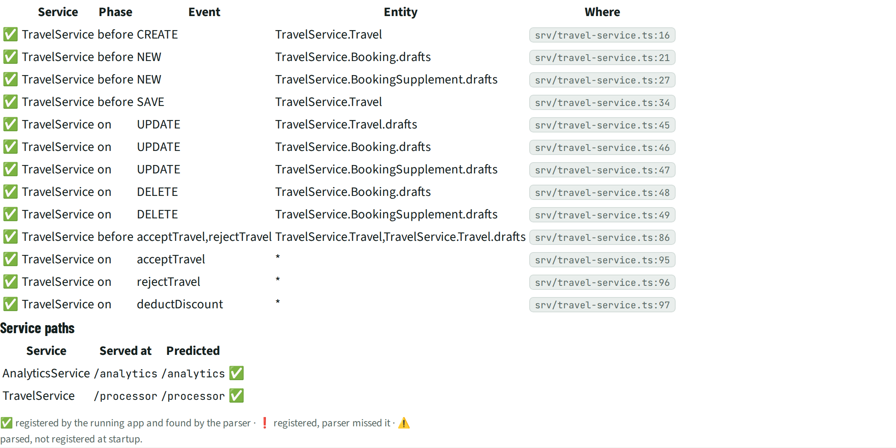

# RTM · Runtime check

> The running app (cds 10.1.0) registered **13** handlers from its own code: 13 match what the static parser found. Service paths: 2 of 2 as predicted. Plugins registering handlers: @cap-js/db-service.

## Facts

_Facts running app (cds.test)._

The app was started in CI with cds.test (cds 10.1.0, profiles test, java, development). Every srv.before/on/after call was recorded with the line that made it, then compared with the handlers found by reading the code.

Legend: ✅ registered and found by the parser · ❗ registered, but the parser missed it · ⚠️ found by the parser, not registered at startup (conditional, registered later, or dead code).

### Handlers

| | Service | Phase | Event | Entity | Where |
| --- | --- | --- | --- | --- | --- |
| ✅ | TravelService | before | CREATE | TravelService.Travel | `srv/travel-service.ts:16` |
| ✅ | TravelService | before | NEW | TravelService.Booking.drafts | `srv/travel-service.ts:21` |
| ✅ | TravelService | before | NEW | TravelService.BookingSupplement.drafts | `srv/travel-service.ts:27` |
| ✅ | TravelService | before | SAVE | TravelService.Travel | `srv/travel-service.ts:34` |
| ✅ | TravelService | on | UPDATE | TravelService.Travel.drafts | `srv/travel-service.ts:45` |
| ✅ | TravelService | on | UPDATE | TravelService.Booking.drafts | `srv/travel-service.ts:46` |
| ✅ | TravelService | on | UPDATE | TravelService.BookingSupplement.drafts | `srv/travel-service.ts:47` |
| ✅ | TravelService | on | DELETE | TravelService.Booking.drafts | `srv/travel-service.ts:48` |
| ✅ | TravelService | on | DELETE | TravelService.BookingSupplement.drafts | `srv/travel-service.ts:49` |
| ✅ | TravelService | before | acceptTravel,rejectTravel | TravelService.Travel,TravelService.Travel.drafts | `srv/travel-service.ts:86` |
| ✅ | TravelService | on | acceptTravel | * | `srv/travel-service.ts:95` |
| ✅ | TravelService | on | rejectTravel | * | `srv/travel-service.ts:96` |
| ✅ | TravelService | on | deductDiscount | * | `srv/travel-service.ts:97` |

### Service paths

| Service | Served at | Predicted | |
| --- | --- | --- | --- |
| AnalyticsService | `/analytics` | `/analytics` | ✅ |
| TravelService | `/processor` | `/processor` | ✅ |

### Plugins that register handlers

- @cap-js/db-service

## Views

**RTM-A Handlers**

[Back to the index](../README.md)
