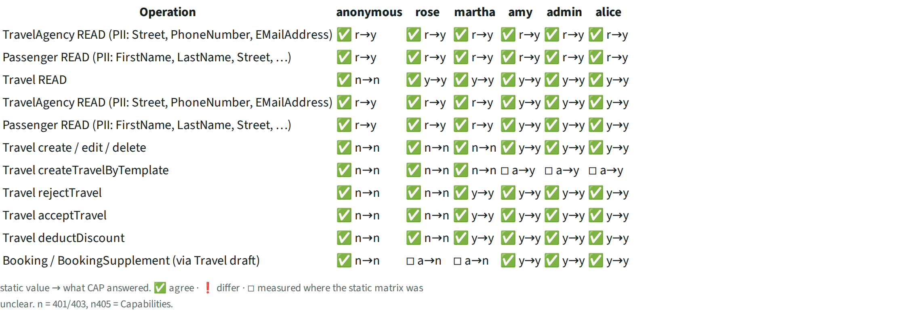
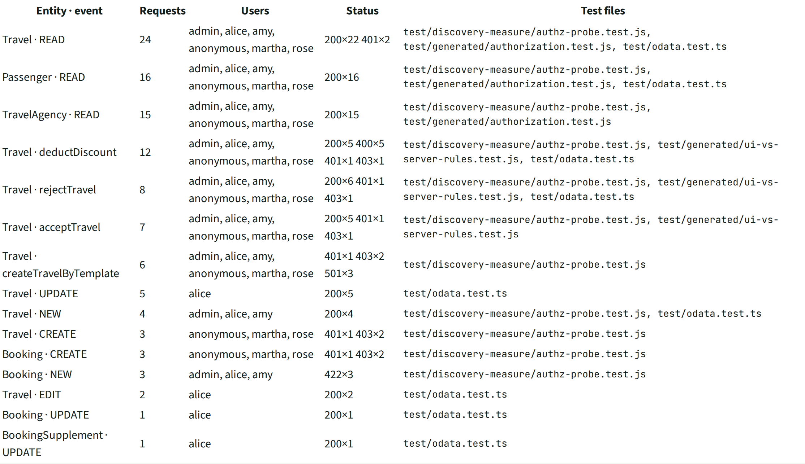
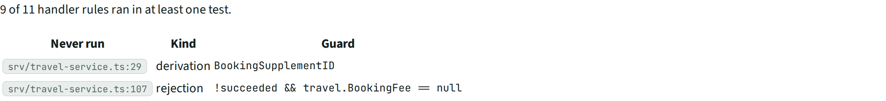

# MSR · Measured in CI

> Authorization: CAP answered **66** requests; 61 cells agree with the static matrix, 5 settle an unclear cell. Tests sent **110** requests from 4 test files as 6 users. Rules reached by any test: **9 of 11** (2 never run).

## Facts

_Facts running app in CI (cds.test, Jest coverage)._

What the running app answered in CI, next to what the pipeline read from the code.

### Authorization, measured

Each cell: static value → what CAP answered (HTTP status). y allowed, n denied (401/403), n405 not allowed by Capabilities, r open, a unclear. ✅ agree · ❗ differ · ◽ measured where the static matrix was unclear.

| Operation | anonymous | rose | martha | amy | admin | alice |
| --- | --- | --- | --- | --- | --- | --- |
| TravelAgency READ (PII: Street, PhoneNumber, EMailAddress) | ✅ r→y (200) | ✅ r→y (200) | ✅ r→y (200) | ✅ r→y (200) | ✅ r→y (200) | ✅ r→y (200) |
| Passenger READ (PII: FirstName, LastName, Street, …) | ✅ r→y (200) | ✅ r→y (200) | ✅ r→y (200) | ✅ r→y (200) | ✅ r→y (200) | ✅ r→y (200) |
| Travel READ | ✅ n→n (401) | ✅ y→y (200) | ✅ y→y (200) | ✅ y→y (200) | ✅ y→y (200) | ✅ y→y (200) |
| TravelAgency READ (PII: Street, PhoneNumber, EMailAddress) | ✅ r→y (200) | ✅ r→y (200) | ✅ r→y (200) | ✅ y→y (200) | ✅ y→y (200) | ✅ y→y (200) |
| Passenger READ (PII: FirstName, LastName, Street, …) | ✅ r→y (200) | ✅ r→y (200) | ✅ r→y (200) | ✅ y→y (200) | ✅ y→y (200) | ✅ y→y (200) |
| Travel create / edit / delete | ✅ n→n (401) | ✅ n→n (403) | ✅ n→n (403) | ✅ y→y (201) | ✅ y→y (201) | ✅ y→y (201) |
| Travel createTravelByTemplate | ✅ n→n (401) | ✅ n→n (403) | ✅ n→n (403) | ◽ a→y (501) | ◽ a→y (501) | ◽ a→y (501) |
| Travel rejectTravel | ✅ n→n (401) | ✅ n→n (403) | ✅ y→y (204) | ✅ y→y (204) | ✅ y→y (204) | ✅ y→y (204) |
| Travel acceptTravel | ✅ n→n (401) | ✅ n→n (403) | ✅ y→y (204) | ✅ y→y (204) | ✅ y→y (204) | ✅ y→y (204) |
| Travel deductDiscount | ✅ n→n (401) | ✅ n→n (403) | ✅ y→y (400) | ✅ y→y (400) | ✅ y→y (400) | ✅ y→y (400) |
| Booking / BookingSupplement (via Travel draft) | ✅ n→n (401) | ◽ a→n (403) | ◽ a→n (403) | ✅ y→y (422) | ✅ y→y (422) | ✅ y→y (422) |

### Requests the tests send

| Entity · event | Requests | Users | Status codes | Test files |
| --- | --- | --- | --- | --- |
| Travel · READ | 24 | admin, alice, amy, anonymous, martha, rose | 200×22 401×2 | `test/discovery-measure/authz-probe.test.js`, `test/generated/authorization.test.js`, `test/odata.test.ts` |
| Passenger · READ | 16 | admin, alice, amy, anonymous, martha, rose | 200×16 | `test/discovery-measure/authz-probe.test.js`, `test/generated/authorization.test.js`, `test/odata.test.ts` |
| TravelAgency · READ | 15 | admin, alice, amy, anonymous, martha, rose | 200×15 | `test/discovery-measure/authz-probe.test.js`, `test/generated/authorization.test.js` |
| Travel · deductDiscount | 12 | admin, alice, amy, anonymous, martha, rose | 200×5 400×5 401×1 403×1 | `test/discovery-measure/authz-probe.test.js`, `test/generated/ui-vs-server-rules.test.js`, `test/odata.test.ts` |
| Travel · rejectTravel | 8 | admin, alice, amy, anonymous, martha, rose | 200×6 401×1 403×1 | `test/discovery-measure/authz-probe.test.js`, `test/generated/ui-vs-server-rules.test.js`, `test/odata.test.ts` |
| Travel · acceptTravel | 7 | admin, alice, amy, anonymous, martha, rose | 200×5 401×1 403×1 | `test/discovery-measure/authz-probe.test.js`, `test/generated/ui-vs-server-rules.test.js` |
| Travel · createTravelByTemplate | 6 | admin, alice, amy, anonymous, martha, rose | 401×1 403×2 501×3 | `test/discovery-measure/authz-probe.test.js` |
| Travel · UPDATE | 5 | alice | 200×5 | `test/odata.test.ts` |
| Travel · NEW | 4 | admin, alice, amy | 200×4 | `test/discovery-measure/authz-probe.test.js`, `test/odata.test.ts` |
| Travel · CREATE | 3 | anonymous, martha, rose | 401×1 403×2 | `test/discovery-measure/authz-probe.test.js` |
| Booking · CREATE | 3 | anonymous, martha, rose | 401×1 403×2 | `test/discovery-measure/authz-probe.test.js` |
| Booking · NEW | 3 | admin, alice, amy | 422×3 | `test/discovery-measure/authz-probe.test.js` |
| Travel · EDIT | 2 | alice | 200×2 | `test/odata.test.ts` |
| Booking · UPDATE | 1 | alice | 200×1 | `test/odata.test.ts` |
| BookingSupplement · UPDATE | 1 | alice | 200×1 | `test/odata.test.ts` |

### Rules reached

9 of 11 handler rules ran in at least one test (Jest coverage, V8).

- never run: `srv/travel-service.ts:29` derivation BookingSupplementID
- never run: `srv/travel-service.ts:107` rejection !succeeded && travel.BookingFee == null

## Views

**MSR-A Authorization, measured**

**MSR-B Requests the tests send**

**MSR-C Rules reached**

[Back to the index](../README.md)
