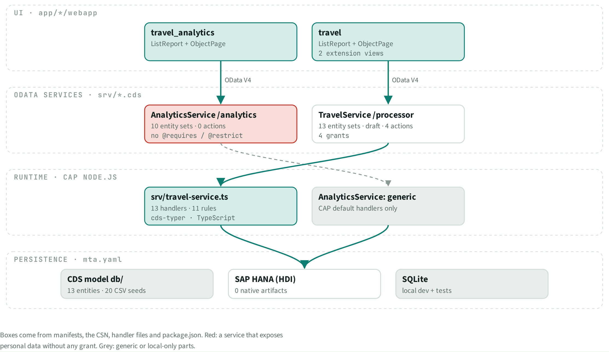
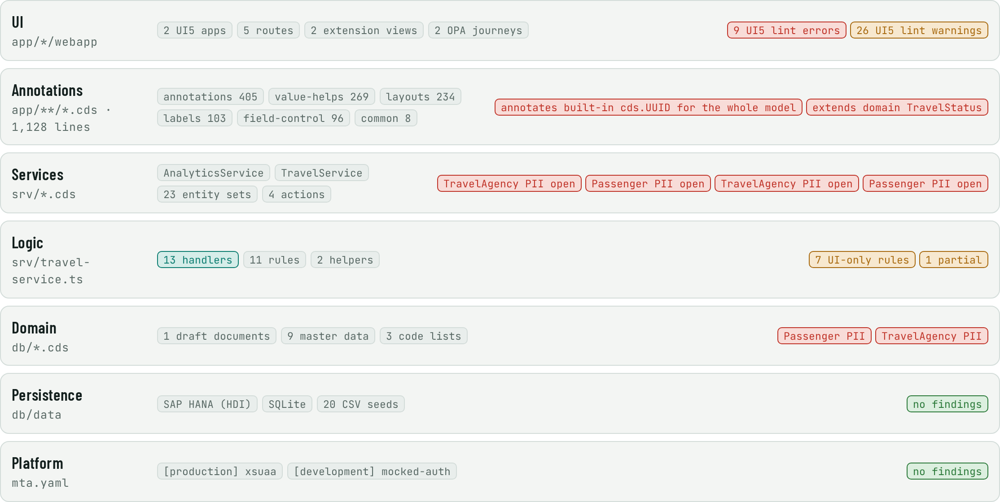

# ARC · Architecture

> 2 UI5 apps on 2 OData services, served by one CAP Node.js process with 13 handlers. **7 business rules are promised by UI annotations only**, not enforced by the server.

## Facts

_Facts generated from the knowledge graph._

| Layer | Path | Contents | Findings |
| --- | --- | --- | --- |
| UI | app/*/webapp | 2 UI5 apps, 5 routes, 2 extension views, 2 OPA journeys | **9 UI5 lint errors** (finding), 26 UI5 lint warnings (warning) |
| Annotations | app/**/*.cds · 1,128 lines | annotations 405, value-helps 269, layouts 234, labels 103, field-control 96, common 8 | **annotates built-in cds.UUID for the whole model** (finding), **extends domain TravelStatus** (finding) |
| Services | srv/*.cds | AnalyticsService, TravelService, 23 entity sets, 4 actions | **TravelAgency PII open** (finding), **Passenger PII open** (finding), **TravelAgency PII open** (finding), **Passenger PII open** (finding) |
| Logic | srv/travel-service.ts | 13 handlers, 11 rules, 2 helpers | 7 UI-only rules (warning), 1 partial (warning) |
| Domain | db/*.cds | 1 draft documents, 9 master data, 3 code lists | **Passenger PII** (finding), **TravelAgency PII** (finding) |
| Persistence | db/data | SAP HANA (HDI), SQLite, 20 CSV seeds | none |
| Platform | mta.yaml | [production] xsuaa, [development] mocked-auth | none |

## Views

**ARC-A Container map**

**ARC-B Layer stack**

[Back to the index](../README.md)
