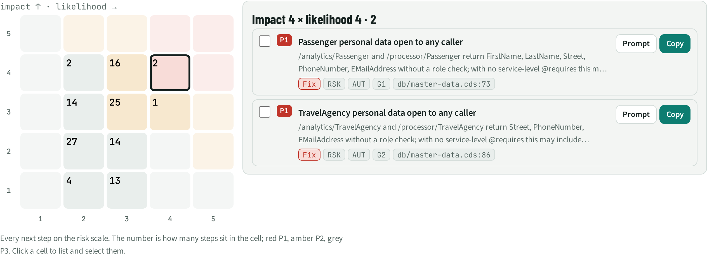
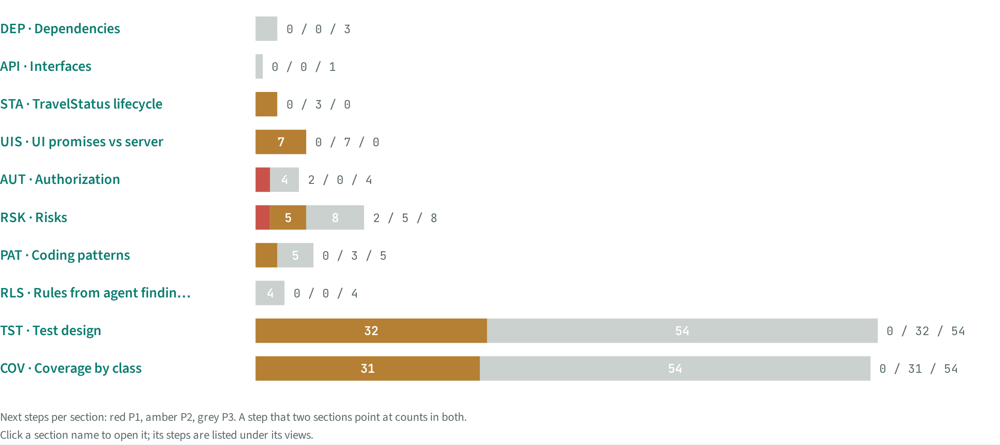

# NXT · Next steps

> 118 next steps from 10 sections, ranked by impact × likelihood: **2 P1** (do now), 42 P2, 74 P3. Tick several and copy one combined prompt for a coding agent, as a plan, a change, or tests only.

## Facts

_Facts generated from the other sections._

Priority = impact × likelihood (1–5 each): P1 ≥ 16, P2 ≥ 9, P3 below. An item that several sections point at (same file:line) is listed once.

| Priority | Id | Step | What | Sections | Evidence | Score |
| --- | --- | --- | --- | --- | --- | --- |
| P1 | `RSK:G1` | Fix | Passenger personal data open to any caller | RSK, AUT | `db/master-data.cds:73` | 4×4 |
| P1 | `RSK:G2` | Fix | TravelAgency personal data open to any caller | RSK, AUT | `db/master-data.cds:86` | 4×4 |
| P2 | `PAT:Auto-exposed master data` | Fix | Auto-exposed master data: also exposes personal data (Passenger, TravelAgency) | PAT | `db/master-data.cds:5` | 4×3 |
| P2 | `RSK:G3` | Fix | rejectTravel, acceptTravel callable in states the UI hides | RSK, UIS, STA, PAT | `app/travel_processor/field-control.cds:37` | 3×4 |
| P2 | `UIS:acceptTravel offered only if TravelStatus != A` | Fix | Server does not enforce: acceptTravel offered only if TravelStatus != A | UIS, STA | `app/travel_processor/field-control.cds:41` | 4×3 |
| P2 | `UIS:Booking: 6 fields controlled by to_Travel.TravelStatus.fieldControl` | Fix | Server does not enforce: Booking: 6 fields controlled by to_Travel.TravelStatus.fieldControl | UIS | `app/travel_processor/field-control.cds:65` | 4×3 |
| P2 | `UIS:Delete Booking hidden when to_Travel.TravelStatus.code != #Open` | Fix | Server does not enforce: Delete Booking hidden when to_Travel.TravelStatus.code != #Open | UIS | `app/travel_processor/field-control.cds:61` | 4×3 |
| P2 | `UIS:New Booking hidden when to_Travel.TravelStatus.code != #Open` | Fix | Server does not enforce: New Booking hidden when to_Travel.TravelStatus.code != #Open | UIS | `app/travel_processor/field-control.cds:60` | 4×3 |
| P2 | `COV:AUT:/analytics: 8 other entities READ:a` | Test | Test: /analytics: 8 other entities READ as anonymous | COV, TST |  | 4×3 |
| P2 | `COV:AUT:/analytics: 8 other entities READ:y` | Test | Test: /analytics: 8 other entities READ as rose/martha/amy/admin/alice | COV, TST |  | 4×3 |
| P2 | `COV:AUT:/processor: 8 other entities READ:a` | Test | Test: /processor: 8 other entities READ as anonymous | COV, TST |  | 4×3 |
| P2 | `COV:AUT:/processor: 8 other entities READ:y` | Test | Test: /processor: 8 other entities READ as rose/martha/amy/admin/alice | COV, TST |  | 4×3 |
| P2 | `COV:AUT:Booking / BookingSupplement (via Travel draft):a` | Test | Test: Booking / BookingSupplement (via Travel draft) as rose/martha | COV, TST |  | 4×3 |
| P2 | `COV:AUT:Booking / BookingSupplement (via Travel draft):n` | Test | Test: Booking / BookingSupplement (via Travel draft) as anonymous | COV, TST |  | 4×3 |
| P2 | `COV:AUT:Travel acceptTravel:n` | Test | Test: Travel acceptTravel as anonymous/rose | COV, TST |  | 4×3 |
| P2 | `COV:AUT:Travel create / edit / delete:n` | Test | Test: Travel create / edit / delete as anonymous/rose/martha | COV, TST |  | 4×3 |
| P2 | `COV:AUT:Travel createTravelByTemplate:n` | Test | Test: Travel createTravelByTemplate as anonymous/rose/martha | COV, TST |  | 4×3 |
| P2 | `COV:AUT:Travel deductDiscount:n` | Test | Test: Travel deductDiscount as anonymous/rose | COV, TST |  | 4×3 |
| P2 | `COV:AUT:Travel rejectTravel:n` | Test | Test: Travel rejectTravel as anonymous/rose | COV, TST |  | 4×3 |
| P2 | `RSK:G4` | Fix | AnalyticsService has no @requires or @restrict | RSK | `srv/analytics-service.cds:3` | 3×3 |
| P2 | `RSK:G5` | Fix | deductDiscount enforced only partly | RSK, UIS, STA | `app/travel_processor/field-control.cds:45` | 3×3 |
| P2 | `RSK:G6` | Fix | Tests run as one user only (alice) | RSK, PAT | `test/odata.test.ts:1` | 3×3 |
| P2 | `RSK:G7` | Fix | Read-only and hidden-create rules exist only in the UI (5) | RSK, UIS | `app/travel_processor/field-control.cds:29` | 3×3 |
| P2 | `COV:RUL:rule:srv/travel-service.ts:23:t` | Test | Test: before NEW Booking: derive BookingID | COV, TST |  | 3×3 |
| P2 | `COV:RUL:rule:srv/travel-service.ts:24:t` | Test | Test: before NEW Booking: derive BookingDate | COV, TST |  | 3×3 |
| P2 | `COV:RUL:rule:srv/travel-service.ts:29:t` | Test | Test: before NEW BookingSupplement: derive BookingSupplementID | COV, TST |  | 3×3 |
| P2 | `COV:RUL:rule:srv/travel-service.ts:93:f` | Test | Test: before acceptTravel/rejectTravel Travel: guard false | COV, TST |  | 3×3 |
| P2 | `COV:RUL:rule:srv/travel-service.ts:93:t` | Test | Test: before acceptTravel/rejectTravel Travel: The travel is locked by ${existingDraft.InProcessByUser}. | COV, TST |  | 3×3 |
| P2 | `COV:STA:acceptTravel:A` | Test | Test: acceptTravel from A | COV, TST |  | 3×3 |
| P2 | `COV:STA:acceptTravel:O` | Test | Test: acceptTravel from O | COV, TST |  | 3×3 |
| P2 | `COV:STA:acceptTravel:X` | Test | Test: acceptTravel from X | COV, TST |  | 3×3 |
| P2 | `COV:UIS:assert.range:Travel:8` | Test | Test: Travel: percent in [1, 100] | COV, TST |  | 3×3 |
| P2 | `COV:UIS:CreateHidden:Booking` | Test | Test: Booking: hidden when to_Travel.TravelStatus.code != #Open — bypass via OData | COV, TST |  | 3×3 |
| P2 | `COV:UIS:DeleteHidden:Booking` | Test | Test: Booking: hidden when to_Travel.TravelStatus.code != #Open — bypass via OData | COV, TST |  | 3×3 |
| P2 | `COV:UIS:field-control:Booking` | Test | Test: Booking: 6 fields controlled by to_Travel.TravelStatus.fieldControl — bypass via OData | COV, TST |  | 3×3 |
| P2 | `COV:UIS:field-control:BookingSupplement` | Test | Test: BookingSupplement: 4 fields controlled by to_Travel.TravelStatus.fieldControl — bypass via OData | COV, TST |  | 3×3 |
| P2 | `COV:UIS:field-control:Travel` | Test | Test: Travel: 5 fields controlled by TravelStatus.fieldControl — bypass via OData | COV, TST |  | 3×3 |
| P2 | `COV:UIS:mandatory:Booking:14` | Test | Test: Booking: ConnectionID, FlightDate, FlightPrice, BookingStatus, to_Carrier, to_Customer | COV, TST |  | 3×3 |
| P2 | `COV:UIS:mandatory:BookingSupplement:16` | Test | Test: BookingSupplement: Price, to_Supplement | COV, TST |  | 3×3 |
| P2 | `COV:UIS:mandatory:Travel:10` | Test | Test: Travel: BeginDate, EndDate, to_Agency, to_Customer | COV, TST |  | 3×3 |
| P2 | `COV:UIS:readonly:Travel:9` | Test | Test: Travel: TravelID, TotalPrice, TravelStatus, GreenFee, TreesPlanted | COV, TST |  | 3×3 |
| P2 | `COV:UIS:side-effects:Travel:6` | Test | Test: Travel: GoGreen → re-read TotalPrice, GreenFee, TreesPlanted | COV, TST |  | 3×3 |
| P2 | `COV:UIS:side-effects:Travel:7` | Test | Test: Travel: to_Booking → re-read TotalPrice | COV, TST |  | 3×3 |
| P2 | `TST:deductDiscount all-pairs` | Test | Turn the 19-case all-pairs suite for deductDiscount into tests | TST |  | 3×3 |
| P3 | `COV:AUT:Travel acceptTravel:y` | Test | Test: Travel acceptTravel as martha/amy/admin/alice | COV, TST |  | 4×2 |
| P3 | `COV:AUT:Travel createTravelByTemplate:a` | Test | Test: Travel createTravelByTemplate as amy/admin/alice | COV, TST |  | 4×2 |
| P3 | `RSK:A12` | Fix | Hard-coded USD in analytics | RSK | `srv/analytics-service.cds:24` | 2×3 |
| P3 | `RSK:A7` | Fix | deductDiscount 404 path crashes | RSK | `srv/travel-service.ts:105` | 2×3 |
| P3 | `RSK:A8` | Fix | TravelID = max + 1 race | RSK | `srv/travel-service.ts:17` | 3×2 |
| P3 | `RSK:G8` | Fix | Global annotation on built-in cds.UUID | RSK, PAT, DEP | `app/common.cds:5` | 2×3 |
| P3 | `RSK:G9` | Fix | createTravelByTemplate declared and granted, no handler | RSK, PAT | `srv/travel-service.cds:12` | 2×3 |
| P3 | `AUT:/analytics: 8 other entities READ (unclear)` | Verify | Check access: /analytics: 8 other entities READ as anonymous | AUT | `srv/analytics-service.cds:9` | 2×3 |
| P3 | `AUT:/processor: 8 other entities READ (unclear)` | Verify | Check access: /processor: 8 other entities READ as anonymous | AUT | `db/schema.cds:82` | 2×3 |
| P3 | `AUT:Booking / BookingSupplement (via Travel draft) (unclear)` | Verify | Check access: Booking / BookingSupplement (via Travel draft) as rose · no role, martha · reviewer | AUT | `srv/travel-service.cds:11` | 2×3 |
| P3 | `AUT:Travel createTravelByTemplate (unclear)` | Verify | Check access: Travel createTravelByTemplate as amy · processor, admin · admin, alice · admin · tests | AUT | `srv/travel-service.cds:11` | 2×3 |
| P3 | `API:/processor/createTravelByTemplate` | Review | Action createTravelByTemplate has no handler | API |  | 2×3 |
| P3 | `DEP:srv/analytics-service.cds → db/master-data.cds` | Review | srv/analytics-service.cds reaches into db/master-data.cds | DEP | `srv/analytics-service.cds:76` | 2×3 |
| P3 | `PAT:Raw SQL via cds.run` | Review | Raw SQL via cds.run: bypasses CQL and draft handling; check projections | PAT | `srv/travel-service.ts:57` | 2×3 |
| P3 | `PAT:UI annotations directly on domain entities` | Review | UI annotations directly on domain entities: bypasses the service layer | PAT | `app/labels.cds:7` | 2×3 |
| P3 | `COV:DRF:TravelService.Travel:edit-discard` | Test | Test: Travel: edit → discard | COV, TST |  | 2×3 |
| P3 | `COV:DRF:TravelService.Travel:foreign-lock` | Test | Test: Travel: foreign → lock | COV, TST |  | 2×3 |
| P3 | `COV:RUL:rule:srv/travel-service.ts:105:f` | Test | Test: on deductDiscount Travel: guard false | COV, TST |  | 3×2 |
| P3 | `COV:RUL:rule:srv/travel-service.ts:106:f` | Test | Test: on deductDiscount Travel: guard false | COV, TST |  | 3×2 |
| P3 | `COV:RUL:rule:srv/travel-service.ts:107:f` | Test | Test: on deductDiscount Travel: guard false | COV, TST |  | 3×2 |
| P3 | `COV:RUL:rule:srv/travel-service.ts:36:f` | Test | Test: before SAVE Travel: guard false | COV, TST |  | 3×2 |
| P3 | `COV:RUL:rule:srv/travel-service.ts:37:f` | Test | Test: before SAVE Travel: guard false | COV, TST |  | 3×2 |
| P3 | `COV:RUL:rule:srv/travel-service.ts:99:f` | Test | Test: on deductDiscount Travel: no write | COV, TST |  | 3×2 |
| P3 | `COV:STA:deductDiscount:A` | Test | Test: deductDiscount from A | COV, TST |  | 3×2 |
| P3 | `COV:STA:deductDiscount:O` | Test | Test: deductDiscount from O | COV, TST |  | 3×2 |
| P3 | `COV:STA:deductDiscount:X` | Test | Test: deductDiscount from X | COV, TST |  | 3×2 |
| P3 | `COV:STA:rejectTravel:A` | Test | Test: rejectTravel from A | COV, TST |  | 3×2 |
| P3 | `COV:STA:rejectTravel:O` | Test | Test: rejectTravel from O | COV, TST |  | 3×2 |
| P3 | `COV:STA:rejectTravel:X` | Test | Test: rejectTravel from X | COV, TST |  | 3×2 |
| P3 | `COV:UIS:side-effects:Travel:5` | Test | Test: Travel: BookingFee → re-read TotalPrice, GreenFee, TreesPlanted | COV, TST |  | 3×2 |
| P3 | `RSK:G10` | Fix | Booking / BookingSupplement: access inherited from the draft root | RSK, PAT | `srv/travel-service.cds:11` | 2×2 |
| P3 | `RSK:G11` | Fix | 3 CDS files change models of another layer | RSK, DEP | `app/travel_processor/field-control.cds:12` | 2×2 |
| P3 | `RSK:G12` | Fix | 9 UI5 lint errors | RSK | `app/travel_analytics/webapp/manifest.json:2` | 2×2 |
| P3 | `RLS:commented-out-grant` | Review | Review draft rule commented-out-grant | RLS | `srv/analytics-service.cds:5` | 2×2 |
| P3 | `RLS:hard-coded-currency` | Review | Review draft rule hard-coded-currency | RLS | `srv/analytics-service.cds:24` | 2×2 |
| P3 | `RLS:max-plus-one-id` | Review | Review draft rule max-plus-one-id | RLS | `srv/travel-service.ts:18` | 2×2 |
| P3 | `RLS:null-deref-in-guard` | Review | Review draft rule null-deref-in-guard | RLS | `srv/travel-service.ts:105` | 2×2 |
| P3 | `COV:CMB:deductDiscount:1` | Test | Test: percent=null, TravelStatus=X, BookingFee=null, target=active, repeat=first | COV, TST |  | 2×2 |
| P3 | `COV:CMB:deductDiscount:10` | Test | Test: percent=51, TravelStatus=X, BookingFee=null, target=active, repeat=first | COV, TST |  | 2×2 |
| P3 | `COV:CMB:deductDiscount:11` | Test | Test: percent=51, TravelStatus=A, BookingFee=> 0, target=draft, repeat=again | COV, TST |  | 2×2 |
| P3 | `COV:CMB:deductDiscount:12` | Test | Test: percent=51, TravelStatus=O, BookingFee=0, target=active, repeat=first | COV, TST |  | 2×2 |
| P3 | `COV:CMB:deductDiscount:13` | Test | Test: percent=100, TravelStatus=X, BookingFee=null, target=active, repeat=first | COV, TST |  | 2×2 |
| P3 | `COV:CMB:deductDiscount:14` | Test | Test: percent=100, TravelStatus=A, BookingFee=0, target=draft, repeat=again | COV, TST |  | 2×2 |
| P3 | `COV:CMB:deductDiscount:15` | Test | Test: percent=100, TravelStatus=O, BookingFee=> 0, target=active, repeat=first | COV, TST |  | 2×2 |
| P3 | `COV:CMB:deductDiscount:16` | Test | Test: percent=101, TravelStatus=X, BookingFee=null, target=active, repeat=first | COV, TST |  | 2×2 |
| P3 | `COV:CMB:deductDiscount:17` | Test | Test: percent=101, TravelStatus=A, BookingFee=0, target=draft, repeat=again | COV, TST |  | 2×2 |
| P3 | `COV:CMB:deductDiscount:18` | Test | Test: percent=101, TravelStatus=O, BookingFee=> 0, target=active, repeat=first | COV, TST |  | 2×2 |
| P3 | `COV:CMB:deductDiscount:19` | Test | Test: percent=1, TravelStatus=X, BookingFee=> 0, target=active, repeat=first | COV, TST |  | 2×2 |
| P3 | `COV:CMB:deductDiscount:2` | Test | Test: percent=null, TravelStatus=A, BookingFee=0, target=draft, repeat=again | COV, TST |  | 2×2 |
| P3 | `COV:CMB:deductDiscount:3` | Test | Test: percent=null, TravelStatus=O, BookingFee=> 0, target=active, repeat=again | COV, TST |  | 2×2 |
| P3 | `COV:CMB:deductDiscount:4` | Test | Test: percent=0, TravelStatus=X, BookingFee=> 0, target=draft, repeat=first | COV, TST |  | 2×2 |
| P3 | `COV:CMB:deductDiscount:5` | Test | Test: percent=0, TravelStatus=A, BookingFee=0, target=active, repeat=first | COV, TST |  | 2×2 |
| P3 | `COV:CMB:deductDiscount:6` | Test | Test: percent=0, TravelStatus=O, BookingFee=null, target=draft, repeat=again | COV, TST |  | 2×2 |
| P3 | `COV:CMB:deductDiscount:7` | Test | Test: percent=1, TravelStatus=X, BookingFee=0, target=active, repeat=again | COV, TST |  | 2×2 |
| P3 | `COV:CMB:deductDiscount:8` | Test | Test: percent=1, TravelStatus=A, BookingFee=null, target=draft, repeat=first | COV, TST |  | 2×2 |
| P3 | `COV:CMB:deductDiscount:9` | Test | Test: percent=1, TravelStatus=O, BookingFee=0, target=active, repeat=first | COV, TST |  | 2×2 |
| P3 | `COV:DRF:TravelService.Travel:new-activate` | Test | Test: Travel: new → activate | COV, TST |  | 2×2 |
| P3 | `COV:FW:TravelService.Booking:BookingStatus` | Test | Test: Booking: save without BookingStatus | COV, TST |  | 1×3 |
| P3 | `COV:FW:TravelService.Booking:ConnectionID` | Test | Test: Booking: save without ConnectionID | COV, TST |  | 1×3 |
| P3 | `COV:FW:TravelService.Booking:FlightDate` | Test | Test: Booking: save without FlightDate | COV, TST |  | 1×3 |
| P3 | `COV:FW:TravelService.Booking:FlightPrice` | Test | Test: Booking: save without FlightPrice | COV, TST |  | 1×3 |
| P3 | `COV:FW:TravelService.Booking:to_Carrier` | Test | Test: Booking: save without to_Carrier | COV, TST |  | 1×3 |
| P3 | `COV:FW:TravelService.Booking:to_Customer` | Test | Test: Booking: save without to_Customer | COV, TST |  | 1×3 |
| P3 | `COV:FW:TravelService.BookingSupplement:Price` | Test | Test: BookingSupplement: save without Price | COV, TST |  | 1×3 |
| P3 | `COV:FW:TravelService.BookingSupplement:to_Supplement` | Test | Test: BookingSupplement: save without to_Supplement | COV, TST |  | 1×3 |
| P3 | `COV:FW:TravelService.Travel:BeginDate` | Test | Test: Travel: save without BeginDate | COV, TST |  | 1×3 |
| P3 | `COV:FW:TravelService.Travel:EndDate` | Test | Test: Travel: save without EndDate | COV, TST |  | 1×3 |
| P3 | `COV:FW:TravelService.Travel:ro` | Test | Test: Travel: write TravelID, TotalPrice, TravelStatus, GreenFee, TreesPlanted | COV, TST |  | 1×3 |
| P3 | `COV:FW:TravelService.Travel:to_Agency` | Test | Test: Travel: save without to_Agency | COV, TST |  | 1×3 |
| P3 | `COV:FW:TravelService.Travel:to_Customer` | Test | Test: Travel: save without to_Customer | COV, TST |  | 1×3 |
| P3 | `COV:FW:deductDiscount:above max` | Test | Test: deductDiscount: percent above max | COV, TST |  | 1×2 |
| P3 | `COV:FW:deductDiscount:below min` | Test | Test: deductDiscount: percent below min | COV, TST |  | 1×2 |
| P3 | `COV:FW:deductDiscount:max` | Test | Test: deductDiscount: percent max | COV, TST |  | 1×2 |
| P3 | `COV:FW:deductDiscount:min` | Test | Test: deductDiscount: percent min | COV, TST |  | 1×2 |

## Prompts

To hand items to a coding agent, paste the header, then the blocks of the items you want, then one closing instruction.

### Header

```text
You are working in https://github.com/SAP-samples/cap-sflight (analysed at commit 7f42e85), a SAP CAP Node.js app with UI5 / Fiori front ends. The tasks below come from its discovery atlas; each cites file:line evidence in this repository. Read the cited lines before acting. If a finding does not hold any more, say so and skip it. Scope: CAP Node.js only.
```

### Closing: Plan

```text
Do not change code yet. For each task: is the finding true (yes / no, with the line you checked), the change you would make, the test that proves it, and the risk of the change. End with the order you suggest.
```

### Closing: Implement

```text
Work through the tasks in the order given (highest priority first). For each: make the change, add the test named under "Done when", run the tests, and make one commit per task with the task id in the message. End with a table: task id, result (done / not reproducible / blocked), files changed, test added.
```

### Closing: Tests only

```text
Only write tests; do not change app code. For each task add a cds.test that pins the expected behaviour. Where today's code behaves differently, keep the expected test as it.skip with the reason, plus one test that pins today's behaviour. End with a table: task id, test file, passes today (yes / no).
```

### Item blocks

```text
### RSK:G1 · Fix · P1 (impact 4 × likelihood 4)
Passenger personal data open to any caller
Finding: /analytics/Passenger and /processor/Passenger return FirstName, LastName, Street, PhoneNumber, EMailAddress without a role check; with no service-level @requires this may include unauthenticated calls (verify behind the approuter).
Evidence: db/master-data.cds:73
Do: Change the app so the finding no longer holds. Keep the change small and in the layer named; do not touch unrelated behaviour.
Done when: A test does this: GET /analytics/Passenger, /processor/Passenger as anonymous and as a user without roles, expect 401/403. It fails on today's code and passes after the fix.
```

```text
### RSK:G2 · Fix · P1 (impact 4 × likelihood 4)
TravelAgency personal data open to any caller
Finding: /analytics/TravelAgency and /processor/TravelAgency return Street, PhoneNumber, EMailAddress without a role check; with no service-level @requires this may include unauthenticated calls (verify behind the approuter).
Evidence: db/master-data.cds:86
Do: Change the app so the finding no longer holds. Keep the change small and in the layer named; do not touch unrelated behaviour.
Done when: A test does this: GET /analytics/TravelAgency, /processor/TravelAgency as anonymous and as a user without roles, expect 401/403. It fails on today's code and passes after the fix.
```

```text
### PAT:Auto-exposed master data · Fix · P2 (impact 4 × likelihood 3)
Auto-exposed master data: also exposes personal data (Passenger, TravelAgency)
Finding: @cds.autoexpose on 10 entities (10 uses).
Evidence: db/master-data.cds:5
Do: Change the app so the finding no longer holds. Keep the change small and in the layer named; do not touch unrelated behaviour.
```

```text
### RSK:G3 · Fix · P2 (impact 3 × likelihood 4)
rejectTravel, acceptTravel callable in states the UI hides
Finding: @Core.OperationAvailable hides rejectTravel when TravelStatus != X; acceptTravel when TravelStatus != A, but no handler checks the status, so a direct POST still changes it.
Evidence: app/travel_processor/field-control.cds:37
Do: Change the app so the finding no longer holds. Keep the change small and in the layer named; do not touch unrelated behaviour.
Done when: A test does this: POST each action on an instance in the hidden state, expect 4xx. It fails on today's code and passes after the fix.
```

```text
### UIS:acceptTravel offered only if TravelStatus != A · Fix · P2 (impact 4 × likelihood 3)
Server does not enforce: acceptTravel offered only if TravelStatus != A
Finding: The UI promises "TravelStatus != A"; the Node server has no rule on this field. A direct OData call bypasses the rule.
Evidence: app/travel_processor/field-control.cds:41
Do: Change the app so the finding no longer holds. Keep the change small and in the layer named; do not touch unrelated behaviour.
Done when: A cds.test sends the request the UI hides or blocks and expects a 4xx rejection.
```

```text
### UIS:Booking: 6 fields controlled by to_Travel.TravelStatus.fieldControl · Fix · P2 (impact 4 × likelihood 3)
Server does not enforce: Booking: 6 fields controlled by to_Travel.TravelStatus.fieldControl
Finding: The UI promises "6 fields controlled by to_Travel.TravelStatus.fieldControl"; the Node server has no update handler checks it. A direct OData call bypasses the rule.
Evidence: app/travel_processor/field-control.cds:65
Do: Change the app so the finding no longer holds. Keep the change small and in the layer named; do not touch unrelated behaviour.
Done when: A cds.test sends the request the UI hides or blocks and expects a 4xx rejection.
```

```text
### UIS:Delete Booking hidden when to_Travel.TravelStatus.code != #Open · Fix · P2 (impact 4 × likelihood 3)
Server does not enforce: Delete Booking hidden when to_Travel.TravelStatus.code != #Open
Finding: The UI promises "hidden when to_Travel.TravelStatus.code != #Open"; the Node server has no before DELETE rejection. A direct OData call bypasses the rule.
Evidence: app/travel_processor/field-control.cds:61
Do: Change the app so the finding no longer holds. Keep the change small and in the layer named; do not touch unrelated behaviour.
Done when: A cds.test sends the request the UI hides or blocks and expects a 4xx rejection.
```

```text
### UIS:New Booking hidden when to_Travel.TravelStatus.code != #Open · Fix · P2 (impact 4 × likelihood 3)
Server does not enforce: New Booking hidden when to_Travel.TravelStatus.code != #Open
Finding: The UI promises "hidden when to_Travel.TravelStatus.code != #Open"; the Node server has no before CREATE/NEW rejection. A direct OData call bypasses the rule.
Evidence: app/travel_processor/field-control.cds:60
Do: Change the app so the finding no longer holds. Keep the change small and in the layer named; do not touch unrelated behaviour.
Done when: A cds.test sends the request the UI hides or blocks and expects a 4xx rejection.
```

```text
### COV:AUT:/analytics: 8 other entities READ:a · Test · P2 (impact 4 × likelihood 3)
Test: /analytics: 8 other entities READ as anonymous
Finding: Authorization. Input: user anonymous. Expected: not known yet, record what the app does. No test touches it.
Do: Write a cds.test (Jest) for this case. If today's behaviour differs from the expected one, pin today's behaviour in one test and add the intended one as `it.skip` with the reason.
Done when: A passing cds.test whose title starts with "AUT:/analytics: 8 other entities READ:a".
```

```text
### COV:AUT:/analytics: 8 other entities READ:y · Test · P2 (impact 4 × likelihood 3)
Test: /analytics: 8 other entities READ as rose/martha/amy/admin/alice
Finding: Authorization. Input: user rose. Expected: 200. No test touches it.
Do: Write a cds.test (Jest) for this case. If today's behaviour differs from the expected one, pin today's behaviour in one test and add the intended one as `it.skip` with the reason.
Done when: A passing cds.test whose title starts with "AUT:/analytics: 8 other entities READ:y".
```

```text
### COV:AUT:/processor: 8 other entities READ:a · Test · P2 (impact 4 × likelihood 3)
Test: /processor: 8 other entities READ as anonymous
Finding: Authorization. Input: user anonymous. Expected: not known yet, record what the app does. No test touches it.
Do: Write a cds.test (Jest) for this case. If today's behaviour differs from the expected one, pin today's behaviour in one test and add the intended one as `it.skip` with the reason.
Done when: A passing cds.test whose title starts with "AUT:/processor: 8 other entities READ:a".
```

```text
### COV:AUT:/processor: 8 other entities READ:y · Test · P2 (impact 4 × likelihood 3)
Test: /processor: 8 other entities READ as rose/martha/amy/admin/alice
Finding: Authorization. Input: user rose. Expected: 200. No test touches it.
Do: Write a cds.test (Jest) for this case. If today's behaviour differs from the expected one, pin today's behaviour in one test and add the intended one as `it.skip` with the reason.
Done when: A passing cds.test whose title starts with "AUT:/processor: 8 other entities READ:y".
```

```text
### COV:AUT:Booking / BookingSupplement (via Travel draft):a · Test · P2 (impact 4 × likelihood 3)
Test: Booking / BookingSupplement (via Travel draft) as rose/martha
Finding: Authorization. Input: user rose. Expected: not known yet, record what the app does. No test touches it.
Do: Write a cds.test (Jest) for this case. If today's behaviour differs from the expected one, pin today's behaviour in one test and add the intended one as `it.skip` with the reason.
Done when: A passing cds.test whose title starts with "AUT:Booking / BookingSupplement (via Travel draft):a".
```

```text
### COV:AUT:Booking / BookingSupplement (via Travel draft):n · Test · P2 (impact 4 × likelihood 3)
Test: Booking / BookingSupplement (via Travel draft) as anonymous
Finding: Authorization. Input: user anonymous. Expected: 401. No test touches it.
Do: Write a cds.test (Jest) for this case. If today's behaviour differs from the expected one, pin today's behaviour in one test and add the intended one as `it.skip` with the reason.
Done when: A passing cds.test whose title starts with "AUT:Booking / BookingSupplement (via Travel draft):n".
```

```text
### COV:AUT:Travel acceptTravel:n · Test · P2 (impact 4 × likelihood 3)
Test: Travel acceptTravel as anonymous/rose
Finding: Authorization. Input: user rose. Expected: 403. No test touches it.
Do: Write a cds.test (Jest) for this case. If today's behaviour differs from the expected one, pin today's behaviour in one test and add the intended one as `it.skip` with the reason.
Done when: A passing cds.test whose title starts with "AUT:Travel acceptTravel:n".
```

```text
### COV:AUT:Travel create / edit / delete:n · Test · P2 (impact 4 × likelihood 3)
Test: Travel create / edit / delete as anonymous/rose/martha
Finding: Authorization. Input: user rose. Expected: 403. No test touches it.
Do: Write a cds.test (Jest) for this case. If today's behaviour differs from the expected one, pin today's behaviour in one test and add the intended one as `it.skip` with the reason.
Done when: A passing cds.test whose title starts with "AUT:Travel create / edit / delete:n".
```

```text
### COV:AUT:Travel createTravelByTemplate:n · Test · P2 (impact 4 × likelihood 3)
Test: Travel createTravelByTemplate as anonymous/rose/martha
Finding: Authorization. Input: user rose. Expected: 403. No test touches it.
Do: Write a cds.test (Jest) for this case. If today's behaviour differs from the expected one, pin today's behaviour in one test and add the intended one as `it.skip` with the reason.
Done when: A passing cds.test whose title starts with "AUT:Travel createTravelByTemplate:n".
```

```text
### COV:AUT:Travel deductDiscount:n · Test · P2 (impact 4 × likelihood 3)
Test: Travel deductDiscount as anonymous/rose
Finding: Authorization. Input: user rose. Expected: 403. No test touches it.
Do: Write a cds.test (Jest) for this case. If today's behaviour differs from the expected one, pin today's behaviour in one test and add the intended one as `it.skip` with the reason.
Done when: A passing cds.test whose title starts with "AUT:Travel deductDiscount:n".
```

```text
### COV:AUT:Travel rejectTravel:n · Test · P2 (impact 4 × likelihood 3)
Test: Travel rejectTravel as anonymous/rose
Finding: Authorization. Input: user rose. Expected: 403. No test touches it.
Do: Write a cds.test (Jest) for this case. If today's behaviour differs from the expected one, pin today's behaviour in one test and add the intended one as `it.skip` with the reason.
Done when: A passing cds.test whose title starts with "AUT:Travel rejectTravel:n".
```

```text
### RSK:G4 · Fix · P2 (impact 3 × likelihood 3)
AnalyticsService has no @requires or @restrict
Finding: Every entity under /analytics is readable by any caller (CAP default restrict_all_services: false).
Evidence: srv/analytics-service.cds:3
Do: Change the app so the finding no longer holds. Keep the change small and in the layer named; do not touch unrelated behaviour.
Done when: A test does this: GET /analytics/$metadata and one entity set as anonymous. It fails on today's code and passes after the fix.
```

```text
### RSK:G5 · Fix · P2 (impact 3 × likelihood 3)
deductDiscount enforced only partly
Finding: UI: TravelStatus = O. Server: allows TravelStatus in {X, O}; also X. The server lets X through.
Evidence: app/travel_processor/field-control.cds:45
Do: Change the app so the finding no longer holds. Keep the change small and in the layer named; do not touch unrelated behaviour.
Done when: A test does this: Call deductDiscount in the states the UI hides, expect 4xx. It fails on today's code and passes after the fix.
```

```text
### RSK:G6 · Fix · P2 (impact 3 × likelihood 3)
Tests run as one user only (alice)
Finding: 4 grants exist, but no existing test runs as a user who should be denied, so a broken @restrict would pass.
Evidence: test/odata.test.ts:1
Do: Change the app so the finding no longer holds. Keep the change small and in the layer named; do not touch unrelated behaviour.
Done when: A test does this: Role × operation tests from the authorization matrix (generated). It fails on today's code and passes after the fix.
```

```text
### RSK:G7 · Fix · P2 (impact 3 × likelihood 3)
Read-only and hidden-create rules exist only in the UI (5)
Finding: Travel: 5 fields controlled by TravelStatus.fieldControl; Booking: 6 fields controlled by to_Travel.TravelStatus.fieldControl; Booking: hidden when to_Travel.TravelStatus.code != #Open; Booking: hidden when to_Travel.TravelStatus.code != #Open; BookingSupplement: 4 fields controlled by to_Travel.TravelStatus.fieldControl. OData clients can still PATCH, POST or DELETE.
Evidence: app/travel_processor/field-control.cds:29
Do: Change the app so the finding no longer holds. Keep the change small and in the layer named; do not touch unrelated behaviour.
Done when: A test does this: PATCH a locked field and POST/DELETE a child on a non-open instance, expect 4xx. It fails on today's code and passes after the fix.
```

```text
### COV:RUL:rule:srv/travel-service.ts:23:t · Test · P2 (impact 3 × likelihood 3)
Test: before NEW Booking: derive BookingID
Finding: Handler rules. Input: always. Expected: BookingID = ++maxID. No test touches it.
Do: Write a cds.test (Jest) for this case. If today's behaviour differs from the expected one, pin today's behaviour in one test and add the intended one as `it.skip` with the reason.
Done when: A passing cds.test whose title starts with "RUL:rule:srv/travel-service.ts:23:t".
```

```text
### COV:RUL:rule:srv/travel-service.ts:24:t · Test · P2 (impact 3 × likelihood 3)
Test: before NEW Booking: derive BookingDate
Finding: Handler rules. Input: always. Expected: BookingDate = today(). No test touches it.
Do: Write a cds.test (Jest) for this case. If today's behaviour differs from the expected one, pin today's behaviour in one test and add the intended one as `it.skip` with the reason.
Done when: A passing cds.test whose title starts with "RUL:rule:srv/travel-service.ts:24:t".
```

```text
### COV:RUL:rule:srv/travel-service.ts:29:t · Test · P2 (impact 3 × likelihood 3)
Test: before NEW BookingSupplement: derive BookingSupplementID
Finding: Handler rules. Input: always. Expected: BookingSupplementID = ++maxID. No test touches it.
Do: Write a cds.test (Jest) for this case. If today's behaviour differs from the expected one, pin today's behaviour in one test and add the intended one as `it.skip` with the reason.
Done when: A passing cds.test whose title starts with "RUL:rule:srv/travel-service.ts:29:t".
```

```text
### COV:RUL:rule:srv/travel-service.ts:93:f · Test · P2 (impact 3 × likelihood 3)
Test: before acceptTravel/rejectTravel Travel: guard false
Finding: Handler rules. Input: !(!isDraft && existingDraft || isDraft && existingDraft?.InProcessByUser !== req.user.id). Expected: passes. No test touches it.
Do: Write a cds.test (Jest) for this case. If today's behaviour differs from the expected one, pin today's behaviour in one test and add the intended one as `it.skip` with the reason.
Done when: A passing cds.test whose title starts with "RUL:rule:srv/travel-service.ts:93:f".
```

```text
### COV:RUL:rule:srv/travel-service.ts:93:t · Test · P2 (impact 3 × likelihood 3)
Test: before acceptTravel/rejectTravel Travel: The travel is locked by ${existingDraft.InProcessByUser}.
Finding: Handler rules. Input: !isDraft && existingDraft || isDraft && existingDraft?.InProcessByUser !== req.user.id. Expected: 423 "The travel is locked by ${existingDraft.InProcessByUser}.". No test touches it.
Do: Write a cds.test (Jest) for this case. If today's behaviour differs from the expected one, pin today's behaviour in one test and add the intended one as `it.skip` with the reason.
Done when: A passing cds.test whose title starts with "RUL:rule:srv/travel-service.ts:93:t".
```

```text
### COV:STA:acceptTravel:A · Test · P2 (impact 3 × likelihood 3)
Test: acceptTravel from A
Finding: Status transitions. Input: TravelStatus=A. Expected: rejected. No test touches it.
Do: Write a cds.test (Jest) for this case. If today's behaviour differs from the expected one, pin today's behaviour in one test and add the intended one as `it.skip` with the reason.
Done when: A passing cds.test whose title starts with "STA:acceptTravel:A".
```

```text
### COV:STA:acceptTravel:O · Test · P2 (impact 3 × likelihood 3)
Test: acceptTravel from O
Finding: Status transitions. Input: TravelStatus=O. Expected: → A. No test touches it.
Do: Write a cds.test (Jest) for this case. If today's behaviour differs from the expected one, pin today's behaviour in one test and add the intended one as `it.skip` with the reason.
Done when: A passing cds.test whose title starts with "STA:acceptTravel:O".
```

```text
### COV:STA:acceptTravel:X · Test · P2 (impact 3 × likelihood 3)
Test: acceptTravel from X
Finding: Status transitions. Input: TravelStatus=X. Expected: → A. No test touches it.
Do: Write a cds.test (Jest) for this case. If today's behaviour differs from the expected one, pin today's behaviour in one test and add the intended one as `it.skip` with the reason.
Done when: A passing cds.test whose title starts with "STA:acceptTravel:X".
```

```text
### COV:UIS:assert.range:Travel:8 · Test · P2 (impact 3 × likelihood 3)
Test: Travel: percent in [1, 100]
Finding: UI vs server rules. Input: assert.range. Expected: CAP rejects / ignores. No test touches it.
Do: Write a cds.test (Jest) for this case. If today's behaviour differs from the expected one, pin today's behaviour in one test and add the intended one as `it.skip` with the reason.
Done when: A passing cds.test whose title starts with "UIS:assert.range:Travel:8".
```

```text
### COV:UIS:CreateHidden:Booking · Test · P2 (impact 3 × likelihood 3)
Test: Booking: hidden when to_Travel.TravelStatus.code != #Open — bypass via OData
Finding: UI vs server rules. Input: PATCH/POST on a non-open instance. Expected: 4xx rejection. No test touches it.
Do: Write a cds.test (Jest) for this case. If today's behaviour differs from the expected one, pin today's behaviour in one test and add the intended one as `it.skip` with the reason.
Done when: A passing cds.test whose title starts with "UIS:CreateHidden:Booking".
```

```text
### COV:UIS:DeleteHidden:Booking · Test · P2 (impact 3 × likelihood 3)
Test: Booking: hidden when to_Travel.TravelStatus.code != #Open — bypass via OData
Finding: UI vs server rules. Input: PATCH/POST on a non-open instance. Expected: 4xx rejection. No test touches it.
Do: Write a cds.test (Jest) for this case. If today's behaviour differs from the expected one, pin today's behaviour in one test and add the intended one as `it.skip` with the reason.
Done when: A passing cds.test whose title starts with "UIS:DeleteHidden:Booking".
```

```text
### COV:UIS:field-control:Booking · Test · P2 (impact 3 × likelihood 3)
Test: Booking: 6 fields controlled by to_Travel.TravelStatus.fieldControl — bypass via OData
Finding: UI vs server rules. Input: PATCH/POST on a non-open instance. Expected: 4xx rejection. No test touches it.
Do: Write a cds.test (Jest) for this case. If today's behaviour differs from the expected one, pin today's behaviour in one test and add the intended one as `it.skip` with the reason.
Done when: A passing cds.test whose title starts with "UIS:field-control:Booking".
```

```text
### COV:UIS:field-control:BookingSupplement · Test · P2 (impact 3 × likelihood 3)
Test: BookingSupplement: 4 fields controlled by to_Travel.TravelStatus.fieldControl — bypass via OData
Finding: UI vs server rules. Input: PATCH/POST on a non-open instance. Expected: 4xx rejection. No test touches it.
Do: Write a cds.test (Jest) for this case. If today's behaviour differs from the expected one, pin today's behaviour in one test and add the intended one as `it.skip` with the reason.
Done when: A passing cds.test whose title starts with "UIS:field-control:BookingSupplement".
```

```text
### COV:UIS:field-control:Travel · Test · P2 (impact 3 × likelihood 3)
Test: Travel: 5 fields controlled by TravelStatus.fieldControl — bypass via OData
Finding: UI vs server rules. Input: PATCH/POST on a non-open instance. Expected: 4xx rejection. No test touches it.
Do: Write a cds.test (Jest) for this case. If today's behaviour differs from the expected one, pin today's behaviour in one test and add the intended one as `it.skip` with the reason.
Done when: A passing cds.test whose title starts with "UIS:field-control:Travel".
```

```text
### COV:UIS:mandatory:Booking:14 · Test · P2 (impact 3 × likelihood 3)
Test: Booking: ConnectionID, FlightDate, FlightPrice, BookingStatus, to_Carrier, to_Customer
Finding: UI vs server rules. Input: mandatory. Expected: CAP rejects / ignores. No test touches it.
Do: Write a cds.test (Jest) for this case. If today's behaviour differs from the expected one, pin today's behaviour in one test and add the intended one as `it.skip` with the reason.
Done when: A passing cds.test whose title starts with "UIS:mandatory:Booking:14".
```

```text
### COV:UIS:mandatory:BookingSupplement:16 · Test · P2 (impact 3 × likelihood 3)
Test: BookingSupplement: Price, to_Supplement
Finding: UI vs server rules. Input: mandatory. Expected: CAP rejects / ignores. No test touches it.
Do: Write a cds.test (Jest) for this case. If today's behaviour differs from the expected one, pin today's behaviour in one test and add the intended one as `it.skip` with the reason.
Done when: A passing cds.test whose title starts with "UIS:mandatory:BookingSupplement:16".
```

```text
### COV:UIS:mandatory:Travel:10 · Test · P2 (impact 3 × likelihood 3)
Test: Travel: BeginDate, EndDate, to_Agency, to_Customer
Finding: UI vs server rules. Input: mandatory. Expected: CAP rejects / ignores. No test touches it.
Do: Write a cds.test (Jest) for this case. If today's behaviour differs from the expected one, pin today's behaviour in one test and add the intended one as `it.skip` with the reason.
Done when: A passing cds.test whose title starts with "UIS:mandatory:Travel:10".
```

```text
### COV:UIS:readonly:Travel:9 · Test · P2 (impact 3 × likelihood 3)
Test: Travel: TravelID, TotalPrice, TravelStatus, GreenFee, TreesPlanted
Finding: UI vs server rules. Input: readonly. Expected: CAP rejects / ignores. No test touches it.
Do: Write a cds.test (Jest) for this case. If today's behaviour differs from the expected one, pin today's behaviour in one test and add the intended one as `it.skip` with the reason.
Done when: A passing cds.test whose title starts with "UIS:readonly:Travel:9".
```

```text
### COV:UIS:side-effects:Travel:6 · Test · P2 (impact 3 × likelihood 3)
Test: Travel: GoGreen → re-read TotalPrice, GreenFee, TreesPlanted
Finding: UI vs server rules. Input: side-effects. Expected: targets recomputed. No test touches it.
Do: Write a cds.test (Jest) for this case. If today's behaviour differs from the expected one, pin today's behaviour in one test and add the intended one as `it.skip` with the reason.
Done when: A passing cds.test whose title starts with "UIS:side-effects:Travel:6".
```

```text
### COV:UIS:side-effects:Travel:7 · Test · P2 (impact 3 × likelihood 3)
Test: Travel: to_Booking → re-read TotalPrice
Finding: UI vs server rules. Input: side-effects. Expected: targets recomputed. No test touches it.
Do: Write a cds.test (Jest) for this case. If today's behaviour differs from the expected one, pin today's behaviour in one test and add the intended one as `it.skip` with the reason.
Done when: A passing cds.test whose title starts with "UIS:side-effects:Travel:7".
```

```text
### TST:deductDiscount all-pairs · Test · P2 (impact 3 × likelihood 3)
Turn the 19-case all-pairs suite for deductDiscount into tests
Finding: 216 full combinations of percent, TravelStatus, BookingFee, target, repeat; the seeded all-pairs suite covers every pair of values. The expected outcome per row is in the atlas (TST-B).
Do: Write a cds.test (Jest) for this case. If today's behaviour differs from the expected one, pin today's behaviour in one test and add the intended one as `it.skip` with the reason.
Done when: One parameterised cds.test (test.each) with 19 rows, each asserting the expected outcome.
```

```text
### COV:AUT:Travel acceptTravel:y · Test · P3 (impact 4 × likelihood 2)
Test: Travel acceptTravel as martha/amy/admin/alice
Finding: Authorization. Input: user martha. Expected: 200. An existing test may touch it (name match only).
Do: Write a cds.test (Jest) for this case. If today's behaviour differs from the expected one, pin today's behaviour in one test and add the intended one as `it.skip` with the reason.
Done when: A passing cds.test whose title starts with "AUT:Travel acceptTravel:y".
```

```text
### COV:AUT:Travel createTravelByTemplate:a · Test · P3 (impact 4 × likelihood 2)
Test: Travel createTravelByTemplate as amy/admin/alice
Finding: Authorization. Input: user amy. Expected: not known yet, record what the app does. An existing test may touch it (name match only).
Do: Write a cds.test (Jest) for this case. If today's behaviour differs from the expected one, pin today's behaviour in one test and add the intended one as `it.skip` with the reason.
Done when: A passing cds.test whose title starts with "AUT:Travel createTravelByTemplate:a".
```

```text
### RSK:A12 · Fix · P3 (impact 2 × likelihood 3)
Hard-coded USD in analytics
Finding: All FlightPrices are summed as USD regardless of their currency.
Evidence: srv/analytics-service.cds:24
Do: Change the app so the finding no longer holds. Keep the change small and in the layer named; do not touch unrelated behaviour.
Done when: A test does this: Seed a EUR booking, assert aggregation either converts or groups by currency. It fails on today's code and passes after the fix.
```

```text
### RSK:A7 · Fix · P3 (impact 2 × likelihood 3)
deductDiscount 404 path crashes
Finding: When the travel is gone, the error message reads travel.ID from undefined: a TypeError and a 500 instead of a 404.
Evidence: srv/travel-service.ts:105
Do: Change the app so the finding no longer holds. Keep the change small and in the layer named; do not touch unrelated behaviour.
Done when: A test does this: deductDiscount on a deleted TravelUUID, expect 404 with message. It fails on today's code and passes after the fix.
```

```text
### RSK:A8 · Fix · P3 (impact 3 × likelihood 2)
TravelID = max + 1 race
Finding: max(TravelID) is read and incremented on CREATE. Two parallel activations can get the same ID.
Evidence: srv/travel-service.ts:17
Do: Change the app so the finding no longer holds. Keep the change small and in the layer named; do not touch unrelated behaviour.
Done when: A test does this: Activate two drafts in parallel, assert distinct TravelIDs. It fails on today's code and passes after the fix.
```

```text
### RSK:G8 · Fix · P3 (impact 2 × likelihood 3)
Global annotation on built-in cds.UUID
Finding: app/common.cds annotates built-in cds.UUID for the whole model: every element of that type in every service changes, including ones the author never saw.
Evidence: app/common.cds:5
Do: Change the app so the finding no longer holds. Keep the change small and in the layer named; do not touch unrelated behaviour.
Done when: A test does this: Check $metadata of each service for the annotation on unrelated cds.UUID fields. It fails on today's code and passes after the fix.
```

```text
### RSK:G9 · Fix · P3 (impact 2 × likelihood 3)
createTravelByTemplate declared and granted, no handler
Finding: The action is in the service and reachable through OData, but no Node handler implements it; CAP answers with an error at runtime.
Evidence: srv/travel-service.cds:12
Do: Change the app so the finding no longer holds. Keep the change small and in the layer named; do not touch unrelated behaviour.
Done when: A test does this: POST createTravelByTemplate as an authorised user, expect a defined error or remove the action. It fails on today's code and passes after the fix.
```

```text
### AUT:/analytics: 8 other entities READ (unclear) · Verify · P3 (impact 2 × likelihood 3)
Check access: /analytics: 8 other entities READ as anonymous
Finding: The grant depends on inheritance or on the auth setup in front of the service.
Evidence: srv/analytics-service.cds:9
Do: Check with a request against the app (cds.test, in-memory SQLite) whether this holds. Report the observed status and body. Do not change app code.
Done when: Observed status per user, recorded in a cds.test.
```

```text
### AUT:/processor: 8 other entities READ (unclear) · Verify · P3 (impact 2 × likelihood 3)
Check access: /processor: 8 other entities READ as anonymous
Finding: The grant depends on inheritance or on the auth setup in front of the service.
Evidence: db/schema.cds:82
Do: Check with a request against the app (cds.test, in-memory SQLite) whether this holds. Report the observed status and body. Do not change app code.
Done when: Observed status per user, recorded in a cds.test.
```

```text
### AUT:Booking / BookingSupplement (via Travel draft) (unclear) · Verify · P3 (impact 2 × likelihood 3)
Check access: Booking / BookingSupplement (via Travel draft) as rose · no role, martha · reviewer
Finding: The grant depends on inheritance or on the auth setup in front of the service.
Evidence: srv/travel-service.cds:11
Do: Check with a request against the app (cds.test, in-memory SQLite) whether this holds. Report the observed status and body. Do not change app code.
Done when: Observed status per user, recorded in a cds.test.
```

```text
### AUT:Travel createTravelByTemplate (unclear) · Verify · P3 (impact 2 × likelihood 3)
Check access: Travel createTravelByTemplate as amy · processor, admin · admin, alice · admin · tests
Finding: The grant depends on inheritance or on the auth setup in front of the service.
Evidence: srv/travel-service.cds:11
Do: Check with a request against the app (cds.test, in-memory SQLite) whether this holds. Report the observed status and body. Do not change app code.
Done when: Observed status per user, recorded in a cds.test.
```

```text
### API:/processor/createTravelByTemplate · Review · P3 (impact 2 × likelihood 3)
Action createTravelByTemplate has no handler
Finding: Declared on Travel and granted to processor, admin; a call returns an error or does nothing.
Do: Read the cited code and decide: keep, change, or document. Give the decision in two sentences; change code only if it is clearly wrong.
```

```text
### DEP:srv/analytics-service.cds → db/master-data.cds · Review · P3 (impact 2 × likelihood 3)
srv/analytics-service.cds reaches into db/master-data.cds
Finding: annotates domain Airport
Evidence: srv/analytics-service.cds:76
Do: Read the cited code and decide: keep, change, or document. Give the decision in two sentences; change code only if it is clearly wrong.
```

```text
### PAT:Raw SQL via cds.run · Review · P3 (impact 2 × likelihood 3)
Raw SQL via cds.run: bypasses CQL and draft handling; check projections
Finding: Travel, Booking, BookingSupplement (15 uses).
Evidence: srv/travel-service.ts:57
Do: Read the cited code and decide: keep, change, or document. Give the decision in two sentences; change code only if it is clearly wrong.
```

```text
### PAT:UI annotations directly on domain entities · Review · P3 (impact 2 × likelihood 3)
UI annotations directly on domain entities: bypasses the service layer
Finding: 11 domain entities annotated from app/ (17 uses).
Evidence: app/labels.cds:7
Do: Read the cited code and decide: keep, change, or document. Give the decision in two sentences; change code only if it is clearly wrong.
```

```text
### COV:DRF:TravelService.Travel:edit-discard · Test · P3 (impact 2 × likelihood 3)
Test: Travel: edit → discard
Finding: Draft lifecycle. Input: edit-discard. Expected: active row unchanged. No test touches it.
Do: Write a cds.test (Jest) for this case. If today's behaviour differs from the expected one, pin today's behaviour in one test and add the intended one as `it.skip` with the reason.
Done when: A passing cds.test whose title starts with "DRF:TravelService.Travel:edit-discard".
```

```text
### COV:DRF:TravelService.Travel:foreign-lock · Test · P3 (impact 2 × likelihood 3)
Test: Travel: foreign → lock
Finding: Draft lifecycle. Input: foreign-lock. Expected: 423 / locked. No test touches it.
Do: Write a cds.test (Jest) for this case. If today's behaviour differs from the expected one, pin today's behaviour in one test and add the intended one as `it.skip` with the reason.
Done when: A passing cds.test whose title starts with "DRF:TravelService.Travel:foreign-lock".
```

```text
### COV:RUL:rule:srv/travel-service.ts:105:f · Test · P3 (impact 3 × likelihood 2)
Test: on deductDiscount Travel: guard false
Finding: Handler rules. Input: !(!succeeded && !travel). Expected: passes. An existing test may touch it (name match only).
Do: Write a cds.test (Jest) for this case. If today's behaviour differs from the expected one, pin today's behaviour in one test and add the intended one as `it.skip` with the reason.
Done when: A passing cds.test whose title starts with "RUL:rule:srv/travel-service.ts:105:f".
```

```text
### COV:RUL:rule:srv/travel-service.ts:106:f · Test · P3 (impact 3 × likelihood 2)
Test: on deductDiscount Travel: guard false
Finding: Handler rules. Input: !(!succeeded && travel.status === TravelStatusCode.Accepted). Expected: passes. An existing test may touch it (name match only).
Do: Write a cds.test (Jest) for this case. If today's behaviour differs from the expected one, pin today's behaviour in one test and add the intended one as `it.skip` with the reason.
Done when: A passing cds.test whose title starts with "RUL:rule:srv/travel-service.ts:106:f".
```

```text
### COV:RUL:rule:srv/travel-service.ts:107:f · Test · P3 (impact 3 × likelihood 2)
Test: on deductDiscount Travel: guard false
Finding: Handler rules. Input: !(!succeeded && travel.BookingFee == null). Expected: passes. An existing test may touch it (name match only).
Do: Write a cds.test (Jest) for this case. If today's behaviour differs from the expected one, pin today's behaviour in one test and add the intended one as `it.skip` with the reason.
Done when: A passing cds.test whose title starts with "RUL:rule:srv/travel-service.ts:107:f".
```

```text
### COV:RUL:rule:srv/travel-service.ts:36:f · Test · P3 (impact 3 × likelihood 2)
Test: before SAVE Travel: guard false
Finding: Handler rules. Input: !(BeginDate < today()). Expected: passes. An existing test may touch it (name match only).
Do: Write a cds.test (Jest) for this case. If today's behaviour differs from the expected one, pin today's behaviour in one test and add the intended one as `it.skip` with the reason.
Done when: A passing cds.test whose title starts with "RUL:rule:srv/travel-service.ts:36:f".
```

```text
### COV:RUL:rule:srv/travel-service.ts:37:f · Test · P3 (impact 3 × likelihood 2)
Test: before SAVE Travel: guard false
Finding: Handler rules. Input: !(BeginDate > EndDate). Expected: passes. An existing test may touch it (name match only).
Do: Write a cds.test (Jest) for this case. If today's behaviour differs from the expected one, pin today's behaviour in one test and add the intended one as `it.skip` with the reason.
Done when: A passing cds.test whose title starts with "RUL:rule:srv/travel-service.ts:37:f".
```

```text
### COV:RUL:rule:srv/travel-service.ts:99:f · Test · P3 (impact 3 × likelihood 2)
Test: on deductDiscount Travel: no write
Finding: Handler rules. Input: !(TravelStatus.code != 'A' and BookingFee != null). Expected: nothing updated, error explains why. An existing test may touch it (name match only).
Do: Write a cds.test (Jest) for this case. If today's behaviour differs from the expected one, pin today's behaviour in one test and add the intended one as `it.skip` with the reason.
Done when: A passing cds.test whose title starts with "RUL:rule:srv/travel-service.ts:99:f".
```

```text
### COV:STA:deductDiscount:A · Test · P3 (impact 3 × likelihood 2)
Test: deductDiscount from A
Finding: Status transitions. Input: TravelStatus=A. Expected: rejected. An existing test may touch it (name match only).
Do: Write a cds.test (Jest) for this case. If today's behaviour differs from the expected one, pin today's behaviour in one test and add the intended one as `it.skip` with the reason.
Done when: A passing cds.test whose title starts with "STA:deductDiscount:A".
```

```text
### COV:STA:deductDiscount:O · Test · P3 (impact 3 × likelihood 2)
Test: deductDiscount from O
Finding: Status transitions. Input: TravelStatus=O. Expected: → O. An existing test may touch it (name match only).
Do: Write a cds.test (Jest) for this case. If today's behaviour differs from the expected one, pin today's behaviour in one test and add the intended one as `it.skip` with the reason.
Done when: A passing cds.test whose title starts with "STA:deductDiscount:O".
```

```text
### COV:STA:deductDiscount:X · Test · P3 (impact 3 × likelihood 2)
Test: deductDiscount from X
Finding: Status transitions. Input: TravelStatus=X. Expected: rejected. An existing test may touch it (name match only).
Do: Write a cds.test (Jest) for this case. If today's behaviour differs from the expected one, pin today's behaviour in one test and add the intended one as `it.skip` with the reason.
Done when: A passing cds.test whose title starts with "STA:deductDiscount:X".
```

```text
### COV:STA:rejectTravel:A · Test · P3 (impact 3 × likelihood 2)
Test: rejectTravel from A
Finding: Status transitions. Input: TravelStatus=A. Expected: → X. An existing test may touch it (name match only).
Do: Write a cds.test (Jest) for this case. If today's behaviour differs from the expected one, pin today's behaviour in one test and add the intended one as `it.skip` with the reason.
Done when: A passing cds.test whose title starts with "STA:rejectTravel:A".
```

```text
### COV:STA:rejectTravel:O · Test · P3 (impact 3 × likelihood 2)
Test: rejectTravel from O
Finding: Status transitions. Input: TravelStatus=O. Expected: → X. An existing test may touch it (name match only).
Do: Write a cds.test (Jest) for this case. If today's behaviour differs from the expected one, pin today's behaviour in one test and add the intended one as `it.skip` with the reason.
Done when: A passing cds.test whose title starts with "STA:rejectTravel:O".
```

```text
### COV:STA:rejectTravel:X · Test · P3 (impact 3 × likelihood 2)
Test: rejectTravel from X
Finding: Status transitions. Input: TravelStatus=X. Expected: rejected. An existing test may touch it (name match only).
Do: Write a cds.test (Jest) for this case. If today's behaviour differs from the expected one, pin today's behaviour in one test and add the intended one as `it.skip` with the reason.
Done when: A passing cds.test whose title starts with "STA:rejectTravel:X".
```

```text
### COV:UIS:side-effects:Travel:5 · Test · P3 (impact 3 × likelihood 2)
Test: Travel: BookingFee → re-read TotalPrice, GreenFee, TreesPlanted
Finding: UI vs server rules. Input: side-effects. Expected: targets recomputed. An existing test may touch it (name match only).
Do: Write a cds.test (Jest) for this case. If today's behaviour differs from the expected one, pin today's behaviour in one test and add the intended one as `it.skip` with the reason.
Done when: A passing cds.test whose title starts with "UIS:side-effects:Travel:5".
```

```text
### RSK:G10 · Fix · P3 (impact 2 × likelihood 2)
Booking / BookingSupplement: access inherited from the draft root
Finding: Composition children carry no own @restrict. Access through the root is checked; direct requests to the child set need a test.
Evidence: srv/travel-service.cds:11
Do: Change the app so the finding no longer holds. Keep the change small and in the layer named; do not touch unrelated behaviour.
Done when: A test does this: PATCH a child as a user without write access on the root, expect 403. It fails on today's code and passes after the fix.
```

```text
### RSK:G11 · Fix · P3 (impact 2 × likelihood 2)
3 CDS files change models of another layer
Finding: app/travel_processor/field-control.cds: extends domain TravelStatus; srv/analytics-service.cds: annotates domain Airport; srv/analytics-service.cds: annotates domain FlightConnection.
Evidence: app/travel_processor/field-control.cds:12
Do: Change the app so the finding no longer holds. Keep the change small and in the layer named; do not touch unrelated behaviour.
Done when: A test does this: Architecture test on the CDS dependency graph (fails on new violations). It fails on today's code and passes after the fix.
```

```text
### RSK:G12 · Fix · P3 (impact 2 × likelihood 2)
9 UI5 lint errors
Finding: no-outdated-manifest-version, no-deprecated-api. These break with the next UI5 major release.
Evidence: app/travel_analytics/webapp/manifest.json:2
Do: Change the app so the finding no longer holds. Keep the change small and in the layer named; do not touch unrelated behaviour.
Done when: A test does this: Run @ui5/linter in CI and fail on errors. It fails on today's code and passes after the fix.
```

```text
### RLS:commented-out-grant · Review · P3 (impact 2 × likelihood 2)
Review draft rule commented-out-grant
Finding: Authorization commented out in CDS. Fires 1 time(s) here: Commented-out restrict in analytics-service.cds.
Evidence: srv/analytics-service.cds:5
Do: Read the cited code and decide: keep, change, or document. Give the decision in two sentences; change code only if it is clearly wrong.
Done when: The rule is set to "accepted" or deleted in addons/rules/library, with the reason in the PR.
```

```text
### RLS:hard-coded-currency · Review · P3 (impact 2 × likelihood 2)
Review draft rule hard-coded-currency
Finding: Currency hard-coded where amounts are aggregated or returned. Fires 1 time(s) here: 'USD' hard-coded as CurrencyCode_code.
Evidence: srv/analytics-service.cds:24
Do: Read the cited code and decide: keep, change, or document. Give the decision in two sentences; change code only if it is clearly wrong.
Done when: The rule is set to "accepted" or deleted in addons/rules/library, with the reason in the PR.
```

```text
### RLS:max-plus-one-id · Review · P3 (impact 2 × likelihood 2)
Review draft rule max-plus-one-id
Finding: Sequential id from max() + 1 (race under parallel requests). Fires 1 time(s) here: TravelID assigned as max + 1.
Evidence: srv/travel-service.ts:18
Do: Read the cited code and decide: keep, change, or document. Give the decision in two sentences; change code only if it is clearly wrong.
Done when: The rule is set to "accepted" or deleted in addons/rules/library, with the reason in the PR.
```

```text
### RLS:null-deref-in-guard · Review · P3 (impact 2 × likelihood 2)
Review draft rule null-deref-in-guard
Finding: Error path reads a property of the value it just found missing. Fires 1 time(s) here: travel.ID read where travel is missing.
Evidence: srv/travel-service.ts:105
Do: Read the cited code and decide: keep, change, or document. Give the decision in two sentences; change code only if it is clearly wrong.
Done when: The rule is set to "accepted" or deleted in addons/rules/library, with the reason in the PR.
```

```text
### COV:CMB:deductDiscount:1 · Test · P3 (impact 2 × likelihood 2)
Test: percent=null, TravelStatus=X, BookingFee=null, target=active, repeat=first
Finding: deductDiscount combinations. Input: percent=null, TravelStatus=X, BookingFee=null, target=active, repeat=first. Expected: 400 invalid parameter. An existing test may touch it (name match only).
Do: Write a cds.test (Jest) for this case. If today's behaviour differs from the expected one, pin today's behaviour in one test and add the intended one as `it.skip` with the reason.
Done when: A passing cds.test whose title starts with "CMB:deductDiscount:1".
```

```text
### COV:CMB:deductDiscount:10 · Test · P3 (impact 2 × likelihood 2)
Test: percent=51, TravelStatus=X, BookingFee=null, target=active, repeat=first
Finding: deductDiscount combinations. Input: percent=51, TravelStatus=X, BookingFee=null, target=active, repeat=first. Expected: 4xx precondition. An existing test may touch it (name match only).
Do: Write a cds.test (Jest) for this case. If today's behaviour differs from the expected one, pin today's behaviour in one test and add the intended one as `it.skip` with the reason.
Done when: A passing cds.test whose title starts with "CMB:deductDiscount:10".
```

```text
### COV:CMB:deductDiscount:11 · Test · P3 (impact 2 × likelihood 2)
Test: percent=51, TravelStatus=A, BookingFee=> 0, target=draft, repeat=again
Finding: deductDiscount combinations. Input: percent=51, TravelStatus=A, BookingFee=> 0, target=draft, repeat=again. Expected: rejected (status). An existing test may touch it (name match only).
Do: Write a cds.test (Jest) for this case. If today's behaviour differs from the expected one, pin today's behaviour in one test and add the intended one as `it.skip` with the reason.
Done when: A passing cds.test whose title starts with "CMB:deductDiscount:11".
```

```text
### COV:CMB:deductDiscount:12 · Test · P3 (impact 2 × likelihood 2)
Test: percent=51, TravelStatus=O, BookingFee=0, target=active, repeat=first
Finding: deductDiscount combinations. Input: percent=51, TravelStatus=O, BookingFee=0, target=active, repeat=first. Expected: success. An existing test may touch it (name match only).
Do: Write a cds.test (Jest) for this case. If today's behaviour differs from the expected one, pin today's behaviour in one test and add the intended one as `it.skip` with the reason.
Done when: A passing cds.test whose title starts with "CMB:deductDiscount:12".
```

```text
### COV:CMB:deductDiscount:13 · Test · P3 (impact 2 × likelihood 2)
Test: percent=100, TravelStatus=X, BookingFee=null, target=active, repeat=first
Finding: deductDiscount combinations. Input: percent=100, TravelStatus=X, BookingFee=null, target=active, repeat=first. Expected: 4xx precondition. An existing test may touch it (name match only).
Do: Write a cds.test (Jest) for this case. If today's behaviour differs from the expected one, pin today's behaviour in one test and add the intended one as `it.skip` with the reason.
Done when: A passing cds.test whose title starts with "CMB:deductDiscount:13".
```

```text
### COV:CMB:deductDiscount:14 · Test · P3 (impact 2 × likelihood 2)
Test: percent=100, TravelStatus=A, BookingFee=0, target=draft, repeat=again
Finding: deductDiscount combinations. Input: percent=100, TravelStatus=A, BookingFee=0, target=draft, repeat=again. Expected: rejected (status). An existing test may touch it (name match only).
Do: Write a cds.test (Jest) for this case. If today's behaviour differs from the expected one, pin today's behaviour in one test and add the intended one as `it.skip` with the reason.
Done when: A passing cds.test whose title starts with "CMB:deductDiscount:14".
```

```text
### COV:CMB:deductDiscount:15 · Test · P3 (impact 2 × likelihood 2)
Test: percent=100, TravelStatus=O, BookingFee=> 0, target=active, repeat=first
Finding: deductDiscount combinations. Input: percent=100, TravelStatus=O, BookingFee=> 0, target=active, repeat=first. Expected: success. An existing test may touch it (name match only).
Do: Write a cds.test (Jest) for this case. If today's behaviour differs from the expected one, pin today's behaviour in one test and add the intended one as `it.skip` with the reason.
Done when: A passing cds.test whose title starts with "CMB:deductDiscount:15".
```

```text
### COV:CMB:deductDiscount:16 · Test · P3 (impact 2 × likelihood 2)
Test: percent=101, TravelStatus=X, BookingFee=null, target=active, repeat=first
Finding: deductDiscount combinations. Input: percent=101, TravelStatus=X, BookingFee=null, target=active, repeat=first. Expected: 400 invalid parameter. An existing test may touch it (name match only).
Do: Write a cds.test (Jest) for this case. If today's behaviour differs from the expected one, pin today's behaviour in one test and add the intended one as `it.skip` with the reason.
Done when: A passing cds.test whose title starts with "CMB:deductDiscount:16".
```

```text
### COV:CMB:deductDiscount:17 · Test · P3 (impact 2 × likelihood 2)
Test: percent=101, TravelStatus=A, BookingFee=0, target=draft, repeat=again
Finding: deductDiscount combinations. Input: percent=101, TravelStatus=A, BookingFee=0, target=draft, repeat=again. Expected: 400 invalid parameter. An existing test may touch it (name match only).
Do: Write a cds.test (Jest) for this case. If today's behaviour differs from the expected one, pin today's behaviour in one test and add the intended one as `it.skip` with the reason.
Done when: A passing cds.test whose title starts with "CMB:deductDiscount:17".
```

```text
### COV:CMB:deductDiscount:18 · Test · P3 (impact 2 × likelihood 2)
Test: percent=101, TravelStatus=O, BookingFee=> 0, target=active, repeat=first
Finding: deductDiscount combinations. Input: percent=101, TravelStatus=O, BookingFee=> 0, target=active, repeat=first. Expected: 400 invalid parameter. An existing test may touch it (name match only).
Do: Write a cds.test (Jest) for this case. If today's behaviour differs from the expected one, pin today's behaviour in one test and add the intended one as `it.skip` with the reason.
Done when: A passing cds.test whose title starts with "CMB:deductDiscount:18".
```

```text
### COV:CMB:deductDiscount:19 · Test · P3 (impact 2 × likelihood 2)
Test: percent=1, TravelStatus=X, BookingFee=> 0, target=active, repeat=first
Finding: deductDiscount combinations. Input: percent=1, TravelStatus=X, BookingFee=> 0, target=active, repeat=first. Expected: accepted today; UI hides it. An existing test may touch it (name match only).
Do: Write a cds.test (Jest) for this case. If today's behaviour differs from the expected one, pin today's behaviour in one test and add the intended one as `it.skip` with the reason.
Done when: A passing cds.test whose title starts with "CMB:deductDiscount:19".
```

```text
### COV:CMB:deductDiscount:2 · Test · P3 (impact 2 × likelihood 2)
Test: percent=null, TravelStatus=A, BookingFee=0, target=draft, repeat=again
Finding: deductDiscount combinations. Input: percent=null, TravelStatus=A, BookingFee=0, target=draft, repeat=again. Expected: 400 invalid parameter. An existing test may touch it (name match only).
Do: Write a cds.test (Jest) for this case. If today's behaviour differs from the expected one, pin today's behaviour in one test and add the intended one as `it.skip` with the reason.
Done when: A passing cds.test whose title starts with "CMB:deductDiscount:2".
```

```text
### COV:CMB:deductDiscount:3 · Test · P3 (impact 2 × likelihood 2)
Test: percent=null, TravelStatus=O, BookingFee=> 0, target=active, repeat=again
Finding: deductDiscount combinations. Input: percent=null, TravelStatus=O, BookingFee=> 0, target=active, repeat=again. Expected: 400 invalid parameter. An existing test may touch it (name match only).
Do: Write a cds.test (Jest) for this case. If today's behaviour differs from the expected one, pin today's behaviour in one test and add the intended one as `it.skip` with the reason.
Done when: A passing cds.test whose title starts with "CMB:deductDiscount:3".
```

```text
### COV:CMB:deductDiscount:4 · Test · P3 (impact 2 × likelihood 2)
Test: percent=0, TravelStatus=X, BookingFee=> 0, target=draft, repeat=first
Finding: deductDiscount combinations. Input: percent=0, TravelStatus=X, BookingFee=> 0, target=draft, repeat=first. Expected: 400 invalid parameter. An existing test may touch it (name match only).
Do: Write a cds.test (Jest) for this case. If today's behaviour differs from the expected one, pin today's behaviour in one test and add the intended one as `it.skip` with the reason.
Done when: A passing cds.test whose title starts with "CMB:deductDiscount:4".
```

```text
### COV:CMB:deductDiscount:5 · Test · P3 (impact 2 × likelihood 2)
Test: percent=0, TravelStatus=A, BookingFee=0, target=active, repeat=first
Finding: deductDiscount combinations. Input: percent=0, TravelStatus=A, BookingFee=0, target=active, repeat=first. Expected: 400 invalid parameter. An existing test may touch it (name match only).
Do: Write a cds.test (Jest) for this case. If today's behaviour differs from the expected one, pin today's behaviour in one test and add the intended one as `it.skip` with the reason.
Done when: A passing cds.test whose title starts with "CMB:deductDiscount:5".
```

```text
### COV:CMB:deductDiscount:6 · Test · P3 (impact 2 × likelihood 2)
Test: percent=0, TravelStatus=O, BookingFee=null, target=draft, repeat=again
Finding: deductDiscount combinations. Input: percent=0, TravelStatus=O, BookingFee=null, target=draft, repeat=again. Expected: 400 invalid parameter. An existing test may touch it (name match only).
Do: Write a cds.test (Jest) for this case. If today's behaviour differs from the expected one, pin today's behaviour in one test and add the intended one as `it.skip` with the reason.
Done when: A passing cds.test whose title starts with "CMB:deductDiscount:6".
```

```text
### COV:CMB:deductDiscount:7 · Test · P3 (impact 2 × likelihood 2)
Test: percent=1, TravelStatus=X, BookingFee=0, target=active, repeat=again
Finding: deductDiscount combinations. Input: percent=1, TravelStatus=X, BookingFee=0, target=active, repeat=again. Expected: accepted today; UI hides it. An existing test may touch it (name match only).
Do: Write a cds.test (Jest) for this case. If today's behaviour differs from the expected one, pin today's behaviour in one test and add the intended one as `it.skip` with the reason.
Done when: A passing cds.test whose title starts with "CMB:deductDiscount:7".
```

```text
### COV:CMB:deductDiscount:8 · Test · P3 (impact 2 × likelihood 2)
Test: percent=1, TravelStatus=A, BookingFee=null, target=draft, repeat=first
Finding: deductDiscount combinations. Input: percent=1, TravelStatus=A, BookingFee=null, target=draft, repeat=first. Expected: rejected (status). An existing test may touch it (name match only).
Do: Write a cds.test (Jest) for this case. If today's behaviour differs from the expected one, pin today's behaviour in one test and add the intended one as `it.skip` with the reason.
Done when: A passing cds.test whose title starts with "CMB:deductDiscount:8".
```

```text
### COV:CMB:deductDiscount:9 · Test · P3 (impact 2 × likelihood 2)
Test: percent=1, TravelStatus=O, BookingFee=0, target=active, repeat=first
Finding: deductDiscount combinations. Input: percent=1, TravelStatus=O, BookingFee=0, target=active, repeat=first. Expected: success. An existing test may touch it (name match only).
Do: Write a cds.test (Jest) for this case. If today's behaviour differs from the expected one, pin today's behaviour in one test and add the intended one as `it.skip` with the reason.
Done when: A passing cds.test whose title starts with "CMB:deductDiscount:9".
```

```text
### COV:DRF:TravelService.Travel:new-activate · Test · P3 (impact 2 × likelihood 2)
Test: Travel: new → activate
Finding: Draft lifecycle. Input: new-activate. Expected: active row created. An existing test may touch it (name match only).
Do: Write a cds.test (Jest) for this case. If today's behaviour differs from the expected one, pin today's behaviour in one test and add the intended one as `it.skip` with the reason.
Done when: A passing cds.test whose title starts with "DRF:TravelService.Travel:new-activate".
```

```text
### COV:FW:TravelService.Booking:BookingStatus · Test · P3 (impact 1 × likelihood 3)
Test: Booking: save without BookingStatus
Finding: Framework constraints. Input: BookingStatus missing. Expected: 400 on activate. No test touches it.
Do: Write a cds.test (Jest) for this case. If today's behaviour differs from the expected one, pin today's behaviour in one test and add the intended one as `it.skip` with the reason.
Done when: A passing cds.test whose title starts with "FW:TravelService.Booking:BookingStatus".
```

```text
### COV:FW:TravelService.Booking:ConnectionID · Test · P3 (impact 1 × likelihood 3)
Test: Booking: save without ConnectionID
Finding: Framework constraints. Input: ConnectionID missing. Expected: 400 on activate. No test touches it.
Do: Write a cds.test (Jest) for this case. If today's behaviour differs from the expected one, pin today's behaviour in one test and add the intended one as `it.skip` with the reason.
Done when: A passing cds.test whose title starts with "FW:TravelService.Booking:ConnectionID".
```

```text
### COV:FW:TravelService.Booking:FlightDate · Test · P3 (impact 1 × likelihood 3)
Test: Booking: save without FlightDate
Finding: Framework constraints. Input: FlightDate missing. Expected: 400 on activate. No test touches it.
Do: Write a cds.test (Jest) for this case. If today's behaviour differs from the expected one, pin today's behaviour in one test and add the intended one as `it.skip` with the reason.
Done when: A passing cds.test whose title starts with "FW:TravelService.Booking:FlightDate".
```

```text
### COV:FW:TravelService.Booking:FlightPrice · Test · P3 (impact 1 × likelihood 3)
Test: Booking: save without FlightPrice
Finding: Framework constraints. Input: FlightPrice missing. Expected: 400 on activate. No test touches it.
Do: Write a cds.test (Jest) for this case. If today's behaviour differs from the expected one, pin today's behaviour in one test and add the intended one as `it.skip` with the reason.
Done when: A passing cds.test whose title starts with "FW:TravelService.Booking:FlightPrice".
```

```text
### COV:FW:TravelService.Booking:to_Carrier · Test · P3 (impact 1 × likelihood 3)
Test: Booking: save without to_Carrier
Finding: Framework constraints. Input: to_Carrier missing. Expected: 400 on activate. No test touches it.
Do: Write a cds.test (Jest) for this case. If today's behaviour differs from the expected one, pin today's behaviour in one test and add the intended one as `it.skip` with the reason.
Done when: A passing cds.test whose title starts with "FW:TravelService.Booking:to_Carrier".
```

```text
### COV:FW:TravelService.Booking:to_Customer · Test · P3 (impact 1 × likelihood 3)
Test: Booking: save without to_Customer
Finding: Framework constraints. Input: to_Customer missing. Expected: 400 on activate. No test touches it.
Do: Write a cds.test (Jest) for this case. If today's behaviour differs from the expected one, pin today's behaviour in one test and add the intended one as `it.skip` with the reason.
Done when: A passing cds.test whose title starts with "FW:TravelService.Booking:to_Customer".
```

```text
### COV:FW:TravelService.BookingSupplement:Price · Test · P3 (impact 1 × likelihood 3)
Test: BookingSupplement: save without Price
Finding: Framework constraints. Input: Price missing. Expected: 400 on activate. No test touches it.
Do: Write a cds.test (Jest) for this case. If today's behaviour differs from the expected one, pin today's behaviour in one test and add the intended one as `it.skip` with the reason.
Done when: A passing cds.test whose title starts with "FW:TravelService.BookingSupplement:Price".
```

```text
### COV:FW:TravelService.BookingSupplement:to_Supplement · Test · P3 (impact 1 × likelihood 3)
Test: BookingSupplement: save without to_Supplement
Finding: Framework constraints. Input: to_Supplement missing. Expected: 400 on activate. No test touches it.
Do: Write a cds.test (Jest) for this case. If today's behaviour differs from the expected one, pin today's behaviour in one test and add the intended one as `it.skip` with the reason.
Done when: A passing cds.test whose title starts with "FW:TravelService.BookingSupplement:to_Supplement".
```

```text
### COV:FW:TravelService.Travel:BeginDate · Test · P3 (impact 1 × likelihood 3)
Test: Travel: save without BeginDate
Finding: Framework constraints. Input: BeginDate missing. Expected: 400 on activate. No test touches it.
Do: Write a cds.test (Jest) for this case. If today's behaviour differs from the expected one, pin today's behaviour in one test and add the intended one as `it.skip` with the reason.
Done when: A passing cds.test whose title starts with "FW:TravelService.Travel:BeginDate".
```

```text
### COV:FW:TravelService.Travel:EndDate · Test · P3 (impact 1 × likelihood 3)
Test: Travel: save without EndDate
Finding: Framework constraints. Input: EndDate missing. Expected: 400 on activate. No test touches it.
Do: Write a cds.test (Jest) for this case. If today's behaviour differs from the expected one, pin today's behaviour in one test and add the intended one as `it.skip` with the reason.
Done when: A passing cds.test whose title starts with "FW:TravelService.Travel:EndDate".
```

```text
### COV:FW:TravelService.Travel:ro · Test · P3 (impact 1 × likelihood 3)
Test: Travel: write TravelID, TotalPrice, TravelStatus, GreenFee, TreesPlanted
Finding: Framework constraints. Input: client sends read-only fields. Expected: values ignored. No test touches it.
Do: Write a cds.test (Jest) for this case. If today's behaviour differs from the expected one, pin today's behaviour in one test and add the intended one as `it.skip` with the reason.
Done when: A passing cds.test whose title starts with "FW:TravelService.Travel:ro".
```

```text
### COV:FW:TravelService.Travel:to_Agency · Test · P3 (impact 1 × likelihood 3)
Test: Travel: save without to_Agency
Finding: Framework constraints. Input: to_Agency missing. Expected: 400 on activate. No test touches it.
Do: Write a cds.test (Jest) for this case. If today's behaviour differs from the expected one, pin today's behaviour in one test and add the intended one as `it.skip` with the reason.
Done when: A passing cds.test whose title starts with "FW:TravelService.Travel:to_Agency".
```

```text
### COV:FW:TravelService.Travel:to_Customer · Test · P3 (impact 1 × likelihood 3)
Test: Travel: save without to_Customer
Finding: Framework constraints. Input: to_Customer missing. Expected: 400 on activate. No test touches it.
Do: Write a cds.test (Jest) for this case. If today's behaviour differs from the expected one, pin today's behaviour in one test and add the intended one as `it.skip` with the reason.
Done when: A passing cds.test whose title starts with "FW:TravelService.Travel:to_Customer".
```

```text
### COV:FW:deductDiscount:above max · Test · P3 (impact 1 × likelihood 2)
Test: deductDiscount: percent above max
Finding: Framework constraints. Input: above max. Expected: 400 out of range. An existing test may touch it (name match only).
Do: Write a cds.test (Jest) for this case. If today's behaviour differs from the expected one, pin today's behaviour in one test and add the intended one as `it.skip` with the reason.
Done when: A passing cds.test whose title starts with "FW:deductDiscount:above max".
```

```text
### COV:FW:deductDiscount:below min · Test · P3 (impact 1 × likelihood 2)
Test: deductDiscount: percent below min
Finding: Framework constraints. Input: below min. Expected: 400 out of range. An existing test may touch it (name match only).
Do: Write a cds.test (Jest) for this case. If today's behaviour differs from the expected one, pin today's behaviour in one test and add the intended one as `it.skip` with the reason.
Done when: A passing cds.test whose title starts with "FW:deductDiscount:below min".
```

```text
### COV:FW:deductDiscount:max · Test · P3 (impact 1 × likelihood 2)
Test: deductDiscount: percent max
Finding: Framework constraints. Input: max. Expected: accepted. An existing test may touch it (name match only).
Do: Write a cds.test (Jest) for this case. If today's behaviour differs from the expected one, pin today's behaviour in one test and add the intended one as `it.skip` with the reason.
Done when: A passing cds.test whose title starts with "FW:deductDiscount:max".
```

```text
### COV:FW:deductDiscount:min · Test · P3 (impact 1 × likelihood 2)
Test: deductDiscount: percent min
Finding: Framework constraints. Input: min. Expected: accepted. An existing test may touch it (name match only).
Do: Write a cds.test (Jest) for this case. If today's behaviour differs from the expected one, pin today's behaviour in one test and add the intended one as `it.skip` with the reason.
Done when: A passing cds.test whose title starts with "FW:deductDiscount:min".
```


## Views

**NXT-A Ranked list**


**NXT-B Priority matrix**



**NXT-C By section**



[Back to the index](../README.md)
