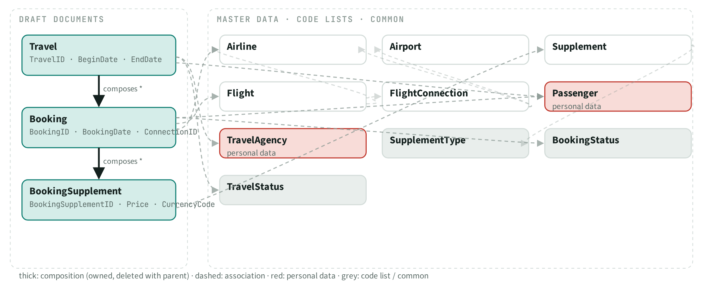
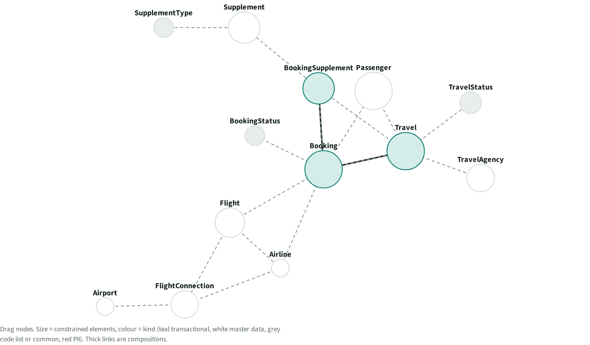
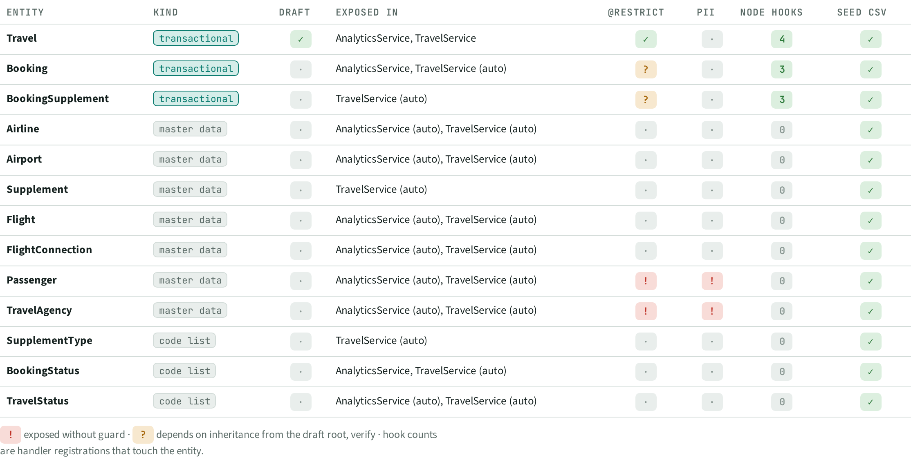

# DAT · Data model

> 13 entities: 3 in draft documents, 7 master data, 3 code lists. Personal data in **Passenger, TravelAgency**.

## Facts

_Facts generated from the knowledge graph._

### Entities

| Entity | Kind | Draft | Exposed in | @restrict | PII | Node hooks |
| --- | --- | --- | --- | --- | --- | --- |
| Travel | transactional | yes | AnalyticsService, TravelService | yes | no | 4 |
| Booking | transactional | no | AnalyticsService, TravelService (auto) | unclear (verify) | no | 3 |
| BookingSupplement | transactional | no | TravelService (auto) | unclear (verify) | no | 3 |
| Airline | master data | no | AnalyticsService (auto), TravelService (auto) | no | no | 0 |
| Airport | master data | no | AnalyticsService (auto), TravelService (auto) | no | no | 0 |
| Supplement | master data | no | TravelService (auto) | no | no | 0 |
| Flight | master data | no | AnalyticsService (auto), TravelService (auto) | no | no | 0 |
| FlightConnection | master data | no | AnalyticsService (auto), TravelService (auto) | no | no | 0 |
| Passenger | master data | no | AnalyticsService (auto), TravelService (auto) | EXPOSED | EXPOSED | 0 |
| TravelAgency | master data | no | AnalyticsService (auto), TravelService (auto) | EXPOSED | EXPOSED | 0 |
| SupplementType | code list | no | TravelService (auto) | no | no | 0 |
| BookingStatus | code list | no | AnalyticsService, TravelService (auto) | no | no | 0 |
| TravelStatus | code list | no | AnalyticsService (auto), TravelService (auto) | no | no | 0 |

### Relations

| From | Kind | To | Via element |
| --- | --- | --- | --- |
| Supplement | association | SupplementType | Type |
| Flight | association | Airline | to_Airline |
| Flight | association | FlightConnection | to_Connection |
| FlightConnection | association | Airport | DepartureAirport |
| FlightConnection | association | Airline | to_Airline |
| Travel | association | TravelStatus | TravelStatus |
| Travel | association | TravelAgency | to_Agency |
| Travel | association | Passenger | to_Customer |
| Travel | composition | Booking | to_Booking |
| Booking | association | BookingStatus | BookingStatus |
| Booking | composition | BookingSupplement | to_BookSupplement |
| Booking | association | Airline | to_Carrier |
| Booking | association | Passenger | to_Customer |
| Booking | association | Travel | to_Travel |
| Booking | association | Flight | to_Flight |
| BookingSupplement | association | Booking | to_Booking |
| BookingSupplement | association | Travel | to_Travel |
| BookingSupplement | association | Supplement | to_Supplement |

## Views

**DAT-A Composition tree**

**DAT-B Force graph**

**DAT-C Entity matrix**

[Back to the index](../README.md)
