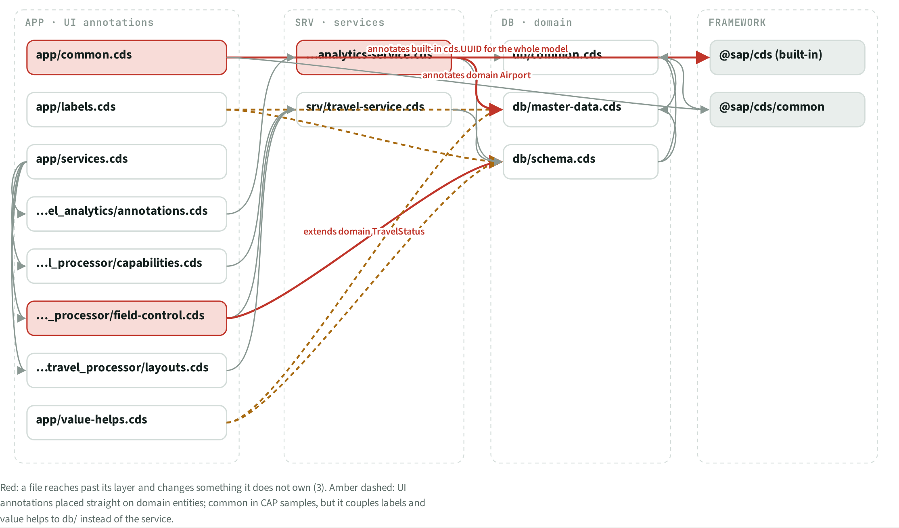
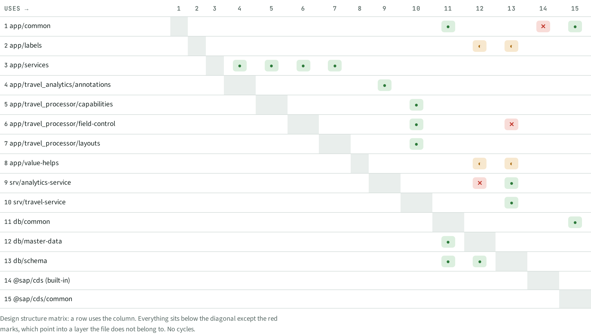

# DEP · Dependencies

> 15 CDS files, 23 file-to-file dependencies. **3 reach past their layer**, 4 put UI annotations straight on the domain.

## Facts

_Facts generated from the knowledge graph._

### Files

| Id | File | Layer |
| --- | --- | --- |
| app/common.cds | app/common.cds | app |
| app/labels.cds | app/labels.cds | app |
| app/services.cds | app/services.cds | app |
| app/travel_analytics/annotations.cds | app/travel_analytics/annotations.cds | app |
| app/travel_processor/capabilities.cds | app/travel_processor/capabilities.cds | app |
| app/travel_processor/field-control.cds | app/travel_processor/field-control.cds | app |
| app/travel_processor/layouts.cds | app/travel_processor/layouts.cds | app |
| app/value-helps.cds | app/value-helps.cds | app |
| srv/analytics-service.cds | srv/analytics-service.cds | srv |
| srv/travel-service.cds | srv/travel-service.cds | srv |
| db/common.cds | db/common.cds | db |
| db/master-data.cds | db/master-data.cds | db |
| db/schema.cds | db/schema.cds | db |
| @sap/cds (built-in) | @sap/cds (built-in) | ext |
| @sap/cds/common | @sap/cds/common | ext |

### Uses

| From | To | Verdict | Why | Evidence |
| --- | --- | --- | --- | --- |
| app/common.cds | db/common.cds | allowed |  | `app/common.cds:1` |
| app/common.cds | @sap/cds (built-in) | VIOLATION | annotates built-in cds.UUID for the whole model | `app/common.cds:5` |
| app/common.cds | @sap/cds/common | allowed |  | `app/common.cds:7` |
| app/labels.cds | db/schema.cds | skips the service layer | annotates domain | `app/labels.cds:7` |
| app/labels.cds | db/master-data.cds | skips the service layer | annotates domain | `app/labels.cds:55` |
| app/services.cds | app/travel_processor/capabilities.cds | allowed |  | `app/services.cds:1` |
| app/services.cds | app/travel_processor/field-control.cds | allowed |  | `app/services.cds:2` |
| app/services.cds | app/travel_processor/layouts.cds | allowed |  | `app/services.cds:3` |
| app/services.cds | app/travel_analytics/annotations.cds | allowed |  | `app/services.cds:5` |
| app/travel_analytics/annotations.cds | srv/analytics-service.cds | allowed |  | `app/travel_analytics/annotations.cds:1` |
| app/travel_processor/capabilities.cds | srv/travel-service.cds | allowed |  | `app/travel_processor/capabilities.cds:1` |
| app/travel_processor/field-control.cds | srv/travel-service.cds | allowed |  | `app/travel_processor/field-control.cds:1` |
| app/travel_processor/field-control.cds | db/schema.cds | VIOLATION | extends domain TravelStatus | `app/travel_processor/field-control.cds:12` |
| app/travel_processor/layouts.cds | srv/travel-service.cds | allowed |  | `app/travel_processor/layouts.cds:1` |
| app/value-helps.cds | db/schema.cds | skips the service layer | annotates domain | `app/value-helps.cds:7` |
| app/value-helps.cds | db/master-data.cds | skips the service layer | annotates domain | `app/value-helps.cds:165` |
| srv/analytics-service.cds | db/schema.cds | allowed |  | `srv/analytics-service.cds:1` |
| srv/analytics-service.cds | db/master-data.cds | VIOLATION | annotates domain Airport | `srv/analytics-service.cds:76` |
| srv/travel-service.cds | db/schema.cds | allowed |  | `srv/travel-service.cds:1` |
| db/common.cds | @sap/cds/common | allowed |  | `db/common.cds:1` |
| db/master-data.cds | db/common.cds | allowed |  | `db/master-data.cds:1` |
| db/schema.cds | db/common.cds | allowed |  | `db/schema.cds:1` |
| db/schema.cds | db/master-data.cds | allowed |  | `db/schema.cds:2` |

## Next steps

Ranked; prompts for each item are in the NXT topic file.

| Priority | Id | Step | What | Sections | Evidence | Score |
| --- | --- | --- | --- | --- | --- | --- |
| P3 | `RSK:G8` | Fix | Global annotation on built-in cds.UUID | RSK, PAT, DEP | `app/common.cds:5` | 2×3 |
| P3 | `DEP:srv/analytics-service.cds → db/master-data.cds` | Review | srv/analytics-service.cds reaches into db/master-data.cds | DEP | `srv/analytics-service.cds:76` | 2×3 |
| P3 | `RSK:G11` | Fix | 3 CDS files change models of another layer | RSK, DEP | `app/travel_processor/field-control.cds:12` | 2×2 |

## Views

**DEP-A Layered graph**

**DEP-B Dependency matrix**

[Back to the index](../README.md)
