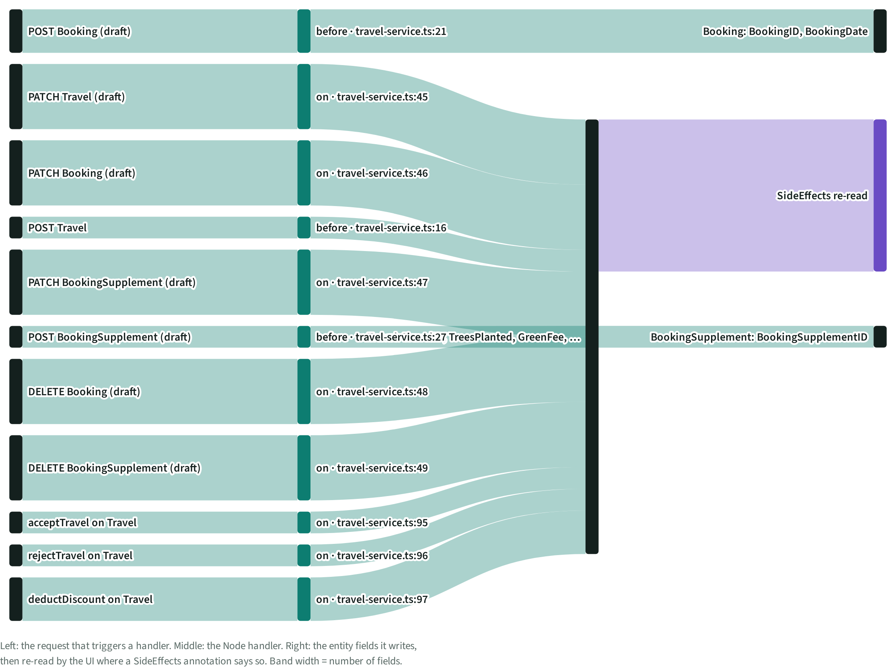
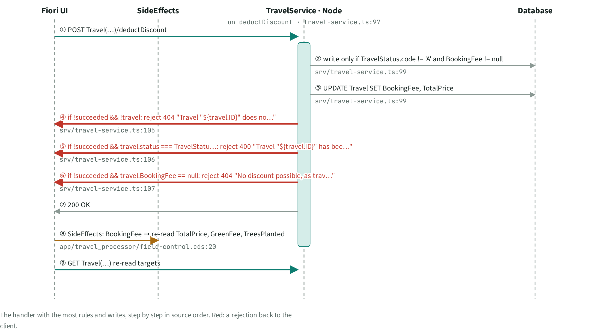
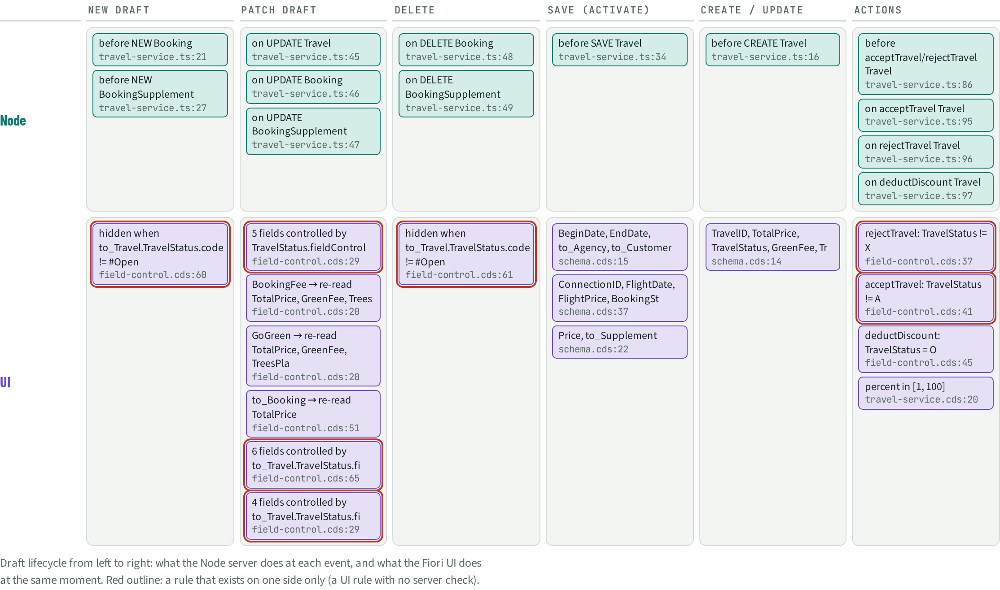

# FLW · Data flow & events

> 3 entities get fields written by handlers; the busiest handler is **on deductDiscount Travel** (travel-service.ts:97). 6 lifecycle events carry server or UI hooks.

## Facts

_Facts generated from the knowledge graph._

### Recompute flow

| From | To | Weight |
| --- | --- | --- |
| POST Travel | before · travel-service.ts:16 | 1 |
| before · travel-service.ts:16 | Travel: TravelID, TreesPlanted, GreenFee, … | 1 |
| POST Booking (draft) | before · travel-service.ts:21 | 2 |
| before · travel-service.ts:21 | Booking: BookingID, BookingDate | 2 |
| POST BookingSupplement (draft) | before · travel-service.ts:27 | 1 |
| before · travel-service.ts:27 | BookingSupplement: BookingSupplementID | 1 |
| PATCH Travel (draft) | on · travel-service.ts:45 | 3 |
| on · travel-service.ts:45 | Travel: TravelID, TreesPlanted, GreenFee, … | 3 |
| PATCH Booking (draft) | on · travel-service.ts:46 | 3 |
| on · travel-service.ts:46 | Travel: TravelID, TreesPlanted, GreenFee, … | 3 |
| PATCH BookingSupplement (draft) | on · travel-service.ts:47 | 3 |
| on · travel-service.ts:47 | Travel: TravelID, TreesPlanted, GreenFee, … | 3 |
| DELETE Booking (draft) | on · travel-service.ts:48 | 3 |
| on · travel-service.ts:48 | Travel: TravelID, TreesPlanted, GreenFee, … | 3 |
| DELETE BookingSupplement (draft) | on · travel-service.ts:49 | 3 |
| on · travel-service.ts:49 | Travel: TravelID, TreesPlanted, GreenFee, … | 3 |
| acceptTravel on Travel | on · travel-service.ts:95 | 1 |
| on · travel-service.ts:95 | Travel: TravelID, TreesPlanted, GreenFee, … | 1 |
| rejectTravel on Travel | on · travel-service.ts:96 | 1 |
| on · travel-service.ts:96 | Travel: TravelID, TreesPlanted, GreenFee, … | 1 |
| deductDiscount on Travel | on · travel-service.ts:97 | 2 |
| on · travel-service.ts:97 | Travel: TravelID, TreesPlanted, GreenFee, … | 2 |
| Travel: TravelID, TreesPlanted, GreenFee, … | SideEffects re-read | 7 |

### Swimlane: on deductDiscount Travel (`travel-service.ts:97`)

| # | From | To | Step | Evidence |
| --- | --- | --- | --- | --- |
| 1 | Fiori UI | TravelService · Node | POST Travel(…)/deductDiscount |  |
| 2 | TravelService · Node | Database | write only if TravelStatus.code != 'A' and BookingFee != null | `srv/travel-service.ts:99` |
| 3 | TravelService · Node | Database | UPDATE Travel SET BookingFee, TotalPrice | `srv/travel-service.ts:99` |
| 4 | TravelService · Node | Fiori UI | if !succeeded && !travel: reject 404 "Travel "${travel.ID}" does no…" | `srv/travel-service.ts:105` |
| 5 | TravelService · Node | Fiori UI | if !succeeded && travel.status === TravelStatu…: reject 400 "Travel "${travel.ID}" has bee…" | `srv/travel-service.ts:106` |
| 6 | TravelService · Node | Fiori UI | if !succeeded && travel.BookingFee == null: reject 404 "No discount possible, as trav…" | `srv/travel-service.ts:107` |
| 7 | TravelService · Node | Fiori UI | 200 OK |  |
| 8 | Fiori UI | SideEffects | SideEffects: BookingFee → re-read TotalPrice, GreenFee, TreesPlanted | `app/travel_processor/field-control.cds:20` |
| 9 | Fiori UI | TravelService · Node | GET Travel(…) re-read targets |  |

### Hooks per lifecycle event

| Event | Node server | Fiori UI |
| --- | --- | --- |
| NEW draft | before NEW Booking `travel-service.ts:21`before NEW BookingSupplement `travel-service.ts:27` | hidden when to_Travel.TravelStatus.code != #Open `field-control.cds:60` **(one side only)** |
| PATCH draft | on UPDATE Travel `travel-service.ts:45`on UPDATE Booking `travel-service.ts:46`on UPDATE BookingSupplement `travel-service.ts:47` | 5 fields controlled by TravelStatus.fieldControl `field-control.cds:29` **(one side only)**BookingFee → re-read TotalPrice, GreenFee, Trees `field-control.cds:20`GoGreen → re-read TotalPrice, GreenFee, TreesPla `field-control.cds:20`to_Booking → re-read TotalPrice `field-control.cds:51`6 fields controlled by to_Travel.TravelStatus.fi `field-control.cds:65` **(one side only)**4 fields controlled by to_Travel.TravelStatus.fi `field-control.cds:29` **(one side only)** |
| DELETE | on DELETE Booking `travel-service.ts:48`on DELETE BookingSupplement `travel-service.ts:49` | hidden when to_Travel.TravelStatus.code != #Open `field-control.cds:61` **(one side only)** |
| SAVE (activate) | before SAVE Travel `travel-service.ts:34` | BeginDate, EndDate, to_Agency, to_Customer `schema.cds:15`ConnectionID, FlightDate, FlightPrice, BookingSt `schema.cds:37`Price, to_Supplement `schema.cds:22` |
| CREATE / UPDATE | before CREATE Travel `travel-service.ts:16` | TravelID, TotalPrice, TravelStatus, GreenFee, Tr `schema.cds:14` |
| Actions | before acceptTravel/rejectTravel Travel `travel-service.ts:86`on acceptTravel Travel `travel-service.ts:95`on rejectTravel Travel `travel-service.ts:96`on deductDiscount Travel `travel-service.ts:97` | rejectTravel: TravelStatus != X `field-control.cds:37` **(one side only)**acceptTravel: TravelStatus != A `field-control.cds:41` **(one side only)**deductDiscount: TravelStatus = O `field-control.cds:45`percent in [1, 100] `travel-service.cds:20` |

A hook marked **(one side only)** is a rule without a counterpart on the other side, or a defect.

## Views

**FLW-A Sankey**

**FLW-B Swimlane: on deductDiscount Travel**

**FLW-C Hook timeline**

[Back to the index](../README.md)
