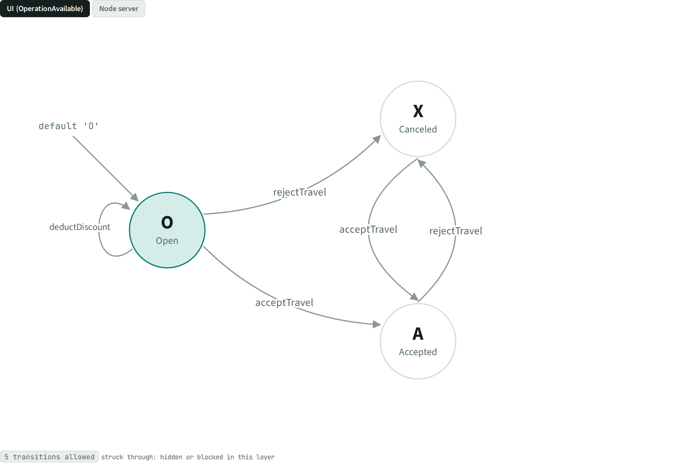
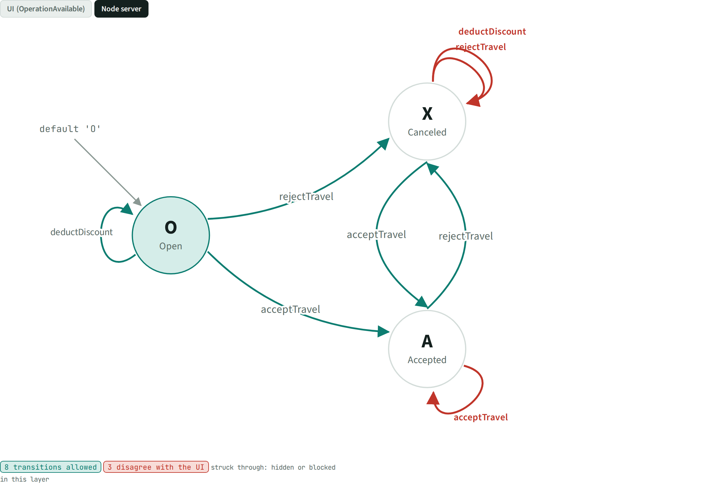
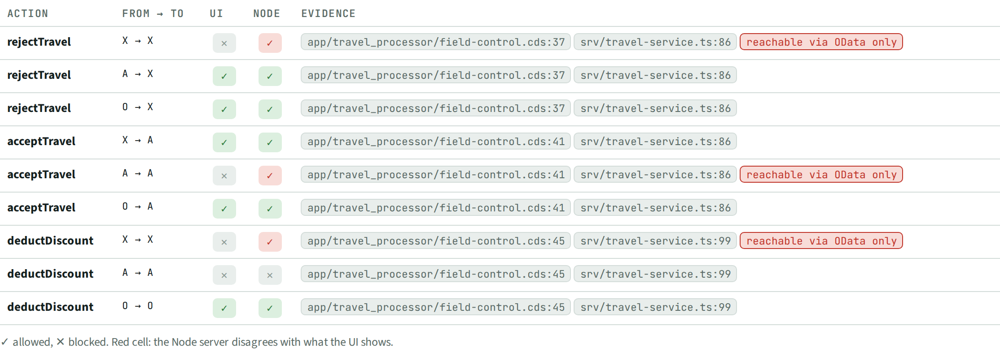

# STA · TravelStatus lifecycle

> 3 states, 9 action × state pairs. The UI allows 5, the Node server 8; **3 disagree**.

## Facts

_Facts generated from the knowledge graph._

States of `Travel.TravelStatus`: X (Canceled), A (Accepted), O (Open); default O.

| Action | From | To | UI offers it | Node allows it | Verdict | Evidence |
| --- | --- | --- | --- | --- | --- | --- |
| rejectTravel | X | X | no | yes | reachable only via OData (UI hides it) | `app/travel_processor/field-control.cds:37`, `srv/travel-service.ts:86` |
| rejectTravel | A | X | yes | yes | consistent | `app/travel_processor/field-control.cds:37`, `srv/travel-service.ts:86` |
| rejectTravel | O | X | yes | yes | consistent | `app/travel_processor/field-control.cds:37`, `srv/travel-service.ts:86` |
| acceptTravel | X | A | yes | yes | consistent | `app/travel_processor/field-control.cds:41`, `srv/travel-service.ts:86` |
| acceptTravel | A | A | no | yes | reachable only via OData (UI hides it) | `app/travel_processor/field-control.cds:41`, `srv/travel-service.ts:86` |
| acceptTravel | O | A | yes | yes | consistent | `app/travel_processor/field-control.cds:41`, `srv/travel-service.ts:86` |
| deductDiscount | X | X | no | yes | reachable only via OData (UI hides it) | `app/travel_processor/field-control.cds:45`, `srv/travel-service.ts:99` |
| deductDiscount | A | A | no | no | consistent | `app/travel_processor/field-control.cds:45`, `srv/travel-service.ts:99` |
| deductDiscount | O | O | yes | yes | consistent | `app/travel_processor/field-control.cds:45`, `srv/travel-service.ts:99` |

## Views

**STA-A State machine**

Same machine, Node layer (red = differs from the UI):

**STA-B Transition table**

[Back to the index](../README.md)
