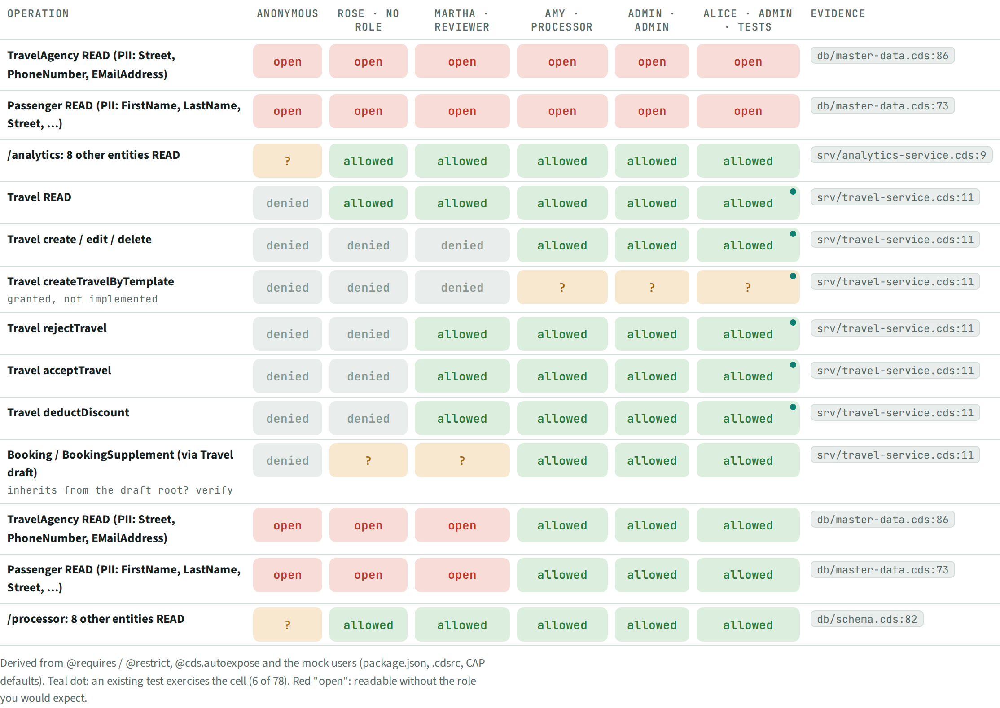
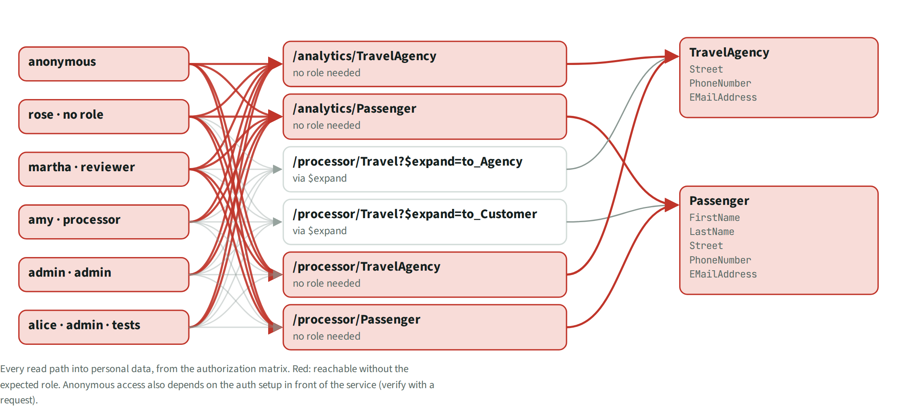
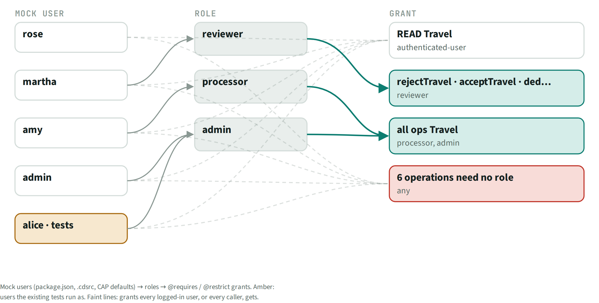

# AUT · Authorization

> 6 users (anonymous plus mock users) × 13 operations. **4 operations expose personal data without a role.** 6 cells are exercised by existing tests.

## Facts

_Facts generated from the knowledge graph._

| Operation | anonymous | rose · no role | martha · reviewer | amy · processor | admin · admin | alice · admin · tests | Evidence | Note |
| --- | --- | --- | --- | --- | --- | --- | --- | --- |
| TravelAgency READ (PII: Street, PhoneNumber, EMailAddress) | OPEN | OPEN | OPEN | OPEN | OPEN | OPEN | `db/master-data.cds:86` |  |
| Passenger READ (PII: FirstName, LastName, Street, …) | OPEN | OPEN | OPEN | OPEN | OPEN | OPEN | `db/master-data.cds:73` |  |
| /analytics: 8 other entities READ | unclear | allowed | allowed | allowed | allowed | allowed | `srv/analytics-service.cds:9` |  |
| Travel READ | denied | allowed | allowed | allowed | allowed | allowed (tested) | `srv/travel-service.cds:11` |  |
| Travel create / edit / delete | denied | denied | denied | allowed | allowed | allowed (tested) | `srv/travel-service.cds:11` |  |
| Travel createTravelByTemplate | denied | denied | denied | unclear | unclear | unclear (tested) | `srv/travel-service.cds:11` | granted, not implemented |
| Travel rejectTravel | denied | denied | allowed | allowed | allowed | allowed (tested) | `srv/travel-service.cds:11` |  |
| Travel acceptTravel | denied | denied | allowed | allowed | allowed | allowed (tested) | `srv/travel-service.cds:11` |  |
| Travel deductDiscount | denied | denied | allowed | allowed | allowed | allowed (tested) | `srv/travel-service.cds:11` |  |
| Booking / BookingSupplement (via Travel draft) | denied | unclear | unclear | allowed | allowed | allowed | `srv/travel-service.cds:11` | inherits from the draft root? verify |
| TravelAgency READ (PII: Street, PhoneNumber, EMailAddress) | OPEN | OPEN | OPEN | allowed | allowed | allowed | `db/master-data.cds:86` |  |
| Passenger READ (PII: FirstName, LastName, Street, …) | OPEN | OPEN | OPEN | allowed | allowed | allowed | `db/master-data.cds:73` |  |
| /processor: 8 other entities READ | unclear | allowed | allowed | allowed | allowed | allowed | `db/schema.cds:82` |  |

OPEN = readable without the role you would expect. "(tested)" = an existing test exercises the cell.

## Next steps

Ranked; prompts for each item are in the NXT topic file.

| Priority | Id | Step | What | Sections | Evidence | Score |
| --- | --- | --- | --- | --- | --- | --- |
| P1 | `RSK:G1` | Fix | Passenger personal data open to any caller | RSK, AUT | `db/master-data.cds:73` | 4×4 |
| P1 | `RSK:G2` | Fix | TravelAgency personal data open to any caller | RSK, AUT | `db/master-data.cds:86` | 4×4 |
| P3 | `AUT:/analytics: 8 other entities READ (unclear)` | Verify | Check access: /analytics: 8 other entities READ as anonymous | AUT | `srv/analytics-service.cds:9` | 2×3 |
| P3 | `AUT:/processor: 8 other entities READ (unclear)` | Verify | Check access: /processor: 8 other entities READ as anonymous | AUT | `db/schema.cds:82` | 2×3 |
| P3 | `AUT:Booking / BookingSupplement (via Travel draft) (unclear)` | Verify | Check access: Booking / BookingSupplement (via Travel draft) as rose · no role, martha · reviewer | AUT | `srv/travel-service.cds:11` | 2×3 |
| P3 | `AUT:Travel createTravelByTemplate (unclear)` | Verify | Check access: Travel createTravelByTemplate as amy · processor, admin · admin, alice · admin · tests | AUT | `srv/travel-service.cds:11` | 2×3 |

## Views

**AUT-A Role heatmap**

**AUT-B PII reach**

**AUT-C Role chain**

[Back to the index](../README.md)
