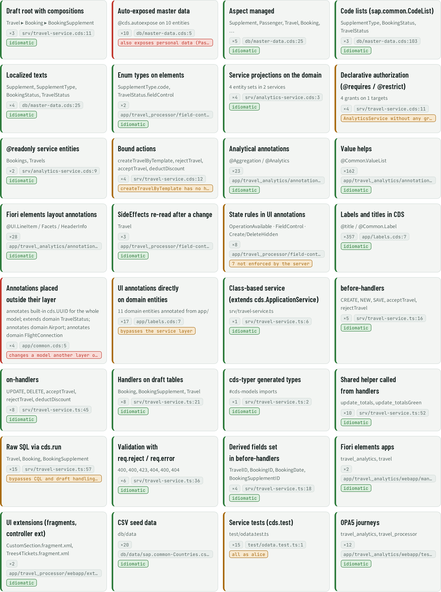
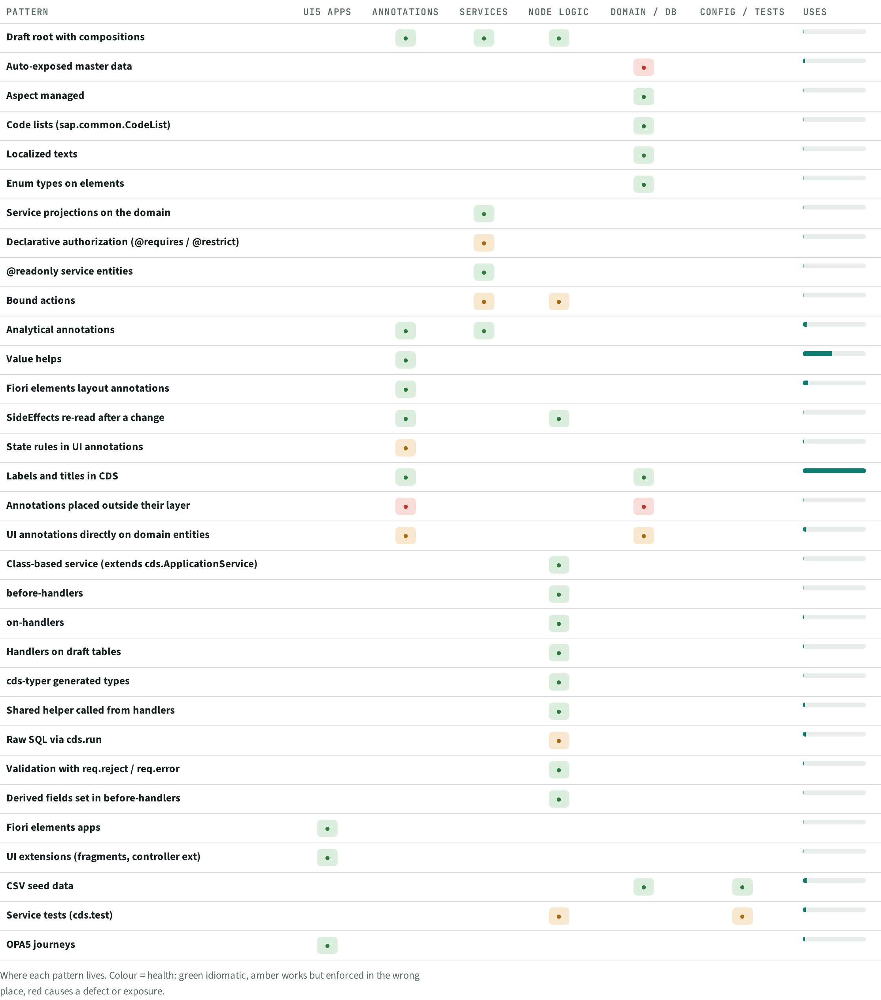

# PAT · Coding patterns

> 32 patterns found by fixed detectors. 2 cause a defect or exposure, 6 work but sit in the wrong place.

## Facts

_Facts generated from the knowledge graph._

| Pattern | Where | Uses | Health | Note | Layers | Evidence |
| --- | --- | --- | --- | --- | --- | --- |
| Draft root with compositions | Travel ▸ Booking ▸ BookingSupplement | 3 | idiomatic |  | Annotations, Services, Node logic | `srv/travel-service.cds:11` |
| Auto-exposed master data | @cds.autoexpose on 10 entities | 10 | causes a defect or exposure | also exposes personal data (Passenger, TravelAgency) | Domain / DB | `db/master-data.cds:5` |
| Aspect managed | Supplement, Passenger, Travel, Booking, … | 5 | idiomatic |  | Domain / DB | `db/master-data.cds:25` |
| Code lists (sap.common.CodeList) | SupplementType, BookingStatus, TravelStatus | 3 | idiomatic |  | Domain / DB | `db/master-data.cds:103` |
| Localized texts | Supplement, SupplementType, BookingStatus, TravelStatus | 4 | idiomatic |  | Domain / DB | `db/master-data.cds:25` |
| Enum types on elements | SupplementType.code, TravelStatus.fieldControl | 2 | idiomatic |  | Domain / DB | `app/travel_processor/field-control.cds:14` |
| Service projections on the domain | 4 entity sets in 2 services | 4 | idiomatic |  | Services | `srv/analytics-service.cds:3` |
| Declarative authorization (@requires / @restrict) | 4 grants on 1 targets | 4 | works, enforced in the wrong place | AnalyticsService without any grant | Services | `srv/travel-service.cds:11` |
| @readonly service entities | Bookings, Travels | 2 | idiomatic |  | Services | `srv/analytics-service.cds:9` |
| Bound actions | createTravelByTemplate, rejectTravel, acceptTravel, deductDiscount | 4 | works, enforced in the wrong place | createTravelByTemplate has no handler | Services, Node logic | `srv/travel-service.cds:12` |
| Analytical annotations | @Aggregation / @Analytics | 23 | idiomatic |  | Annotations, Services | `app/travel_analytics/annotations.cds:9` |
| Value helps | @Common.ValueList | 162 | idiomatic |  | Annotations | `app/travel_analytics/annotations.cds:171` |
| Fiori elements layout annotations | @UI.LineItem / Facets / HeaderInfo | 28 | idiomatic |  | Annotations | `app/travel_analytics/annotations.cds:81` |
| SideEffects re-read after a change | Travel | 3 | idiomatic |  | Annotations, Node logic | `app/travel_processor/field-control.cds:20` |
| State rules in UI annotations | OperationAvailable · FieldControl · Create/DeleteHidden | 8 | works, enforced in the wrong place | 7 not enforced by the server | Annotations | `app/travel_processor/field-control.cds:37` |
| Labels and titles in CDS | @title / @Common.Label | 357 | idiomatic |  | Annotations, Domain / DB | `app/labels.cds:7` |
| Annotations placed outside their layer | annotates built-in cds.UUID for the whole model; extends domain TravelStatus; annotates domain Airport; annotates domain FlightConnection | 4 | causes a defect or exposure | changes a model another layer owns | Annotations, Domain / DB | `app/common.cds:5` |
| UI annotations directly on domain entities | 11 domain entities annotated from app/ | 17 | works, enforced in the wrong place | bypasses the service layer | Annotations, Domain / DB | `app/labels.cds:7` |
| Class-based service (extends cds.ApplicationService) | srv/travel-service.ts | 1 | idiomatic |  | Node logic | `srv/travel-service.ts:6` |
| before-handlers | CREATE, NEW, SAVE, acceptTravel, rejectTravel | 5 | idiomatic |  | Node logic | `srv/travel-service.ts:16` |
| on-handlers | UPDATE, DELETE, acceptTravel, rejectTravel, deductDiscount | 8 | idiomatic |  | Node logic | `srv/travel-service.ts:45` |
| Handlers on draft tables | Booking, BookingSupplement, Travel | 8 | idiomatic |  | Node logic | `srv/travel-service.ts:21` |
| cds-typer generated types | #cds-models imports | 1 | idiomatic |  | Node logic | `srv/travel-service.ts:2` |
| Shared helper called from handlers | update_totals, update_totalsGreen | 10 | idiomatic |  | Node logic | `srv/travel-service.ts:52` |
| Raw SQL via cds.run | Travel, Booking, BookingSupplement | 15 | works, enforced in the wrong place | bypasses CQL and draft handling; check projections | Node logic | `srv/travel-service.ts:57` |
| Validation with req.reject / req.error | 400, 400, 423, 404, 400, 404 | 6 | idiomatic |  | Node logic | `srv/travel-service.ts:36` |
| Derived fields set in before-handlers | TravelID, BookingID, BookingDate, BookingSupplementID | 4 | idiomatic |  | Node logic | `srv/travel-service.ts:18` |
| Fiori elements apps | travel_analytics, travel | 2 | idiomatic |  | UI5 apps | `app/travel_analytics/webapp/manifest.json:1` |
| UI extensions (fragments, controller ext) | CustomSection.fragment.xml, Trees4Tickets.fragment.xml | 2 | idiomatic |  | UI5 apps | `app/travel_processor/webapp/ext/fragment/CustomSection.fragment.xml:1` |
| CSV seed data | db/data | 20 | idiomatic |  | Domain / DB, Config / tests | `db/data/sap.common-Countries.csv:1` |
| Service tests (cds.test) | test/odata.test.ts | 15 | works, enforced in the wrong place | all as alice | Node logic, Config / tests | `test/odata.test.ts:1` |
| OPA5 journeys | travel_analytics, travel_processor | 12 | idiomatic |  | UI5 apps | `app/travel_analytics/webapp/test/integration/OpaJourney.js:1` |

## Next steps

Ranked; prompts for each item are in the NXT topic file.

| Priority | Id | Step | What | Sections | Evidence | Score |
| --- | --- | --- | --- | --- | --- | --- |
| P2 | `PAT:Auto-exposed master data` | Fix | Auto-exposed master data: also exposes personal data (Passenger, TravelAgency) | PAT | `db/master-data.cds:5` | 4×3 |
| P2 | `RSK:G3` | Fix | rejectTravel, acceptTravel callable in states the UI hides | RSK, UIS, STA, PAT | `app/travel_processor/field-control.cds:37` | 3×4 |
| P2 | `RSK:G6` | Fix | Tests run as one user only (alice) | RSK, PAT | `test/odata.test.ts:1` | 3×3 |
| P3 | `RSK:G8` | Fix | Global annotation on built-in cds.UUID | RSK, PAT, DEP | `app/common.cds:5` | 2×3 |
| P3 | `RSK:G9` | Fix | createTravelByTemplate declared and granted, no handler | RSK, PAT | `srv/travel-service.cds:12` | 2×3 |
| P3 | `PAT:Raw SQL via cds.run` | Review | Raw SQL via cds.run: bypasses CQL and draft handling; check projections | PAT | `srv/travel-service.ts:57` | 2×3 |
| P3 | `PAT:UI annotations directly on domain entities` | Review | UI annotations directly on domain entities: bypasses the service layer | PAT | `app/labels.cds:7` | 2×3 |
| P3 | `RSK:G10` | Fix | Booking / BookingSupplement: access inherited from the draft root | RSK, PAT | `srv/travel-service.cds:11` | 2×2 |

## Views

**PAT-A Pattern cards**

**PAT-B Pattern × layer**

[Back to the index](../README.md)
