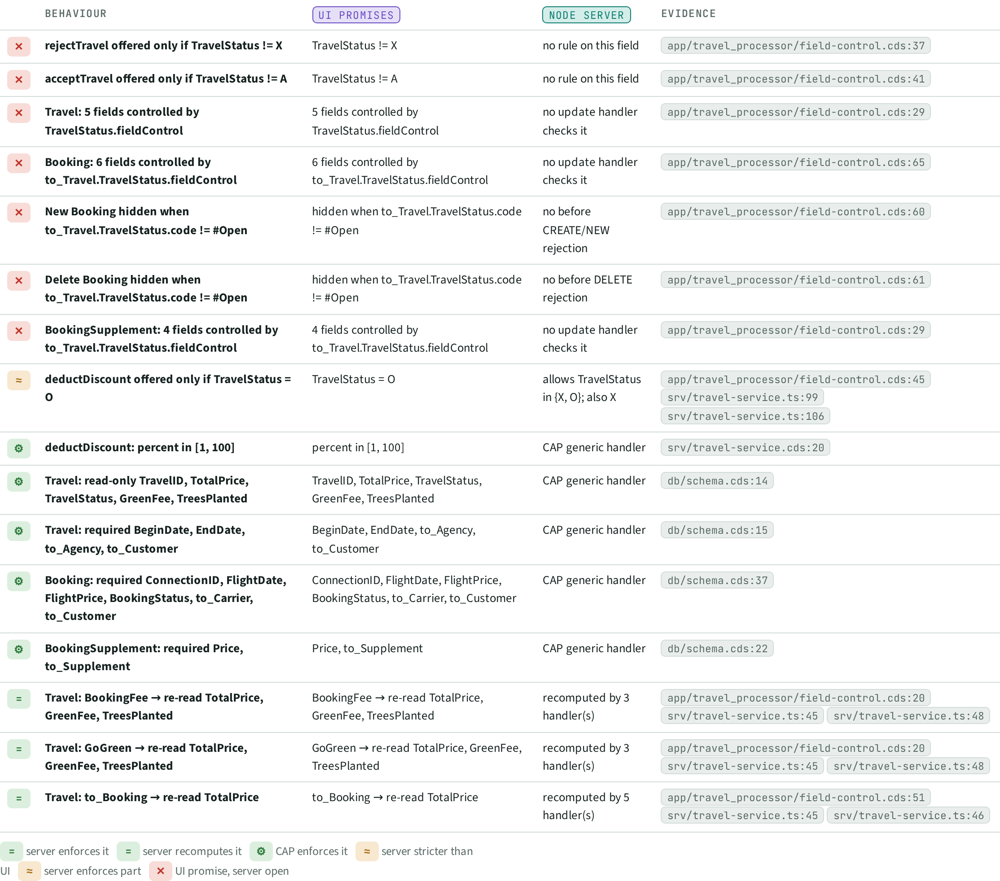
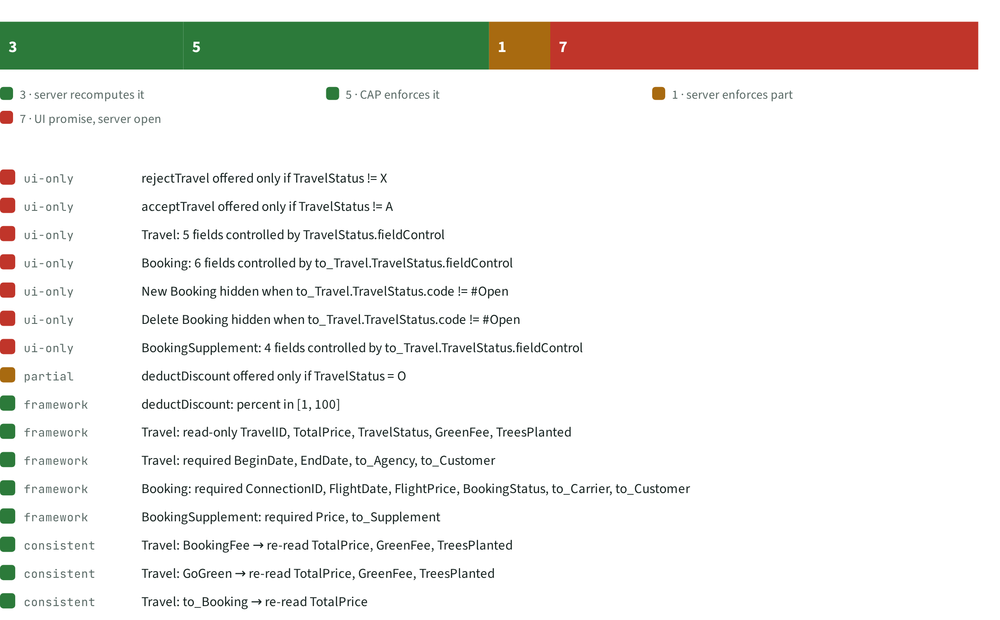

# UIS · UI promises vs server

> 16 rules the UI promises, read from the annotations. 8 are enforced by the server or by CAP, 1 only partly; **7 exist only in the UI** and can be bypassed with a plain OData call.

## Facts

_Facts generated from the knowledge graph._

| Rule | UI promises | Node server | Verdict | Evidence |
| --- | --- | --- | --- | --- |
| rejectTravel offered only if TravelStatus != X | TravelStatus != X | no rule on this field | UI promise, server open | `app/travel_processor/field-control.cds:37` |
| acceptTravel offered only if TravelStatus != A | TravelStatus != A | no rule on this field | UI promise, server open | `app/travel_processor/field-control.cds:41` |
| Travel: 5 fields controlled by TravelStatus.fieldControl | 5 fields controlled by TravelStatus.fieldControl | no update handler checks it | UI promise, server open | `app/travel_processor/field-control.cds:29` |
| Booking: 6 fields controlled by to_Travel.TravelStatus.fieldControl | 6 fields controlled by to_Travel.TravelStatus.fieldControl | no update handler checks it | UI promise, server open | `app/travel_processor/field-control.cds:65` |
| New Booking hidden when to_Travel.TravelStatus.code != #Open | hidden when to_Travel.TravelStatus.code != #Open | no before CREATE/NEW rejection | UI promise, server open | `app/travel_processor/field-control.cds:60` |
| Delete Booking hidden when to_Travel.TravelStatus.code != #Open | hidden when to_Travel.TravelStatus.code != #Open | no before DELETE rejection | UI promise, server open | `app/travel_processor/field-control.cds:61` |
| BookingSupplement: 4 fields controlled by to_Travel.TravelStatus.fieldControl | 4 fields controlled by to_Travel.TravelStatus.fieldControl | no update handler checks it | UI promise, server open | `app/travel_processor/field-control.cds:29` |
| deductDiscount offered only if TravelStatus = O | TravelStatus = O | allows TravelStatus in {X, O}; also X | server enforces part | `app/travel_processor/field-control.cds:45`, `srv/travel-service.ts:99`, `srv/travel-service.ts:106` |
| deductDiscount: percent in [1, 100] | percent in [1, 100] | CAP generic handler | CAP enforces it | `srv/travel-service.cds:20` |
| Travel: read-only TravelID, TotalPrice, TravelStatus, GreenFee, TreesPlanted | TravelID, TotalPrice, TravelStatus, GreenFee, TreesPlanted | CAP generic handler | CAP enforces it | `db/schema.cds:14` |
| Travel: required BeginDate, EndDate, to_Agency, to_Customer | BeginDate, EndDate, to_Agency, to_Customer | CAP generic handler | CAP enforces it | `db/schema.cds:15` |
| Booking: required ConnectionID, FlightDate, FlightPrice, BookingStatus, to_Carrier, to_Customer | ConnectionID, FlightDate, FlightPrice, BookingStatus, to_Carrier, to_Customer | CAP generic handler | CAP enforces it | `db/schema.cds:37` |
| BookingSupplement: required Price, to_Supplement | Price, to_Supplement | CAP generic handler | CAP enforces it | `db/schema.cds:22` |
| Travel: BookingFee → re-read TotalPrice, GreenFee, TreesPlanted | BookingFee → re-read TotalPrice, GreenFee, TreesPlanted | recomputed by 3 handler(s) | server recomputes it | `app/travel_processor/field-control.cds:20`, `srv/travel-service.ts:45`, `srv/travel-service.ts:48` |
| Travel: GoGreen → re-read TotalPrice, GreenFee, TreesPlanted | GoGreen → re-read TotalPrice, GreenFee, TreesPlanted | recomputed by 3 handler(s) | server recomputes it | `app/travel_processor/field-control.cds:20`, `srv/travel-service.ts:45`, `srv/travel-service.ts:48` |
| Travel: to_Booking → re-read TotalPrice | to_Booking → re-read TotalPrice | recomputed by 5 handler(s) | server recomputes it | `app/travel_processor/field-control.cds:51`, `srv/travel-service.ts:45`, `srv/travel-service.ts:46` |

Verdicts: server enforces it (0), server recomputes it (3), CAP enforces it (5), server stricter than UI (0), server enforces part (1), UI promise, server open (7).

## Views

**UIS-A Reflexion matrix**

**UIS-B Verdict bars**

[Back to the index](../README.md)
