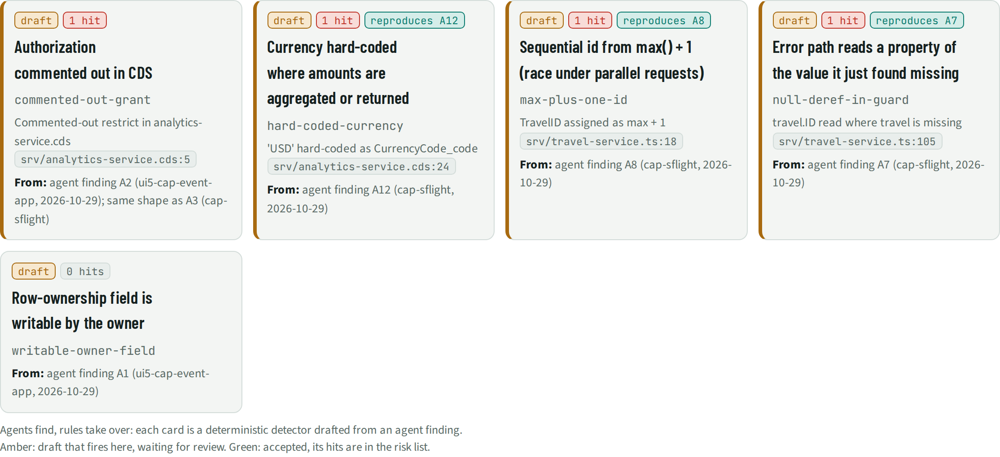

# RLS · Rules from agent findings

> 5 rules drafted from agent findings: 0 accepted, 5 waiting for review. 4 drafts fire on this app, reproducing agent findings **A12, A8, A7** without AI.

## Facts

_Facts curated from the deep read (not yet generated)._

Rules drafted by agents from their own findings, reviewed and accepted like code. A draft only reports; an accepted rule adds risks and retires the agent finding it reproduces. Each rule has a unit test in `addons/rules/library/<key>.test.js`.

| Rule | Status | Drafted from | Hits on this app | Reproduces agent finding |
| --- | --- | --- | --- | --- |
| `commented-out-grant` Authorization commented out in CDS | draft | agent finding A2 (ui5-cap-event-app, 2026-10-29); same shape as A3 (cap-sflight) | `srv/analytics-service.cds:5` Commented-out restrict in analytics-service.cds | – |
| `hard-coded-currency` Currency hard-coded where amounts are aggregated or returned | draft | agent finding A12 (cap-sflight, 2026-10-29) | `srv/analytics-service.cds:24` 'USD' hard-coded as CurrencyCode_code | A12 |
| `max-plus-one-id` Sequential id from max() + 1 (race under parallel requests) | draft | agent finding A8 (cap-sflight, 2026-10-29) | `srv/travel-service.ts:18` TravelID assigned as max + 1 | A8 |
| `null-deref-in-guard` Error path reads a property of the value it just found missing | draft | agent finding A7 (cap-sflight, 2026-10-29) | `srv/travel-service.ts:105` travel.ID read where travel is missing | A7 |
| `writable-owner-field` Row-ownership field is writable by the owner | draft | agent finding A1 (ui5-cap-event-app, 2026-10-29) | – | – |

## Views

**RLS-A Rule cards**

[Back to the index](../README.md)
