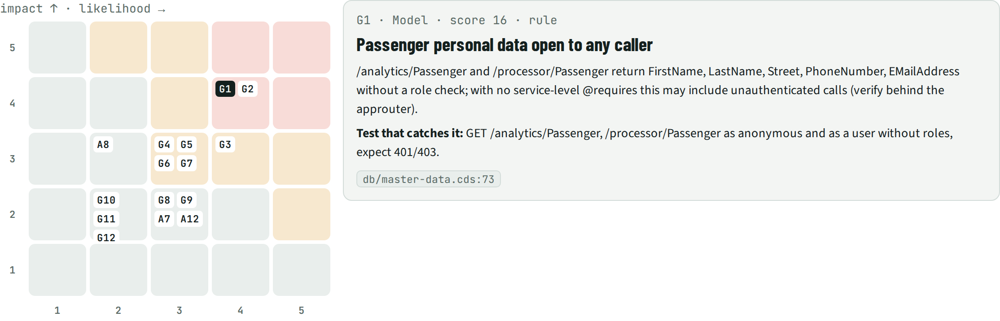
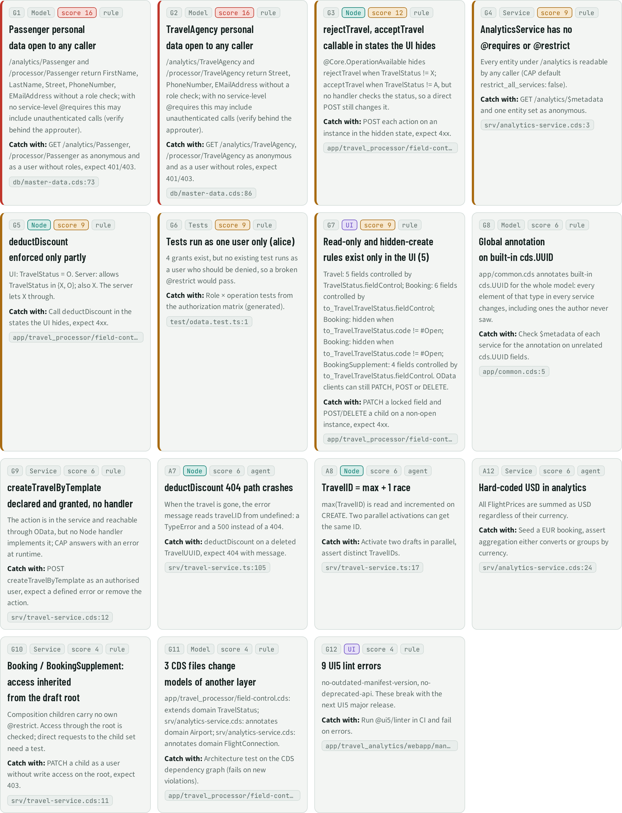

# RSK · Risks

> 15 risks: 12 found by rules, 3 by agent review. Highest: **Passenger personal data open to any caller** (score 16).

## Facts

_Facts generated from the knowledge graph, plus agent findings (marked "agent review")._

| Id | Risk | Layer | Impact | Likelihood | Score | Found by | Evidence |
| --- | --- | --- | --- | --- | --- | --- | --- |
| G1 | Passenger personal data open to any caller | Model | 4 | 4 | 16 | rule pii-open:Passenger | `db/master-data.cds:73` |
| G2 | TravelAgency personal data open to any caller | Model | 4 | 4 | 16 | rule pii-open:TravelAgency | `db/master-data.cds:86` |
| G3 | rejectTravel, acceptTravel callable in states the UI hides | Node | 3 | 4 | 12 | rule ui-only:actions | `app/travel_processor/field-control.cds:37` |
| G4 | AnalyticsService has no @requires or @restrict | Service | 3 | 3 | 9 | rule open-svc:AnalyticsService | `srv/analytics-service.cds:3` |
| G5 | deductDiscount enforced only partly | Node | 3 | 3 | 9 | rule partial:uirule:TravelService.Travel.deductDiscount:available | `app/travel_processor/field-control.cds:45` |
| G6 | Tests run as one user only (alice) | Tests | 3 | 3 | 9 | rule tests-one-user | `test/odata.test.ts:1` |
| G7 | Read-only and hidden-create rules exist only in the UI (5) | UI | 3 | 3 | 9 | rule ui-only:fields | `app/travel_processor/field-control.cds:29` |
| G8 | Global annotation on built-in cds.UUID | Model | 2 | 3 | 6 | rule global:cds.UUID | `app/common.cds:5` |
| G9 | createTravelByTemplate declared and granted, no handler | Service | 2 | 3 | 6 | rule noimpl:createTravelByTemplate | `srv/travel-service.cds:12` |
| A7 | deductDiscount 404 path crashes | Node | 2 | 3 | 6 | agent review | `srv/travel-service.ts:105` |
| A8 | TravelID = max + 1 race | Node | 3 | 2 | 6 | agent review | `srv/travel-service.ts:17` |
| A12 | Hard-coded USD in analytics | Service | 2 | 3 | 6 | agent review | `srv/analytics-service.cds:24` |
| G10 | Booking / BookingSupplement: access inherited from the draft root | Service | 2 | 2 | 4 | rule inherit:TravelService.Booking | `srv/travel-service.cds:11` |
| G11 | 3 CDS files change models of another layer | Model | 2 | 2 | 4 | rule layering | `app/travel_processor/field-control.cds:12` |
| G12 | 9 UI5 lint errors | UI | 2 | 2 | 4 | rule ui5-errors | `app/travel_analytics/webapp/manifest.json:2` |

#### G1 Passenger personal data open to any caller

/analytics/Passenger and /processor/Passenger return FirstName, LastName, Street, PhoneNumber, EMailAddress without a role check; with no service-level @requires this may include unauthenticated calls (verify behind the approuter).

- Evidence: `db/master-data.cds:73`
- Test that catches it: GET /analytics/Passenger, /processor/Passenger as anonymous and as a user without roles, expect 401/403.

#### G2 TravelAgency personal data open to any caller

/analytics/TravelAgency and /processor/TravelAgency return Street, PhoneNumber, EMailAddress without a role check; with no service-level @requires this may include unauthenticated calls (verify behind the approuter).

- Evidence: `db/master-data.cds:86`
- Test that catches it: GET /analytics/TravelAgency, /processor/TravelAgency as anonymous and as a user without roles, expect 401/403.

#### G3 rejectTravel, acceptTravel callable in states the UI hides

@Core.OperationAvailable hides rejectTravel when TravelStatus != X; acceptTravel when TravelStatus != A, but no handler checks the status, so a direct POST still changes it.

- Evidence: `app/travel_processor/field-control.cds:37`
- Test that catches it: POST each action on an instance in the hidden state, expect 4xx.

#### G4 AnalyticsService has no @requires or @restrict

Every entity under /analytics is readable by any caller (CAP default restrict_all_services: false).

- Evidence: `srv/analytics-service.cds:3`
- Test that catches it: GET /analytics/$metadata and one entity set as anonymous.

#### G5 deductDiscount enforced only partly

UI: TravelStatus = O. Server: allows TravelStatus in {X, O}; also X. The server lets X through.

- Evidence: `app/travel_processor/field-control.cds:45`
- Test that catches it: Call deductDiscount in the states the UI hides, expect 4xx.

#### G6 Tests run as one user only (alice)

4 grants exist, but no existing test runs as a user who should be denied, so a broken @restrict would pass.

- Evidence: `test/odata.test.ts:1`
- Test that catches it: Role × operation tests from the authorization matrix (generated).

#### G7 Read-only and hidden-create rules exist only in the UI (5)

Travel: 5 fields controlled by TravelStatus.fieldControl; Booking: 6 fields controlled by to_Travel.TravelStatus.fieldControl; Booking: hidden when to_Travel.TravelStatus.code != #Open; Booking: hidden when to_Travel.TravelStatus.code != #Open; BookingSupplement: 4 fields controlled by to_Travel.TravelStatus.fieldControl. OData clients can still PATCH, POST or DELETE.

- Evidence: `app/travel_processor/field-control.cds:29`
- Test that catches it: PATCH a locked field and POST/DELETE a child on a non-open instance, expect 4xx.

#### G8 Global annotation on built-in cds.UUID

app/common.cds annotates built-in cds.UUID for the whole model: every element of that type in every service changes, including ones the author never saw.

- Evidence: `app/common.cds:5`
- Test that catches it: Check $metadata of each service for the annotation on unrelated cds.UUID fields.

#### G9 createTravelByTemplate declared and granted, no handler

The action is in the service and reachable through OData, but no Node handler implements it; CAP answers with an error at runtime.

- Evidence: `srv/travel-service.cds:12`
- Test that catches it: POST createTravelByTemplate as an authorised user, expect a defined error or remove the action.

#### A7 deductDiscount 404 path crashes

When the travel is gone, the error message reads travel.ID from undefined: a TypeError and a 500 instead of a 404.

- Evidence: `srv/travel-service.ts:105`
- Test that catches it: deductDiscount on a deleted TravelUUID, expect 404 with message.

#### A8 TravelID = max + 1 race

max(TravelID) is read and incremented on CREATE. Two parallel activations can get the same ID.

- Evidence: `srv/travel-service.ts:17`
- Test that catches it: Activate two drafts in parallel, assert distinct TravelIDs.

#### A12 Hard-coded USD in analytics

All FlightPrices are summed as USD regardless of their currency.

- Evidence: `srv/analytics-service.cds:24`
- Test that catches it: Seed a EUR booking, assert aggregation either converts or groups by currency.

#### G10 Booking / BookingSupplement: access inherited from the draft root

Composition children carry no own @restrict. Access through the root is checked; direct requests to the child set need a test.

- Evidence: `srv/travel-service.cds:11`
- Test that catches it: PATCH a child as a user without write access on the root, expect 403.

#### G11 3 CDS files change models of another layer

app/travel_processor/field-control.cds: extends domain TravelStatus; srv/analytics-service.cds: annotates domain Airport; srv/analytics-service.cds: annotates domain FlightConnection.

- Evidence: `app/travel_processor/field-control.cds:12`
- Test that catches it: Architecture test on the CDS dependency graph (fails on new violations).

#### G12 9 UI5 lint errors

no-outdated-manifest-version, no-deprecated-api. These break with the next UI5 major release.

- Evidence: `app/travel_analytics/webapp/manifest.json:2`
- Test that catches it: Run @ui5/linter in CI and fail on errors.

## Next steps

Ranked; prompts for each item are in the NXT topic file.

| Priority | Id | Step | What | Sections | Evidence | Score |
| --- | --- | --- | --- | --- | --- | --- |
| P1 | `RSK:G1` | Fix | Passenger personal data open to any caller | RSK, AUT | `db/master-data.cds:73` | 4×4 |
| P1 | `RSK:G2` | Fix | TravelAgency personal data open to any caller | RSK, AUT | `db/master-data.cds:86` | 4×4 |
| P2 | `RSK:G3` | Fix | rejectTravel, acceptTravel callable in states the UI hides | RSK, UIS, STA, PAT | `app/travel_processor/field-control.cds:37` | 3×4 |
| P2 | `RSK:G4` | Fix | AnalyticsService has no @requires or @restrict | RSK | `srv/analytics-service.cds:3` | 3×3 |
| P2 | `RSK:G5` | Fix | deductDiscount enforced only partly | RSK, UIS, STA | `app/travel_processor/field-control.cds:45` | 3×3 |
| P2 | `RSK:G6` | Fix | Tests run as one user only (alice) | RSK, PAT | `test/odata.test.ts:1` | 3×3 |
| P2 | `RSK:G7` | Fix | Read-only and hidden-create rules exist only in the UI (5) | RSK, UIS | `app/travel_processor/field-control.cds:29` | 3×3 |
| P3 | `RSK:A12` | Fix | Hard-coded USD in analytics | RSK | `srv/analytics-service.cds:24` | 2×3 |
| P3 | `RSK:A7` | Fix | deductDiscount 404 path crashes | RSK | `srv/travel-service.ts:105` | 2×3 |
| P3 | `RSK:A8` | Fix | TravelID = max + 1 race | RSK | `srv/travel-service.ts:17` | 3×2 |
| P3 | `RSK:G8` | Fix | Global annotation on built-in cds.UUID | RSK, PAT, DEP | `app/common.cds:5` | 2×3 |
| P3 | `RSK:G9` | Fix | createTravelByTemplate declared and granted, no handler | RSK, PAT | `srv/travel-service.cds:12` | 2×3 |
| P3 | `RSK:G10` | Fix | Booking / BookingSupplement: access inherited from the draft root | RSK, PAT | `srv/travel-service.cds:11` | 2×2 |
| P3 | `RSK:G11` | Fix | 3 CDS files change models of another layer | RSK, DEP | `app/travel_processor/field-control.cds:12` | 2×2 |
| P3 | `RSK:G12` | Fix | 9 UI5 lint errors | RSK | `app/travel_analytics/webapp/manifest.json:2` | 2×2 |

## Views

**RSK-A Impact × likelihood**

**RSK-B Ranked cards**

[Back to the index](../README.md)
