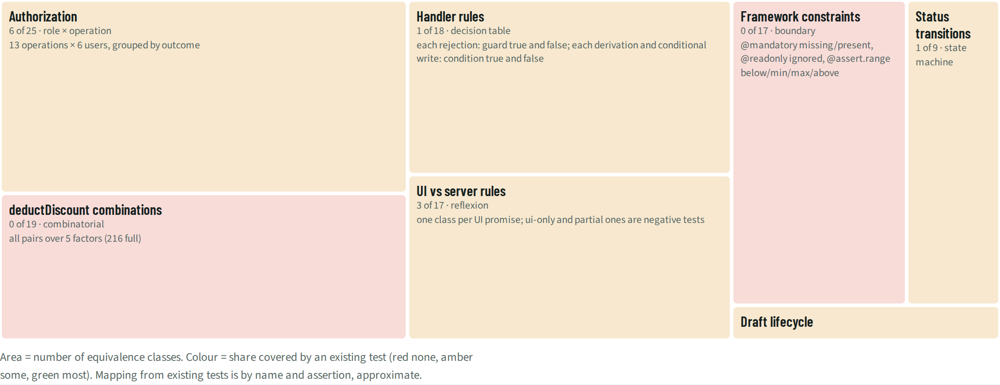
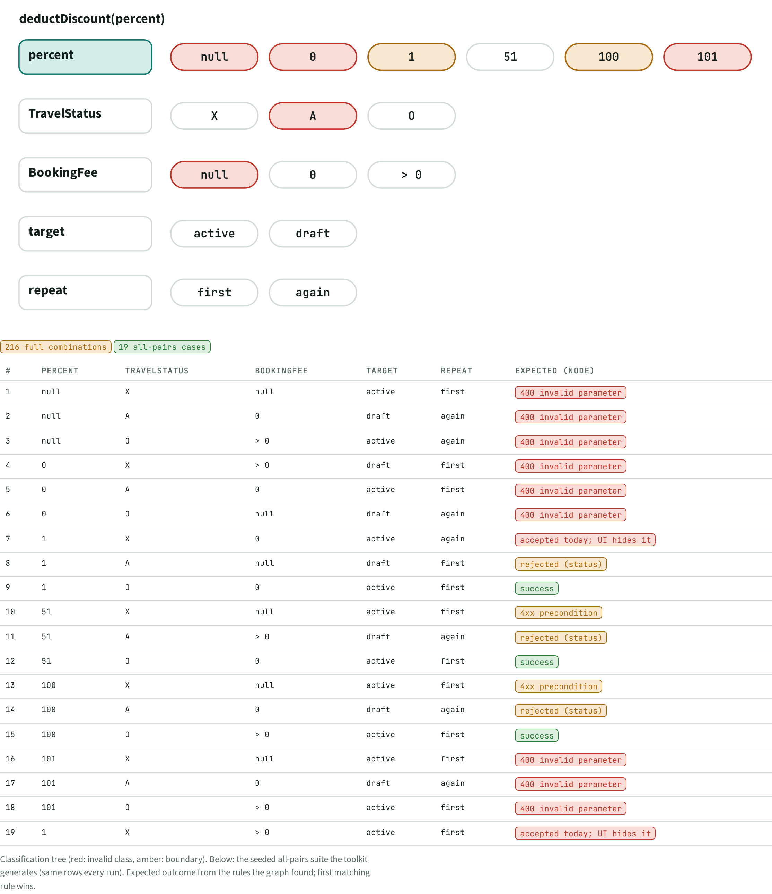
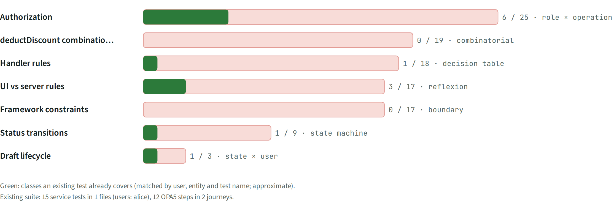

# TST · Test design

> 108 equivalence classes in 7 categories; **12 covered by existing tests**. deductDiscount: 19 all-pairs cases instead of 216.

## Facts

_Facts generated from the knowledge graph._

| Category | Technique | Classes | Covered today | How the classes were cut |
| --- | --- | --- | --- | --- |
| Authorization | role × operation | 25 | 6 | 13 operations × 6 users, grouped by outcome |
| deductDiscount combinations | combinatorial | 19 | 0 | all pairs over 5 factors (216 full) |
| Handler rules | decision table | 18 | 1 | each rejection: guard true and false; each derivation and conditional write: condition true and false |
| UI vs server rules | reflexion | 17 | 3 | one class per UI promise; ui-only and partial ones are negative tests |
| Framework constraints | boundary | 17 | 0 | @mandatory missing/present, @readonly ignored, @assert.range below/min/max/above |
| Status transitions | state machine | 9 | 1 | each action from each state |
| Draft lifecycle | state × user | 3 | 1 | new → activate, edit → discard, edit while another user holds the draft |

Total: 108 classes, 12 covered.

### deductDiscount classification tree

| Factor | Classes | Invalid | Boundary |
| --- | --- | --- | --- |
| percent | null, 0, 1, 51, 100, 101 | null, 0, 101 | 1, 100 |
| TravelStatus | X, A, O | A |  |
| BookingFee | null, 0, > 0 | null |  |
| target | active, draft |  |  |
| repeat | first, again |  |  |

Full combination: 216 cases. All-pairs suite (19 cases, seeded, identical every run):

| # | percent | TravelStatus | BookingFee | target | repeat | Expected (Node) |
| --- | --- | --- | --- | --- | --- | --- |
| 1 | null | X | null | active | first | 400 invalid parameter |
| 2 | null | A | 0 | draft | again | 400 invalid parameter |
| 3 | null | O | > 0 | active | again | 400 invalid parameter |
| 4 | 0 | X | > 0 | draft | first | 400 invalid parameter |
| 5 | 0 | A | 0 | active | first | 400 invalid parameter |
| 6 | 0 | O | null | draft | again | 400 invalid parameter |
| 7 | 1 | X | 0 | active | again | accepted today; UI hides it |
| 8 | 1 | A | null | draft | first | rejected (status) |
| 9 | 1 | O | 0 | active | first | success |
| 10 | 51 | X | null | active | first | 4xx precondition |
| 11 | 51 | A | > 0 | draft | again | rejected (status) |
| 12 | 51 | O | 0 | active | first | success |
| 13 | 100 | X | null | active | first | 4xx precondition |
| 14 | 100 | A | 0 | draft | again | rejected (status) |
| 15 | 100 | O | > 0 | active | first | success |
| 16 | 101 | X | null | active | first | 400 invalid parameter |
| 17 | 101 | A | 0 | draft | again | 400 invalid parameter |
| 18 | 101 | O | > 0 | active | first | 400 invalid parameter |
| 19 | 1 | X | > 0 | active | first | accepted today; UI hides it |

### All equivalence classes

| Category | Id | Class | Input | Expected | Today | Covered by | Request generated |
| --- | --- | --- | --- | --- | --- | --- | --- |
| Authorization | AUT:TravelAgency READ (PII: Street, PhoneNumber, EMailAddress):r | TravelAgency READ (PII: Street, PhoneNumber, EMailAddress) as anonymous/rose/martha/amy/admin/alice | user rose | 403 (today 200: open) |  |  | yes |
| Authorization | AUT:Passenger READ (PII: FirstName, LastName, Street, …):r | Passenger READ (PII: FirstName, LastName, Street, …) as anonymous/rose/martha/amy/admin/alice | user rose | 403 (today 200: open) |  |  | yes |
| Authorization | AUT:/analytics: 8 other entities READ:a | /analytics: 8 other entities READ as anonymous | user anonymous | verify |  |  |  |
| Authorization | AUT:/analytics: 8 other entities READ:y | /analytics: 8 other entities READ as rose/martha/amy/admin/alice | user rose | 200 |  |  |  |
| Authorization | AUT:Travel READ:n | Travel READ as anonymous | user anonymous | 401 |  |  | yes |
| Authorization | AUT:Travel READ:y | Travel READ as rose/martha/amy/admin/alice | user rose | 200 |  | existing test (same user + entity) | yes |
| Authorization | AUT:Travel create / edit / delete:n | Travel create / edit / delete as anonymous/rose/martha | user rose | 403 |  |  |  |
| Authorization | AUT:Travel create / edit / delete:y | Travel create / edit / delete as amy/admin/alice | user amy | 200 |  | existing test (same user + entity) |  |
| Authorization | AUT:Travel createTravelByTemplate:n | Travel createTravelByTemplate as anonymous/rose/martha | user rose | 403 |  |  |  |
| Authorization | AUT:Travel createTravelByTemplate:a | Travel createTravelByTemplate as amy/admin/alice | user amy | verify |  | existing test (same user + entity) |  |
| Authorization | AUT:Travel rejectTravel:n | Travel rejectTravel as anonymous/rose | user rose | 403 |  |  |  |
| Authorization | AUT:Travel rejectTravel:y | Travel rejectTravel as martha/amy/admin/alice | user martha | 200 |  | existing test (same user + entity) |  |
| Authorization | AUT:Travel acceptTravel:n | Travel acceptTravel as anonymous/rose | user rose | 403 |  |  |  |
| Authorization | AUT:Travel acceptTravel:y | Travel acceptTravel as martha/amy/admin/alice | user martha | 200 |  | existing test (same user + entity) |  |
| Authorization | AUT:Travel deductDiscount:n | Travel deductDiscount as anonymous/rose | user rose | 403 |  |  |  |
| Authorization | AUT:Travel deductDiscount:y | Travel deductDiscount as martha/amy/admin/alice | user martha | 200 |  | existing test (same user + entity) |  |
| Authorization | AUT:Booking / BookingSupplement (via Travel draft):n | Booking / BookingSupplement (via Travel draft) as anonymous | user anonymous | 401 |  |  |  |
| Authorization | AUT:Booking / BookingSupplement (via Travel draft):a | Booking / BookingSupplement (via Travel draft) as rose/martha | user rose | verify |  |  |  |
| Authorization | AUT:Booking / BookingSupplement (via Travel draft):y | Booking / BookingSupplement (via Travel draft) as amy/admin/alice | user amy | 200 |  |  |  |
| Authorization | AUT:TravelAgency READ (PII: Street, PhoneNumber, EMailAddress):r | TravelAgency READ (PII: Street, PhoneNumber, EMailAddress) as anonymous/rose/martha | user rose | 403 (today 200: open) |  |  | yes |
| Authorization | AUT:TravelAgency READ (PII: Street, PhoneNumber, EMailAddress):y | TravelAgency READ (PII: Street, PhoneNumber, EMailAddress) as amy/admin/alice | user amy | 200 |  |  | yes |
| Authorization | AUT:Passenger READ (PII: FirstName, LastName, Street, …):r | Passenger READ (PII: FirstName, LastName, Street, …) as anonymous/rose/martha | user rose | 403 (today 200: open) |  |  | yes |
| Authorization | AUT:Passenger READ (PII: FirstName, LastName, Street, …):y | Passenger READ (PII: FirstName, LastName, Street, …) as amy/admin/alice | user amy | 200 |  |  | yes |
| Authorization | AUT:/processor: 8 other entities READ:a | /processor: 8 other entities READ as anonymous | user anonymous | verify |  |  |  |
| Authorization | AUT:/processor: 8 other entities READ:y | /processor: 8 other entities READ as rose/martha/amy/admin/alice | user rose | 200 |  |  |  |
| UI vs server rules | UIS:rejectTravel:X | rejectTravel on TravelStatus = X (UI hides it) | Travel "56657221A8E4645C17002DF03754AB66" | 4xx rejection | accepted (UI-only rule) |  | yes |
| UI vs server rules | UIS:acceptTravel:A | acceptTravel on TravelStatus = A (UI hides it) | Travel "59657221A8E4645C17002DF03754AB66" | 4xx rejection | accepted (UI-only rule) |  | yes |
| UI vs server rules | UIS:deductDiscount:X | deductDiscount on TravelStatus = X (UI hides it) | Travel "56657221A8E4645C17002DF03754AB66" | 4xx rejection | accepted (UI-only rule) | test/odata.test.ts: "deduct discount multiple times does not end up in error" | yes |
| UI vs server rules | UIS:deductDiscount:A | deductDiscount on TravelStatus = A (UI hides it) | Travel "59657221A8E4645C17002DF03754AB66" | 4xx rejection | rejected | test/odata.test.ts: "deduct discount multiple times does not end up in error" | yes |
| UI vs server rules | UIS:field-control:Travel | Travel: 5 fields controlled by TravelStatus.fieldControl — bypass via OData | PATCH/POST on a non-open instance | 4xx rejection | accepted (UI-only rule) |  |  |
| UI vs server rules | UIS:side-effects:Travel:5 | Travel: BookingFee → re-read TotalPrice, GreenFee, TreesPlanted | side-effects | targets recomputed |  | test/odata.test.ts: "re-calculates totals after booking fee changed" |  |
| UI vs server rules | UIS:side-effects:Travel:6 | Travel: GoGreen → re-read TotalPrice, GreenFee, TreesPlanted | side-effects | targets recomputed |  |  |  |
| UI vs server rules | UIS:side-effects:Travel:7 | Travel: to_Booking → re-read TotalPrice | side-effects | targets recomputed |  |  |  |
| UI vs server rules | UIS:assert.range:Travel:8 | Travel: percent in [1, 100] | assert.range | CAP rejects / ignores |  |  |  |
| UI vs server rules | UIS:readonly:Travel:9 | Travel: TravelID, TotalPrice, TravelStatus, GreenFee, TreesPlanted | readonly | CAP rejects / ignores |  |  |  |
| UI vs server rules | UIS:mandatory:Travel:10 | Travel: BeginDate, EndDate, to_Agency, to_Customer | mandatory | CAP rejects / ignores |  |  |  |
| UI vs server rules | UIS:field-control:Booking | Booking: 6 fields controlled by to_Travel.TravelStatus.fieldControl — bypass via OData | PATCH/POST on a non-open instance | 4xx rejection | accepted (UI-only rule) |  |  |
| UI vs server rules | UIS:CreateHidden:Booking | Booking: hidden when to_Travel.TravelStatus.code != #Open — bypass via OData | PATCH/POST on a non-open instance | 4xx rejection | accepted (UI-only rule) |  |  |
| UI vs server rules | UIS:DeleteHidden:Booking | Booking: hidden when to_Travel.TravelStatus.code != #Open — bypass via OData | PATCH/POST on a non-open instance | 4xx rejection | accepted (UI-only rule) |  |  |
| UI vs server rules | UIS:mandatory:Booking:14 | Booking: ConnectionID, FlightDate, FlightPrice, BookingStatus, to_Carrier, to_Customer | mandatory | CAP rejects / ignores |  |  |  |
| UI vs server rules | UIS:field-control:BookingSupplement | BookingSupplement: 4 fields controlled by to_Travel.TravelStatus.fieldControl — bypass via OData | PATCH/POST on a non-open instance | 4xx rejection | accepted (UI-only rule) |  |  |
| UI vs server rules | UIS:mandatory:BookingSupplement:16 | BookingSupplement: Price, to_Supplement | mandatory | CAP rejects / ignores |  |  |  |
| Status transitions | STA:rejectTravel:X | rejectTravel from X | TravelStatus=X | rejected | → X |  |  |
| Status transitions | STA:rejectTravel:A | rejectTravel from A | TravelStatus=A | → X | → X |  |  |
| Status transitions | STA:rejectTravel:O | rejectTravel from O | TravelStatus=O | → X | → X |  |  |
| Status transitions | STA:acceptTravel:X | acceptTravel from X | TravelStatus=X | → A | → A |  |  |
| Status transitions | STA:acceptTravel:A | acceptTravel from A | TravelStatus=A | rejected | → A |  |  |
| Status transitions | STA:acceptTravel:O | acceptTravel from O | TravelStatus=O | → A | → A |  |  |
| Status transitions | STA:deductDiscount:X | deductDiscount from X | TravelStatus=X | rejected | → X |  |  |
| Status transitions | STA:deductDiscount:A | deductDiscount from A | TravelStatus=A | rejected | rejected |  |  |
| Status transitions | STA:deductDiscount:O | deductDiscount from O | TravelStatus=O | → O | → O | test/odata.test.ts: "deduct discount multiple times does not end up in error" |  |
| Handler rules | RUL:rule:srv/travel-service.ts:18:t | before CREATE Travel: derive TravelID | always | TravelID = ++maxID |  |  |  |
| Handler rules | RUL:rule:srv/travel-service.ts:23:t | before NEW Booking: derive BookingID | always | BookingID = ++maxID |  |  |  |
| Handler rules | RUL:rule:srv/travel-service.ts:24:t | before NEW Booking: derive BookingDate | always | BookingDate = today() |  |  |  |
| Handler rules | RUL:rule:srv/travel-service.ts:29:t | before NEW BookingSupplement: derive BookingSupplementID | always | BookingSupplementID = ++maxID |  |  |  |
| Handler rules | RUL:rule:srv/travel-service.ts:36:t | before SAVE Travel: Begin Date must not be before today. | BeginDate < today() | 400 "Begin Date must not be before today." |  |  |  |
| Handler rules | RUL:rule:srv/travel-service.ts:36:f | before SAVE Travel: guard false | !(BeginDate < today()) | passes |  |  |  |
| Handler rules | RUL:rule:srv/travel-service.ts:37:t | before SAVE Travel: End Date must be after Begin Date. | BeginDate > EndDate | 400 "End Date must be after Begin Date." |  |  |  |
| Handler rules | RUL:rule:srv/travel-service.ts:37:f | before SAVE Travel: guard false | !(BeginDate > EndDate) | passes |  |  |  |
| Handler rules | RUL:rule:srv/travel-service.ts:93:t | before acceptTravel/rejectTravel Travel: The travel is locked by ${existingDraft.InProcessByUser}. | !isDraft && existingDraft \|\| isDraft && existingDraft?.InProcessByUser !== req.user.id | 423 "The travel is locked by ${existingDraft.InProcessByUser}." |  |  |  |
| Handler rules | RUL:rule:srv/travel-service.ts:93:f | before acceptTravel/rejectTravel Travel: guard false | !(!isDraft && existingDraft \|\| isDraft && existingDraft?.InProcessByUser !== req.user.id) | passes |  |  |  |
| Handler rules | RUL:rule:srv/travel-service.ts:99:t | on deductDiscount Travel: write when TravelStatus.code != 'A' and BookingFee != null | TravelStatus.code != 'A' and BookingFee != null | row updated |  | app/travel_processor/webapp/test/integration/OpaJourney.js: "#3: List report: Create travel" |  |
| Handler rules | RUL:rule:srv/travel-service.ts:99:f | on deductDiscount Travel: no write | !(TravelStatus.code != 'A' and BookingFee != null) | nothing updated, error explains why |  |  |  |
| Handler rules | RUL:rule:srv/travel-service.ts:105:t | on deductDiscount Travel: Travel "${travel.ID}" does not exist; may have been deleted meanwhile. | !succeeded && !travel | 404 "Travel "${travel.ID}" does not exist; may have been deleted " |  |  |  |
| Handler rules | RUL:rule:srv/travel-service.ts:105:f | on deductDiscount Travel: guard false | !(!succeeded && !travel) | passes |  |  |  |
| Handler rules | RUL:rule:srv/travel-service.ts:106:t | on deductDiscount Travel: Travel "${travel.ID}" has been approved already. | !succeeded && travel.status === TravelStatusCode.Accepted | 400 "Travel "${travel.ID}" has been approved already." |  |  |  |
| Handler rules | RUL:rule:srv/travel-service.ts:106:f | on deductDiscount Travel: guard false | !(!succeeded && travel.status === TravelStatusCode.Accepted) | passes |  |  |  |
| Handler rules | RUL:rule:srv/travel-service.ts:107:t | on deductDiscount Travel: No discount possible, as travel "${travel.ID}" does not yet have a booking fee added. | !succeeded && travel.BookingFee == null | 404 "No discount possible, as travel "${travel.ID}" does not yet " |  |  |  |
| Handler rules | RUL:rule:srv/travel-service.ts:107:f | on deductDiscount Travel: guard false | !(!succeeded && travel.BookingFee == null) | passes |  |  |  |
| Framework constraints | FW:deductDiscount:below min | deductDiscount: percent below min | below min | 400 out of range |  |  |  |
| Framework constraints | FW:deductDiscount:min | deductDiscount: percent min | min | accepted |  |  |  |
| Framework constraints | FW:deductDiscount:max | deductDiscount: percent max | max | accepted |  |  |  |
| Framework constraints | FW:deductDiscount:above max | deductDiscount: percent above max | above max | 400 out of range |  |  |  |
| Framework constraints | FW:TravelService.Travel:ro | Travel: write TravelID, TotalPrice, TravelStatus, GreenFee, TreesPlanted | client sends read-only fields | values ignored |  |  |  |
| Framework constraints | FW:TravelService.Travel:BeginDate | Travel: save without BeginDate | BeginDate missing | 400 on activate |  |  |  |
| Framework constraints | FW:TravelService.Travel:EndDate | Travel: save without EndDate | EndDate missing | 400 on activate |  |  |  |
| Framework constraints | FW:TravelService.Travel:to_Agency | Travel: save without to_Agency | to_Agency missing | 400 on activate |  |  |  |
| Framework constraints | FW:TravelService.Travel:to_Customer | Travel: save without to_Customer | to_Customer missing | 400 on activate |  |  |  |
| Framework constraints | FW:TravelService.Booking:ConnectionID | Booking: save without ConnectionID | ConnectionID missing | 400 on activate |  |  |  |
| Framework constraints | FW:TravelService.Booking:FlightDate | Booking: save without FlightDate | FlightDate missing | 400 on activate |  |  |  |
| Framework constraints | FW:TravelService.Booking:FlightPrice | Booking: save without FlightPrice | FlightPrice missing | 400 on activate |  |  |  |
| Framework constraints | FW:TravelService.Booking:BookingStatus | Booking: save without BookingStatus | BookingStatus missing | 400 on activate |  |  |  |
| Framework constraints | FW:TravelService.Booking:to_Carrier | Booking: save without to_Carrier | to_Carrier missing | 400 on activate |  |  |  |
| Framework constraints | FW:TravelService.Booking:to_Customer | Booking: save without to_Customer | to_Customer missing | 400 on activate |  |  |  |
| Framework constraints | FW:TravelService.BookingSupplement:Price | BookingSupplement: save without Price | Price missing | 400 on activate |  |  |  |
| Framework constraints | FW:TravelService.BookingSupplement:to_Supplement | BookingSupplement: save without to_Supplement | to_Supplement missing | 400 on activate |  |  |  |
| Draft lifecycle | DRF:TravelService.Travel:new-activate | Travel: new → activate | new-activate | active row created |  | app/travel_processor/webapp/test/integration/OpaJourney.js: "#3: List report: Create travel" |  |
| Draft lifecycle | DRF:TravelService.Travel:edit-discard | Travel: edit → discard | edit-discard | active row unchanged |  |  |  |
| Draft lifecycle | DRF:TravelService.Travel:foreign-lock | Travel: foreign → lock | foreign-lock | 423 / locked |  |  |  |
| deductDiscount combinations | CMB:deductDiscount:1 | percent=null, TravelStatus=X, BookingFee=null, target=active, repeat=first | percent=null, TravelStatus=X, BookingFee=null, target=active, repeat=first | 400 invalid parameter |  |  |  |
| deductDiscount combinations | CMB:deductDiscount:2 | percent=null, TravelStatus=A, BookingFee=0, target=draft, repeat=again | percent=null, TravelStatus=A, BookingFee=0, target=draft, repeat=again | 400 invalid parameter |  |  |  |
| deductDiscount combinations | CMB:deductDiscount:3 | percent=null, TravelStatus=O, BookingFee=> 0, target=active, repeat=again | percent=null, TravelStatus=O, BookingFee=> 0, target=active, repeat=again | 400 invalid parameter |  |  |  |
| deductDiscount combinations | CMB:deductDiscount:4 | percent=0, TravelStatus=X, BookingFee=> 0, target=draft, repeat=first | percent=0, TravelStatus=X, BookingFee=> 0, target=draft, repeat=first | 400 invalid parameter |  |  |  |
| deductDiscount combinations | CMB:deductDiscount:5 | percent=0, TravelStatus=A, BookingFee=0, target=active, repeat=first | percent=0, TravelStatus=A, BookingFee=0, target=active, repeat=first | 400 invalid parameter |  |  |  |
| deductDiscount combinations | CMB:deductDiscount:6 | percent=0, TravelStatus=O, BookingFee=null, target=draft, repeat=again | percent=0, TravelStatus=O, BookingFee=null, target=draft, repeat=again | 400 invalid parameter |  |  |  |
| deductDiscount combinations | CMB:deductDiscount:7 | percent=1, TravelStatus=X, BookingFee=0, target=active, repeat=again | percent=1, TravelStatus=X, BookingFee=0, target=active, repeat=again | accepted today; UI hides it |  |  |  |
| deductDiscount combinations | CMB:deductDiscount:8 | percent=1, TravelStatus=A, BookingFee=null, target=draft, repeat=first | percent=1, TravelStatus=A, BookingFee=null, target=draft, repeat=first | rejected (status) |  |  |  |
| deductDiscount combinations | CMB:deductDiscount:9 | percent=1, TravelStatus=O, BookingFee=0, target=active, repeat=first | percent=1, TravelStatus=O, BookingFee=0, target=active, repeat=first | success |  |  |  |
| deductDiscount combinations | CMB:deductDiscount:10 | percent=51, TravelStatus=X, BookingFee=null, target=active, repeat=first | percent=51, TravelStatus=X, BookingFee=null, target=active, repeat=first | 4xx precondition |  |  |  |
| deductDiscount combinations | CMB:deductDiscount:11 | percent=51, TravelStatus=A, BookingFee=> 0, target=draft, repeat=again | percent=51, TravelStatus=A, BookingFee=> 0, target=draft, repeat=again | rejected (status) |  |  |  |
| deductDiscount combinations | CMB:deductDiscount:12 | percent=51, TravelStatus=O, BookingFee=0, target=active, repeat=first | percent=51, TravelStatus=O, BookingFee=0, target=active, repeat=first | success |  |  |  |
| deductDiscount combinations | CMB:deductDiscount:13 | percent=100, TravelStatus=X, BookingFee=null, target=active, repeat=first | percent=100, TravelStatus=X, BookingFee=null, target=active, repeat=first | 4xx precondition |  |  |  |
| deductDiscount combinations | CMB:deductDiscount:14 | percent=100, TravelStatus=A, BookingFee=0, target=draft, repeat=again | percent=100, TravelStatus=A, BookingFee=0, target=draft, repeat=again | rejected (status) |  |  |  |
| deductDiscount combinations | CMB:deductDiscount:15 | percent=100, TravelStatus=O, BookingFee=> 0, target=active, repeat=first | percent=100, TravelStatus=O, BookingFee=> 0, target=active, repeat=first | success |  |  |  |
| deductDiscount combinations | CMB:deductDiscount:16 | percent=101, TravelStatus=X, BookingFee=null, target=active, repeat=first | percent=101, TravelStatus=X, BookingFee=null, target=active, repeat=first | 400 invalid parameter |  |  |  |
| deductDiscount combinations | CMB:deductDiscount:17 | percent=101, TravelStatus=A, BookingFee=0, target=draft, repeat=again | percent=101, TravelStatus=A, BookingFee=0, target=draft, repeat=again | 400 invalid parameter |  |  |  |
| deductDiscount combinations | CMB:deductDiscount:18 | percent=101, TravelStatus=O, BookingFee=> 0, target=active, repeat=first | percent=101, TravelStatus=O, BookingFee=> 0, target=active, repeat=first | 400 invalid parameter |  |  |  |
| deductDiscount combinations | CMB:deductDiscount:19 | percent=1, TravelStatus=X, BookingFee=> 0, target=active, repeat=first | percent=1, TravelStatus=X, BookingFee=> 0, target=active, repeat=first | accepted today; UI hides it |  |  |  |

## Views

**TST-A Coverage treemap**

**TST-B deductDiscount classes**

**TST-C Coverage bars**

[Back to the index](../README.md)
