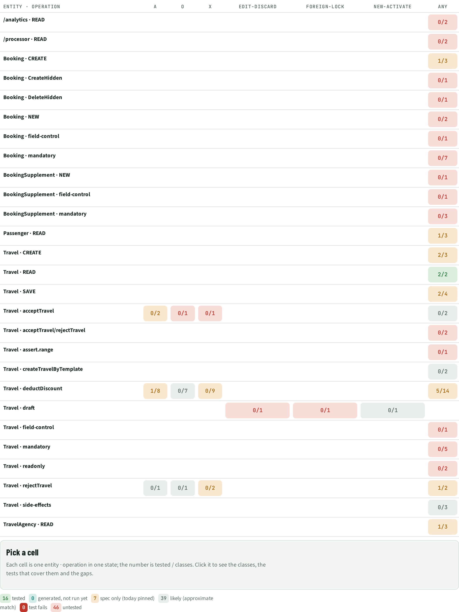
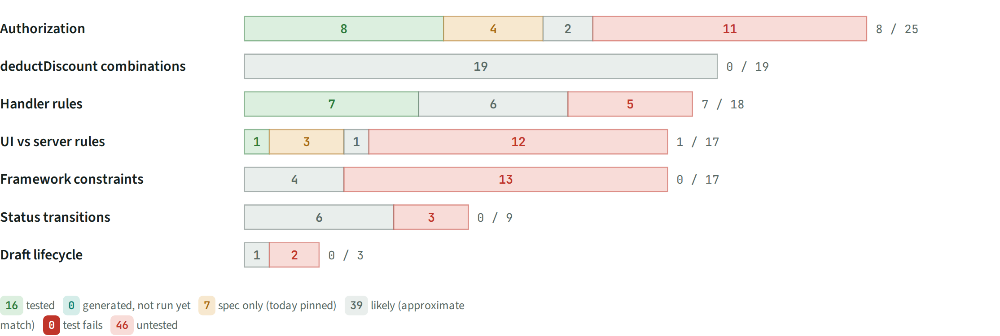
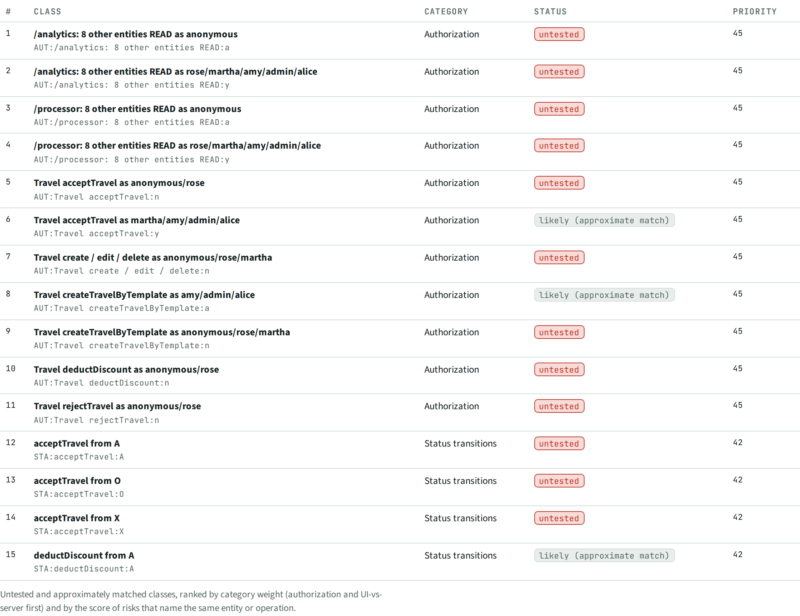

# COV · Coverage by class

> 16 of 108 classes tested (**15%**) by tests that ran in CI; 7 pin today's behaviour with the intended one waiting as a spec test, 0 generated but not run yet, 39 likely (approximate match), **46 untested**.

## Facts

_Facts curated from the deep read (not yet generated)._

16 of 108 classes tested (15%). Statuses include the results of the generated and existing tests from the CI run.

Legend: ✅ tested · 🧪 generated, not run yet · 🟡 spec only (today pinned) · 〰️ likely (approximate match) · ❌ test fails · ⬜ untested. A cell shows tested / classes.

### Heatmap: entity · operation × state

| Entity · operation | A | O | X | edit-discard | foreign-lock | new-activate | any |
| --- | --- | --- | --- | --- | --- | --- | --- |
| /analytics · READ |  |  |  |  |  |  | ⬜ 0/2 |
| /processor · READ |  |  |  |  |  |  | ⬜ 0/2 |
| Booking · CREATE |  |  |  |  |  |  | 🟡 1/3 |
| Booking · CreateHidden |  |  |  |  |  |  | ⬜ 0/1 |
| Booking · DeleteHidden |  |  |  |  |  |  | ⬜ 0/1 |
| Booking · NEW |  |  |  |  |  |  | ⬜ 0/2 |
| Booking · field-control |  |  |  |  |  |  | ⬜ 0/1 |
| Booking · mandatory |  |  |  |  |  |  | ⬜ 0/7 |
| BookingSupplement · NEW |  |  |  |  |  |  | ⬜ 0/1 |
| BookingSupplement · field-control |  |  |  |  |  |  | ⬜ 0/1 |
| BookingSupplement · mandatory |  |  |  |  |  |  | ⬜ 0/3 |
| Passenger · READ |  |  |  |  |  |  | 🟡 1/3 |
| Travel · CREATE |  |  |  |  |  |  | 🟡 2/3 |
| Travel · READ |  |  |  |  |  |  | ✅ 2/2 |
| Travel · SAVE |  |  |  |  |  |  | 〰️ 2/4 |
| Travel · acceptTravel | ⬜ 0/2 | ⬜ 0/1 | ⬜ 0/1 |  |  |  | ⬜ 0/2 |
| Travel · acceptTravel/rejectTravel |  |  |  |  |  |  | ⬜ 0/2 |
| Travel · assert.range |  |  |  |  |  |  | ⬜ 0/1 |
| Travel · createTravelByTemplate |  |  |  |  |  |  | ⬜ 0/2 |
| Travel · deductDiscount | 〰️ 1/8 | 〰️ 0/7 | 〰️ 0/9 |  |  |  | 🟡 5/14 |
| Travel · draft |  |  |  | ⬜ 0/1 | ⬜ 0/1 | 〰️ 0/1 |  |
| Travel · field-control |  |  |  |  |  |  | ⬜ 0/1 |
| Travel · mandatory |  |  |  |  |  |  | ⬜ 0/5 |
| Travel · readonly |  |  |  |  |  |  | ⬜ 0/2 |
| Travel · rejectTravel | 〰️ 0/1 | 〰️ 0/1 | 〰️ 0/2 |  |  |  | 🟡 1/2 |
| Travel · side-effects |  |  |  |  |  |  | ⬜ 0/3 |
| TravelAgency · READ |  |  |  |  |  |  | 🟡 1/3 |

### Status per category

| Category | tested | generated, not run yet | spec only (today pinned) | likely (approximate match) | test fails | untested |
| --- | --- | --- | --- | --- | --- | --- |
| Authorization | 8 | 0 | 4 | 2 | 0 | 11 |
| UI vs server rules | 1 | 0 | 3 | 1 | 0 | 12 |
| Status transitions | 0 | 0 | 0 | 6 | 0 | 3 |
| Handler rules | 7 | 0 | 0 | 6 | 0 | 5 |
| Framework constraints | 0 | 0 | 0 | 4 | 0 | 13 |
| Draft lifecycle | 0 | 0 | 0 | 1 | 0 | 2 |
| deductDiscount combinations | 0 | 0 | 0 | 19 | 0 | 0 |

### Test next

| # | Class | Category | Status | Priority |
| --- | --- | --- | --- | --- |
| 1 | `AUT:/analytics: 8 other entities READ:a` /analytics: 8 other entities READ as anonymous | Authorization | untested | 45 |
| 2 | `AUT:/analytics: 8 other entities READ:y` /analytics: 8 other entities READ as rose/martha/amy/admin/alice | Authorization | untested | 45 |
| 3 | `AUT:/processor: 8 other entities READ:a` /processor: 8 other entities READ as anonymous | Authorization | untested | 45 |
| 4 | `AUT:/processor: 8 other entities READ:y` /processor: 8 other entities READ as rose/martha/amy/admin/alice | Authorization | untested | 45 |
| 5 | `AUT:Travel acceptTravel:n` Travel acceptTravel as anonymous/rose | Authorization | untested | 45 |
| 6 | `AUT:Travel acceptTravel:y` Travel acceptTravel as martha/amy/admin/alice | Authorization | likely (approximate match) | 45 |
| 7 | `AUT:Travel create / edit / delete:n` Travel create / edit / delete as anonymous/rose/martha | Authorization | untested | 45 |
| 8 | `AUT:Travel createTravelByTemplate:a` Travel createTravelByTemplate as amy/admin/alice | Authorization | likely (approximate match) | 45 |
| 9 | `AUT:Travel createTravelByTemplate:n` Travel createTravelByTemplate as anonymous/rose/martha | Authorization | untested | 45 |
| 10 | `AUT:Travel deductDiscount:n` Travel deductDiscount as anonymous/rose | Authorization | untested | 45 |
| 11 | `AUT:Travel rejectTravel:n` Travel rejectTravel as anonymous/rose | Authorization | untested | 45 |
| 12 | `STA:acceptTravel:A` acceptTravel from A | Status transitions | untested | 42 |
| 13 | `STA:acceptTravel:O` acceptTravel from O | Status transitions | untested | 42 |
| 14 | `STA:acceptTravel:X` acceptTravel from X | Status transitions | untested | 42 |
| 15 | `STA:deductDiscount:A` deductDiscount from A | Status transitions | likely (approximate match) | 42 |

### Every class

| Class | Entity · op | State | Status | Tests | Existing requests | Name match |
| --- | --- | --- | --- | --- | --- | --- |
| `AUT:TravelAgency READ (PII: Street, PhoneNumber, EMailAddress):r` | TravelAgency · READ |  | 🟡 spec only (today pinned) | today: passed, spec: pending, today: passed, spec: pending |  |  |
| `AUT:Passenger READ (PII: FirstName, LastName, Street, …):r` | Passenger · READ |  | 🟡 spec only (today pinned) | today: passed, spec: pending, today: passed, spec: pending |  |  |
| `AUT:/analytics: 8 other entities READ:a` | /analytics · READ |  | ⬜ untested |  |  |  |
| `AUT:/analytics: 8 other entities READ:y` | /analytics · READ |  | ⬜ untested |  |  |  |
| `AUT:Travel READ:n` | Travel · READ |  | ✅ tested | today: passed |  |  |
| `AUT:Travel READ:y` | Travel · READ |  | ✅ tested | today: passed | `test/odata.test.ts:52`, `test/odata.test.ts:76`, `test/odata.test.ts:85` | existing test (same user + entity) |
| `AUT:Travel create / edit / delete:n` | Travel · CREATE |  | ⬜ untested |  |  |  |
| `AUT:Travel create / edit / delete:y` | Travel · CREATE |  | ✅ tested |  | `test/odata.test.ts:117`, `test/odata.test.ts:121`, `test/odata.test.ts:148` | existing test (same user + entity) |
| `AUT:Travel createTravelByTemplate:n` | Travel · createTravelByTemplate |  | ⬜ untested |  |  |  |
| `AUT:Travel createTravelByTemplate:a` | Travel · createTravelByTemplate |  | 〰️ likely (approximate match) |  |  | existing test (same user + entity) |
| `AUT:Travel rejectTravel:n` | Travel · rejectTravel |  | ⬜ untested |  |  |  |
| `AUT:Travel rejectTravel:y` | Travel · rejectTravel |  | ✅ tested |  | `test/odata.test.ts:147` | existing test (same user + entity) |
| `AUT:Travel acceptTravel:n` | Travel · acceptTravel |  | ⬜ untested |  |  |  |
| `AUT:Travel acceptTravel:y` | Travel · acceptTravel |  | 〰️ likely (approximate match) |  |  | existing test (same user + entity) |
| `AUT:Travel deductDiscount:n` | Travel · deductDiscount |  | ⬜ untested |  |  |  |
| `AUT:Travel deductDiscount:y` | Travel · deductDiscount |  | ✅ tested |  | `test/odata.test.ts:214` | existing test (same user + entity) |
| `AUT:Booking / BookingSupplement (via Travel draft):n` | Booking · CREATE |  | ⬜ untested |  |  |  |
| `AUT:Booking / BookingSupplement (via Travel draft):a` | Booking · CREATE |  | ⬜ untested |  |  |  |
| `AUT:Booking / BookingSupplement (via Travel draft):y` | Booking · CREATE |  | ✅ tested |  | `test/odata.test.ts:155` |  |
| `AUT:TravelAgency READ (PII: Street, PhoneNumber, EMailAddress):r` | TravelAgency · READ |  | 🟡 spec only (today pinned) | today: passed, spec: pending, today: passed, spec: pending |  |  |
| `AUT:TravelAgency READ (PII: Street, PhoneNumber, EMailAddress):y` | TravelAgency · READ |  | ✅ tested | today: passed |  |  |
| `AUT:Passenger READ (PII: FirstName, LastName, Street, …):r` | Passenger · READ |  | 🟡 spec only (today pinned) | today: passed, spec: pending, today: passed, spec: pending |  |  |
| `AUT:Passenger READ (PII: FirstName, LastName, Street, …):y` | Passenger · READ |  | ✅ tested | today: passed |  |  |
| `AUT:/processor: 8 other entities READ:a` | /processor · READ |  | ⬜ untested |  |  |  |
| `AUT:/processor: 8 other entities READ:y` | /processor · READ |  | ⬜ untested |  |  |  |
| `UIS:rejectTravel:X` | Travel · rejectTravel | X | 🟡 spec only (today pinned) | today: passed, spec: pending | `test/odata.test.ts:147` |  |
| `UIS:acceptTravel:A` | Travel · acceptTravel | A | 🟡 spec only (today pinned) | today: passed, spec: pending |  |  |
| `UIS:deductDiscount:X` | Travel · deductDiscount | X | 🟡 spec only (today pinned) | today: passed, spec: pending | `test/odata.test.ts:214` | test/odata.test.ts: "deduct discount multiple times does not end up in error" |
| `UIS:deductDiscount:A` | Travel · deductDiscount | A | ✅ tested | today: passed | `test/odata.test.ts:214` | test/odata.test.ts: "deduct discount multiple times does not end up in error" |
| `UIS:field-control:Travel` | Travel · field-control |  | ⬜ untested |  |  |  |
| `UIS:side-effects:Travel:5` | Travel · side-effects |  | 〰️ likely (approximate match) |  |  | test/odata.test.ts: "re-calculates totals after booking fee changed" |
| `UIS:side-effects:Travel:6` | Travel · side-effects |  | ⬜ untested |  |  |  |
| `UIS:side-effects:Travel:7` | Travel · side-effects |  | ⬜ untested |  |  |  |
| `UIS:assert.range:Travel:8` | Travel · assert.range |  | ⬜ untested |  |  |  |
| `UIS:readonly:Travel:9` | Travel · readonly |  | ⬜ untested |  |  |  |
| `UIS:mandatory:Travel:10` | Travel · mandatory |  | ⬜ untested |  |  |  |
| `UIS:field-control:Booking` | Booking · field-control |  | ⬜ untested |  |  |  |
| `UIS:CreateHidden:Booking` | Booking · CreateHidden |  | ⬜ untested |  |  |  |
| `UIS:DeleteHidden:Booking` | Booking · DeleteHidden |  | ⬜ untested |  |  |  |
| `UIS:mandatory:Booking:14` | Booking · mandatory |  | ⬜ untested |  |  |  |
| `UIS:field-control:BookingSupplement` | BookingSupplement · field-control |  | ⬜ untested |  |  |  |
| `UIS:mandatory:BookingSupplement:16` | BookingSupplement · mandatory |  | ⬜ untested |  |  |  |
| `STA:rejectTravel:X` | Travel · rejectTravel | X | 〰️ likely (approximate match) |  | `test/odata.test.ts:147` |  |
| `STA:rejectTravel:A` | Travel · rejectTravel | A | 〰️ likely (approximate match) |  | `test/odata.test.ts:147` |  |
| `STA:rejectTravel:O` | Travel · rejectTravel | O | 〰️ likely (approximate match) |  | `test/odata.test.ts:147` |  |
| `STA:acceptTravel:X` | Travel · acceptTravel | X | ⬜ untested |  |  |  |
| `STA:acceptTravel:A` | Travel · acceptTravel | A | ⬜ untested |  |  |  |
| `STA:acceptTravel:O` | Travel · acceptTravel | O | ⬜ untested |  |  |  |
| `STA:deductDiscount:X` | Travel · deductDiscount | X | 〰️ likely (approximate match) |  | `test/odata.test.ts:214` |  |
| `STA:deductDiscount:A` | Travel · deductDiscount | A | 〰️ likely (approximate match) |  | `test/odata.test.ts:214` |  |
| `STA:deductDiscount:O` | Travel · deductDiscount | O | 〰️ likely (approximate match) |  | `test/odata.test.ts:214` | test/odata.test.ts: "deduct discount multiple times does not end up in error" |
| `RUL:rule:srv/travel-service.ts:18:t` | Travel · CREATE |  | ✅ tested |  | `test/odata.test.ts:117`, `test/odata.test.ts:121`, `test/odata.test.ts:148` |  |
| `RUL:rule:srv/travel-service.ts:23:t` | Booking · NEW |  | ⬜ untested |  |  |  |
| `RUL:rule:srv/travel-service.ts:24:t` | Booking · NEW |  | ⬜ untested |  |  |  |
| `RUL:rule:srv/travel-service.ts:29:t` | BookingSupplement · NEW |  | ⬜ untested |  |  |  |
| `RUL:rule:srv/travel-service.ts:36:t` | Travel · SAVE |  | ✅ tested |  | `test/odata.test.ts:117` |  |
| `RUL:rule:srv/travel-service.ts:36:f` | Travel · SAVE |  | 〰️ likely (approximate match) |  | `test/odata.test.ts:117` |  |
| `RUL:rule:srv/travel-service.ts:37:t` | Travel · SAVE |  | ✅ tested |  | `test/odata.test.ts:117` |  |
| `RUL:rule:srv/travel-service.ts:37:f` | Travel · SAVE |  | 〰️ likely (approximate match) |  | `test/odata.test.ts:117` |  |
| `RUL:rule:srv/travel-service.ts:93:t` | Travel · acceptTravel/rejectTravel |  | ⬜ untested |  |  |  |
| `RUL:rule:srv/travel-service.ts:93:f` | Travel · acceptTravel/rejectTravel |  | ⬜ untested |  |  |  |
| `RUL:rule:srv/travel-service.ts:99:t` | Travel · deductDiscount |  | ✅ tested |  | `test/odata.test.ts:214` | app/travel_processor/webapp/test/integration/OpaJourney.js: "#3: List report: Create travel" |
| `RUL:rule:srv/travel-service.ts:99:f` | Travel · deductDiscount |  | 〰️ likely (approximate match) |  | `test/odata.test.ts:214` |  |
| `RUL:rule:srv/travel-service.ts:105:t` | Travel · deductDiscount |  | ✅ tested |  | `test/odata.test.ts:214` |  |
| `RUL:rule:srv/travel-service.ts:105:f` | Travel · deductDiscount |  | 〰️ likely (approximate match) |  | `test/odata.test.ts:214` |  |
| `RUL:rule:srv/travel-service.ts:106:t` | Travel · deductDiscount |  | ✅ tested |  | `test/odata.test.ts:214` |  |
| `RUL:rule:srv/travel-service.ts:106:f` | Travel · deductDiscount |  | 〰️ likely (approximate match) |  | `test/odata.test.ts:214` |  |
| `RUL:rule:srv/travel-service.ts:107:t` | Travel · deductDiscount |  | ✅ tested |  | `test/odata.test.ts:214` |  |
| `RUL:rule:srv/travel-service.ts:107:f` | Travel · deductDiscount |  | 〰️ likely (approximate match) |  | `test/odata.test.ts:214` |  |
| `FW:deductDiscount:below min` | Travel · deductDiscount |  | 〰️ likely (approximate match) |  | `test/odata.test.ts:214` |  |
| `FW:deductDiscount:min` | Travel · deductDiscount |  | 〰️ likely (approximate match) |  | `test/odata.test.ts:214` |  |
| `FW:deductDiscount:max` | Travel · deductDiscount |  | 〰️ likely (approximate match) |  | `test/odata.test.ts:214` |  |
| `FW:deductDiscount:above max` | Travel · deductDiscount |  | 〰️ likely (approximate match) |  | `test/odata.test.ts:214` |  |
| `FW:TravelService.Travel:ro` | Travel · readonly |  | ⬜ untested |  |  |  |
| `FW:TravelService.Travel:BeginDate` | Travel · mandatory |  | ⬜ untested |  |  |  |
| `FW:TravelService.Travel:EndDate` | Travel · mandatory |  | ⬜ untested |  |  |  |
| `FW:TravelService.Travel:to_Agency` | Travel · mandatory |  | ⬜ untested |  |  |  |
| `FW:TravelService.Travel:to_Customer` | Travel · mandatory |  | ⬜ untested |  |  |  |
| `FW:TravelService.Booking:ConnectionID` | Booking · mandatory |  | ⬜ untested |  |  |  |
| `FW:TravelService.Booking:FlightDate` | Booking · mandatory |  | ⬜ untested |  |  |  |
| `FW:TravelService.Booking:FlightPrice` | Booking · mandatory |  | ⬜ untested |  |  |  |
| `FW:TravelService.Booking:BookingStatus` | Booking · mandatory |  | ⬜ untested |  |  |  |
| `FW:TravelService.Booking:to_Carrier` | Booking · mandatory |  | ⬜ untested |  |  |  |
| `FW:TravelService.Booking:to_Customer` | Booking · mandatory |  | ⬜ untested |  |  |  |
| `FW:TravelService.BookingSupplement:Price` | BookingSupplement · mandatory |  | ⬜ untested |  |  |  |
| `FW:TravelService.BookingSupplement:to_Supplement` | BookingSupplement · mandatory |  | ⬜ untested |  |  |  |
| `DRF:TravelService.Travel:new-activate` | Travel · draft | new-activate | 〰️ likely (approximate match) |  |  | app/travel_processor/webapp/test/integration/OpaJourney.js: "#3: List report: Create travel" |
| `DRF:TravelService.Travel:edit-discard` | Travel · draft | edit-discard | ⬜ untested |  |  |  |
| `DRF:TravelService.Travel:foreign-lock` | Travel · draft | foreign-lock | ⬜ untested |  |  |  |
| `CMB:deductDiscount:1` | Travel · deductDiscount | X | 〰️ likely (approximate match) |  | `test/odata.test.ts:214` |  |
| `CMB:deductDiscount:2` | Travel · deductDiscount | A | 〰️ likely (approximate match) |  | `test/odata.test.ts:214` |  |
| `CMB:deductDiscount:3` | Travel · deductDiscount | O | 〰️ likely (approximate match) |  | `test/odata.test.ts:214` |  |
| `CMB:deductDiscount:4` | Travel · deductDiscount | X | 〰️ likely (approximate match) |  | `test/odata.test.ts:214` |  |
| `CMB:deductDiscount:5` | Travel · deductDiscount | A | 〰️ likely (approximate match) |  | `test/odata.test.ts:214` |  |
| `CMB:deductDiscount:6` | Travel · deductDiscount | O | 〰️ likely (approximate match) |  | `test/odata.test.ts:214` |  |
| `CMB:deductDiscount:7` | Travel · deductDiscount | X | 〰️ likely (approximate match) |  | `test/odata.test.ts:214` |  |
| `CMB:deductDiscount:8` | Travel · deductDiscount | A | 〰️ likely (approximate match) |  | `test/odata.test.ts:214` |  |
| `CMB:deductDiscount:9` | Travel · deductDiscount | O | 〰️ likely (approximate match) |  | `test/odata.test.ts:214` |  |
| `CMB:deductDiscount:10` | Travel · deductDiscount | X | 〰️ likely (approximate match) |  | `test/odata.test.ts:214` |  |
| `CMB:deductDiscount:11` | Travel · deductDiscount | A | 〰️ likely (approximate match) |  | `test/odata.test.ts:214` |  |
| `CMB:deductDiscount:12` | Travel · deductDiscount | O | 〰️ likely (approximate match) |  | `test/odata.test.ts:214` |  |
| `CMB:deductDiscount:13` | Travel · deductDiscount | X | 〰️ likely (approximate match) |  | `test/odata.test.ts:214` |  |
| `CMB:deductDiscount:14` | Travel · deductDiscount | A | 〰️ likely (approximate match) |  | `test/odata.test.ts:214` |  |
| `CMB:deductDiscount:15` | Travel · deductDiscount | O | 〰️ likely (approximate match) |  | `test/odata.test.ts:214` |  |
| `CMB:deductDiscount:16` | Travel · deductDiscount | X | 〰️ likely (approximate match) |  | `test/odata.test.ts:214` |  |
| `CMB:deductDiscount:17` | Travel · deductDiscount | A | 〰️ likely (approximate match) |  | `test/odata.test.ts:214` |  |
| `CMB:deductDiscount:18` | Travel · deductDiscount | O | 〰️ likely (approximate match) |  | `test/odata.test.ts:214` |  |
| `CMB:deductDiscount:19` | Travel · deductDiscount | X | 〰️ likely (approximate match) |  | `test/odata.test.ts:214` |  |

## Views

**COV-A Heatmap**

**COV-B Status per category**

**COV-C Test next**

[Back to the index](../README.md)
