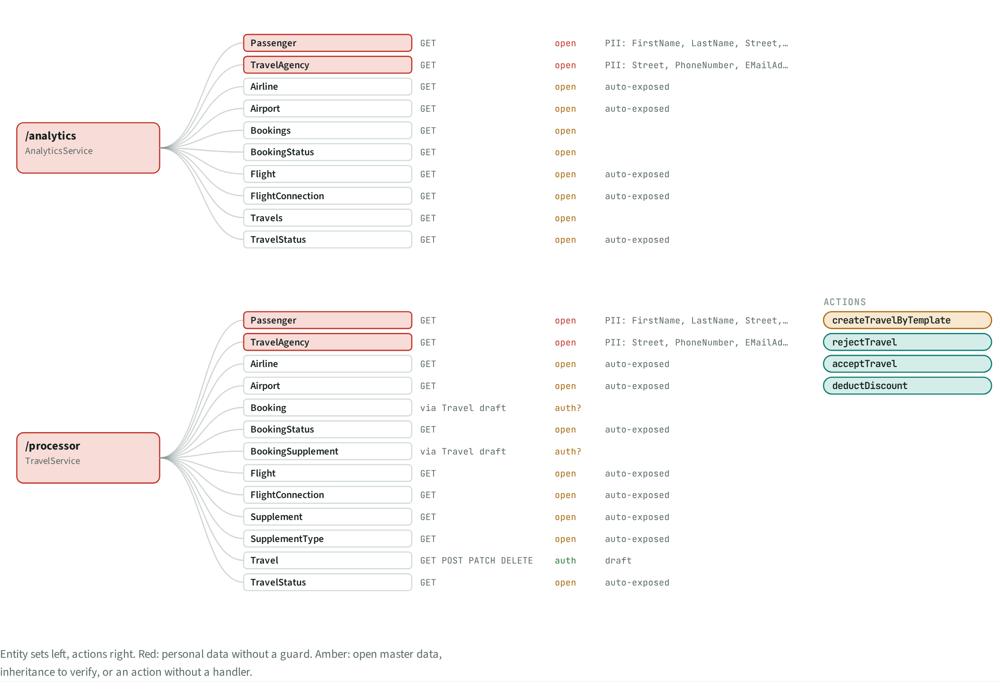
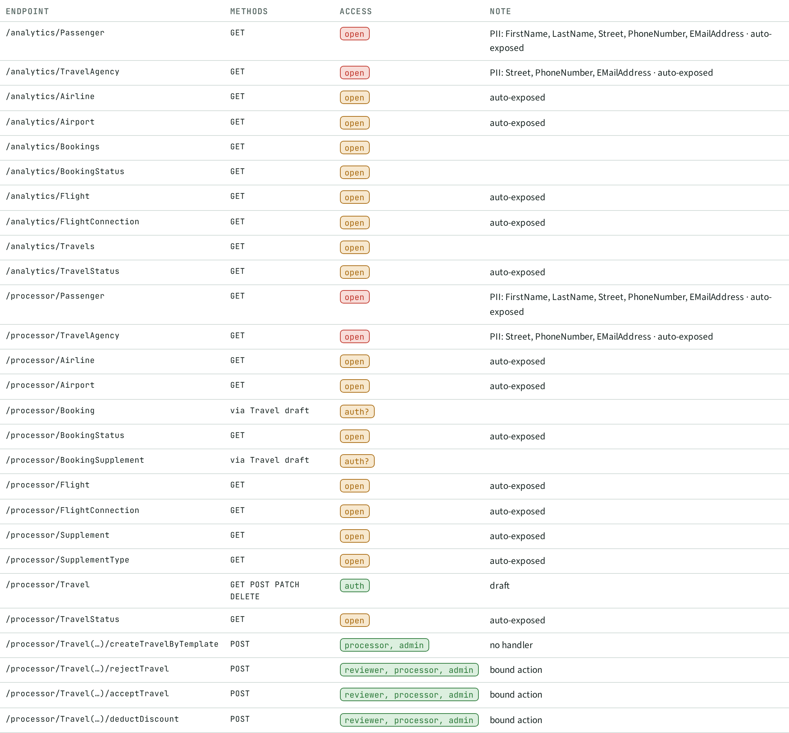

# API · Interfaces

> 2 service roots, 23 entity sets, 4 actions. **20 sets need no role**, including personal data.

## Facts

_Facts generated from the knowledge graph._

| Endpoint | Methods | Access | Note |
| --- | --- | --- | --- |
| /analytics/Passenger | GET | open | PII: FirstName, LastName, Street, PhoneNumber, EMailAddress · auto-exposed |
| /analytics/TravelAgency | GET | open | PII: Street, PhoneNumber, EMailAddress · auto-exposed |
| /analytics/Airline | GET | open | auto-exposed |
| /analytics/Airport | GET | open | auto-exposed |
| /analytics/Bookings | GET | open |  |
| /analytics/BookingStatus | GET | open |  |
| /analytics/Flight | GET | open | auto-exposed |
| /analytics/FlightConnection | GET | open | auto-exposed |
| /analytics/Travels | GET | open |  |
| /analytics/TravelStatus | GET | open | auto-exposed |
| /processor/Passenger | GET | open | PII: FirstName, LastName, Street, PhoneNumber, EMailAddress · auto-exposed |
| /processor/TravelAgency | GET | open | PII: Street, PhoneNumber, EMailAddress · auto-exposed |
| /processor/Airline | GET | open | auto-exposed |
| /processor/Airport | GET | open | auto-exposed |
| /processor/Booking | via Travel draft | auth? |  |
| /processor/BookingStatus | GET | open | auto-exposed |
| /processor/BookingSupplement | via Travel draft | auth? |  |
| /processor/Flight | GET | open | auto-exposed |
| /processor/FlightConnection | GET | open | auto-exposed |
| /processor/Supplement | GET | open | auto-exposed |
| /processor/SupplementType | GET | open | auto-exposed |
| /processor/Travel | GET POST PATCH DELETE | auth | draft |
| /processor/TravelStatus | GET | open | auto-exposed |
| /processor/Travel(…)/createTravelByTemplate | POST | processor, admin | no handler |
| /processor/Travel(…)/rejectTravel | POST | reviewer, processor, admin | bound action |
| /processor/Travel(…)/acceptTravel | POST | reviewer, processor, admin | bound action |
| /processor/Travel(…)/deductDiscount | POST | reviewer, processor, admin | bound action |

## Next steps

Ranked; prompts for each item are in the NXT topic file.

| Priority | Id | Step | What | Sections | Evidence | Score |
| --- | --- | --- | --- | --- | --- | --- |
| P3 | `API:/processor/createTravelByTemplate` | Review | Action createTravelByTemplate has no handler | API |  | 2×3 |

## Views

**API-A Endpoint map**

**API-B Interface list**

[Back to the index](../README.md)
