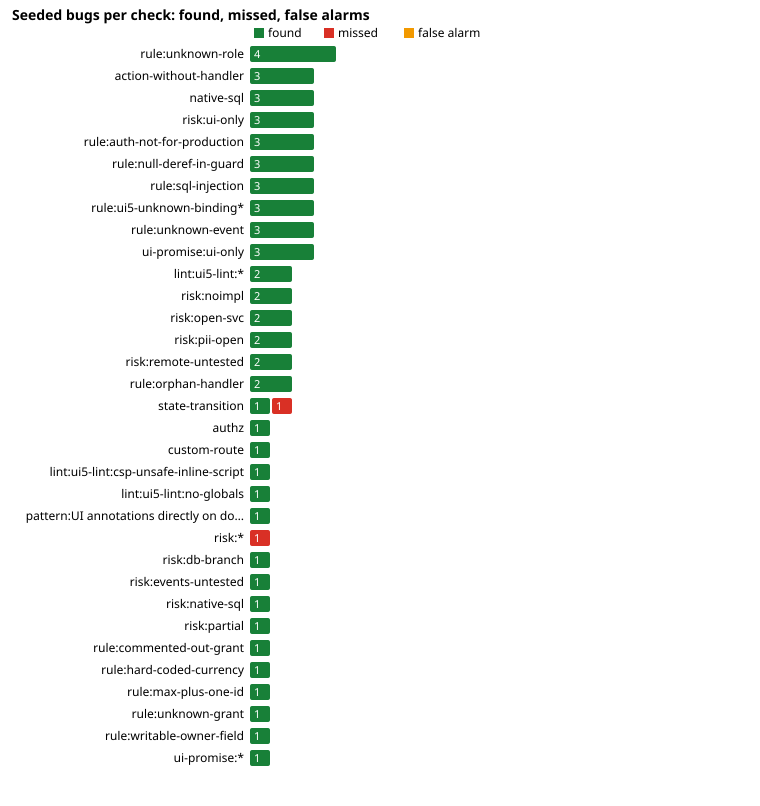

# Stress corpus scorecard

Generated by `node stress/bin/stress.js run` on 2026-11-02 00:22 UTC (373s). Method: [README.md](../README.md).

## Summary

| Measure | Value |
| --- | --- |
| Seeded bugs found | **48 of 48** (100%) |
| Bug-free variants understood (shapes, configs, probes) | **19 of 19** (graph as expected, no new alarm) |
| By category | config 5/5 · authz 11/11 · cap 9/9 · ui-promise 3/3 · sql 5/5 · events 6/6 · shape 2/2 · ui5 7/7 |
| False alarms on clean apps | 0 (in 2 control apps) |
| Seeds with extra alarms (noise) | 0 |
| Cases proven valid | 72 of 72 |
| Bugs proven real at runtime | 26 of 26 seeds with a proof test (passes on the seeded app, fails on the clean one) |

## Before and after this round of fixes

The same seeds scored with the toolkit of `main` before the fixes (`report/results-main.json`). A seed counts when its bug is found (or a bug-free variant is understood) with no false alarm.

| Category | Seeds | Before | After |
| --- | ---: | ---: | ---: |
| config | 13 | 8 | 13 |
| authz | 12 | 4 | 12 |
| cap | 9 | 4 | 9 |
| ui-promise | 5 | 0 | 5 |
| sql | 5 | 0 | 5 |
| events | 6 | 0 | 6 |
| shape | 10 | 4 | 10 |
| ui5 | 7 | 4 | 7 |
| **all** | 67 | 24 | 67 |

## Per check

Recall = seeds found / seeds that expect the check. False alarms count alarms on clean control apps plus unexpected new alarms in seeded variants.

| Check | Seeds | Found | Missed | Recall | False alarms | Missed seeds |
| --- | ---: | ---: | ---: | ---: | ---: | --- |
| `rule:unknown-role` | 4 | 4 | 0 | 100% | 0 |  |
| `action-without-handler` | 3 | 3 | 0 | 100% | 0 |  |
| `native-sql` | 3 | 3 | 0 | 100% | 0 |  |
| `risk:ui-only` | 3 | 3 | 0 | 100% | 0 |  |
| `rule:auth-not-for-production` | 3 | 3 | 0 | 100% | 0 |  |
| `rule:null-deref-in-guard` | 3 | 3 | 0 | 100% | 0 |  |
| `rule:sql-injection` | 3 | 3 | 0 | 100% | 0 |  |
| `rule:ui5-unknown-binding*` | 3 | 3 | 0 | 100% | 0 |  |
| `rule:unknown-event` | 3 | 3 | 0 | 100% | 0 |  |
| `ui-promise:ui-only` | 3 | 3 | 0 | 100% | 0 |  |
| `lint:ui5-lint:*` | 2 | 2 | 0 | 100% | 0 |  |
| `risk:noimpl` | 2 | 2 | 0 | 100% | 0 |  |
| `risk:open-svc` | 2 | 2 | 0 | 100% | 0 |  |
| `risk:pii-open` | 2 | 2 | 0 | 100% | 0 |  |
| `risk:remote-untested` | 2 | 2 | 0 | 100% | 0 |  |
| `rule:orphan-handler` | 2 | 2 | 0 | 100% | 0 |  |
| `state-transition` | 2 | 1 | 1 | 50% | 0 | transition-wrong-target |
| `authz` | 1 | 1 | 0 | 100% | 0 |  |
| `custom-route` | 1 | 1 | 0 | 100% | 0 |  |
| `lint:ui5-lint:csp-unsafe-inline-script` | 1 | 1 | 0 | 100% | 0 |  |
| `lint:ui5-lint:no-globals` | 1 | 1 | 0 | 100% | 0 |  |
| `pattern:UI annotations directly on domain entities` | 1 | 1 | 0 | 100% | 0 |  |
| `risk:*` | 1 | 0 | 1 | 0% | 0 | ts-stock-unchecked |
| `risk:db-branch` | 1 | 1 | 0 | 100% | 0 |  |
| `risk:events-untested` | 1 | 1 | 0 | 100% | 0 |  |
| `risk:native-sql` | 1 | 1 | 0 | 100% | 0 |  |
| `risk:partial` | 1 | 1 | 0 | 100% | 0 |  |
| `rule:commented-out-grant` | 1 | 1 | 0 | 100% | 0 |  |
| `rule:event-never-emitted` | 1 | 1 | 0 | 100% | 0 |  |
| `rule:hard-coded-currency` | 1 | 1 | 0 | 100% | 0 |  |
| `rule:max-plus-one-id` | 1 | 1 | 0 | 100% | 0 |  |
| `rule:unknown-grant` | 1 | 1 | 0 | 100% | 0 |  |
| `rule:writable-owner-field` | 1 | 1 | 0 | 100% | 0 |  |
| `ui-promise:*` | 1 | 1 | 0 | 100% | 0 |  |

## Seeds

| Seed | Category | Planted bug | Expected checks | Result | Extra alarms | Proof |
| --- | --- | --- | --- | --- | --- | --- |
| config-cdsrc-json | config | No bug: the same mocked users, read from .cdsrc.json. |  | ✅ understood |  | ✅ same behaviour |
| config-cdsrc-yaml | config | No bug: the mocked users come from .cdsrc.yaml. |  | ✅ understood |  | ✅ same behaviour |
| config-profile-users | config | No bug: the usual split between local mock users and XSUAA in production. |  | ✅ understood |  | ✅ same behaviour |
| config-custom-folders | config | No bug: services and handlers live in service/ as configured. |  | ✅ understood |  | ✅ same behaviour |
| config-monorepo | config | No bug: npm workspaces; the CAP project is one level down. |  | ✅ understood |  | ✅ same behaviour |
| config-dummy-auth-production | config | Dummy auth in production: every request runs as a privileged user, all @requires and @restrict are void. | `rule:auth-not-for-production` | ✅ found |  | smoke |
| config-mocked-auth-production | config | Mocked auth in production: anyone who knows the user name "admin" (password empty) is admin. | `rule:auth-not-for-production` | ✅ found |  | smoke |
| config-mocked-auth-no-production-override | config | The mock users sit at the top level of cds.requires.auth and nothing overrides them for production, so production stays mocked (as many samples are configured). | `rule:auth-not-for-production` | ✅ found |  | smoke |
| config-xs-security-missing-scope | config | @requires: Admin, but xs-security.json defines only Buyer and Approver: nobody can be given Admin in production. | `rule:unknown-role` | ✅ found |  | smoke |
| config-xs-security-complete | config | No bug: scopes and role templates for Buyer, Approver and Admin. |  | ✅ understood |  | smoke |
| config-multitenancy | config | No bug: an MTX sidecar folder and cds.requires.multitenancy / extensibility / toggles. |  | ✅ understood |  | ✅ same behaviour |
| config-ui5-custom-webapp-path | config | No bug: the UI5 app sources are in app/orders/src as ui5.yaml says. |  | ✅ understood |  | smoke |
| config-remote-profile | config | The remote API is configured only in the production profile; locally and in tests the call has no destination and no mock. | `risk:remote-untested` | ✅ found |  | smoke |
| authz-no-requires | authz | AdminService (customers with e-mail and phone) is open to anonymous callers. | `risk:open-svc` `risk:pii-open` | ✅ found |  | ✅ |
| authz-role-typo-requires | authz | Typo in the role name locks every real admin out; no mock user, no xs-security role carries it. | `rule:unknown-role` | ✅ found |  | ✅ |
| authz-role-typo-restrict | authz | Typo in a @restrict role: approvers can no longer read or approve. | `rule:unknown-role` | ✅ found |  | ✅ |
| authz-grant-typo | authz | Typo in a grant: the action approve is granted to nobody. | `rule:unknown-grant` | ✅ found |  | ✅ |
| authz-row-filter-dropped | authz | Every buyer reads and edits every order (cross-user access). | `authz` | ✅ found |  | ✅ |
| authz-commented-grant | authz | Someone commented out a grant while debugging; approvers are locked out. | `rule:commented-out-grant` | ✅ found |  | ✅ |
| authz-writable-owner | authz | Rows are filtered by owner = $user, but owner is writable: a buyer can hand an order to someone else. | `rule:writable-owner-field` | ✅ found |  | smoke |
| authz-pii-projection | authz | A new projection on Customers in OrderService exposes e-mail and phone to any authenticated user. | `risk:pii-open` | ✅ found |  | ✅ |
| authz-custom-route | authz | A bootstrap route returns all orders without any authentication. | `custom-route` | ✅ found |  | ✅ |
| action-handler-removed | cap | The reject handler was deleted; the action is still in the service and the UI. | `action-without-handler` `risk:noimpl` | ✅ found |  | ✅ |
| action-handler-typo | cap | Typo in the event name: approve has no handler, the aprove handler never runs. | `action-without-handler` `rule:orphan-handler` | ✅ found |  | ✅ |
| action-orphan-handler | cap | this.on('cancel', Orders) is dead code: the service has no cancel action. | `rule:orphan-handler` | ✅ found |  | smoke |
| action-null-deref | cap | The 404 message reads order.ID from undefined: a TypeError and a 500 instead of a 404. | `rule:null-deref-in-guard` | ✅ found |  | smoke |
| action-max-plus-one | cap | Two parallel creates read the same max and get the same order number. | `rule:max-plus-one-id` | ✅ found |  | smoke |
| action-hard-coded-currency | cap | Every order is stored in EUR whatever the customer currency is. | `rule:hard-coded-currency` | ✅ found |  | smoke |
| ui-only-action-guard | ui-promise | @Core.OperationAvailable hides approve unless status = S, but the server approves open orders too. | `ui-promise:ui-only` `risk:ui-only` | ✅ found |  | ✅ |
| ui-partial-action-guard | ui-promise | The UI offers approve only for submitted orders; the server also approves open and rejected ones. | `risk:partial` `state-transition` | ✅ found |  | ✅ |
| probe-static-readonly | ui-promise | No bug: @readonly replaced by the static @Common.FieldControl: #ReadOnly, which CAP enforces like @readonly (the proof shows the server ignores the value). |  | ✅ quiet |  | ✅ behaves as claimed |
| probe-static-mandatory | ui-promise | No bug: @mandatory moved to the static @Common.FieldControl: #Mandatory, which CAP enforces like @mandatory (the proof shows a 400). |  | ✅ quiet |  | ✅ behaves as claimed |
| probe-write-grant-not-actions | authz | No bug: Buyers have READ, WRITE and submit; approve is not theirs. The authorization matrix must say denied, not unclear. |  | ✅ quiet |  | ✅ behaves as claimed |
| transition-wrong-target | ui-promise | Copy-paste: reject moves the order to Approved. Static checks cannot know that "reject" should not mean A. | `state-transition` | ➖ out of reach |  | ✅ |
| sql-injection-native | sql | req.data.q is pasted into a SQL string: q = x' UNION SELECT ... reads any table. | `native-sql` `rule:sql-injection` | ✅ found |  | ✅ |
| sql-injection-cql-string | sql | .where(`name like '%${q}%'`) parses user input as CQL: q = x' or name like '% returns every row. | `rule:sql-injection` | ✅ found |  | ✅ |
| sql-hana-only | sql | FROM DUMMY only exists on HANA: submit fails on SQLite, so no local test reaches it. | `native-sql` `risk:native-sql` | ✅ found |  | ✅ |
| sql-db-branch | sql | The HANA branch never runs in SQLite tests. | `risk:db-branch` | ✅ found |  | smoke |
| event-emit-undeclared | events | Typo in the emitted event name: subscribers of OrderApproved never hear about approvals. | `rule:unknown-event` | ✅ found |  | smoke |
| event-subscribe-typo | events | An audit subscriber on another service listens to an event name that is never emitted. | `rule:unknown-event` | ✅ found |  | smoke |
| event-emit-removed | events | The emit was lost (found by the AI pass on a refactored shape, 2026-11-02): consumers of OrderApproved never hear of an approval. | `rule:event-never-emitted` | ✅ found |  | ✅ |
| event-subscriber-untested | events | A subscriber writes the audit log on OrderApproved; no test emits the event and checks the log (the existing test only mentions the event name). | `risk:events-untested` | ✅ found |  | smoke |
| remote-untested | events | Submit calls a remote OData API; no test mocks it, so timeouts and 4xx answers are untested. | `risk:remote-untested` | ✅ found |  | smoke |
| layer-ui-on-domain | cap | app/ annotates sales.Orders (db layer) instead of the service projection: every service gets the UI texts. | `pattern:UI annotations directly on domain entities` | ✅ found |  | smoke |
| shape-loop-registration | shape | No bug: approve and reject are registered by iterating over a table of transitions. |  | ✅ understood |  | ✅ same behaviour |
| shape-handler-modules | shape | No bug: this.on("approve", Orders, require("./handlers/approve")). |  | ✅ understood |  | ✅ same behaviour |
| shape-bound-methods | shape | No bug: each action is handled by a method of the service class. |  | ✅ understood |  | ✅ same behaviour |
| shape-service-impl-function | shape | No bug: the older function style, and entity targets given as strings ('Orders'). |  | ✅ understood |  | ✅ same behaviour |
| shape-srv-arrow | shape | No bug: one handler for approve and reject, dispatching on req.event. |  | ✅ understood |  | ✅ same behaviour |
| shape-impl-annotation | shape | No bug: the implementation file does not sit next to the .cds file. |  | ✅ understood |  | ✅ same behaviour |
| shape-src-folder-bug | shape | The 404 guard reads order.ID from undefined (500 instead of 404); the code sits in srv/src/. | `rule:null-deref-in-guard` | ✅ found |  | smoke |
| shape-esm | shape | No bug: package.json "type": "module" and an ESM service class. |  | ✅ understood |  | ✅ same behaviour |
| shape-cds-expression-guard-removed | shape | @Core.OperationAvailable: (status.code = 'S') in CDS expression syntax; the server approves in any state. | `ui-promise:ui-only` `risk:ui-only` | ✅ found |  | ✅ |
| shape-loop-guard-removed | shape | Transitions table says approve may start anywhere (from = null); the UI still hides it unless S. | `ui-promise:*` | ✅ found |  | ✅ |
| ts-unbound-action-no-handler | cap | The unbound action submitOrder has no handler any more; the UI still calls it. | `action-without-handler` `risk:noimpl` | ✅ found |  | ✅ |
| ts-cancel-guard-removed | ui-promise | @Core.OperationAvailable: ($self.status = 'N') hides cancel for shipped orders; the server cancels them anyway and puts the stock back. | `ui-promise:ui-only` `risk:ui-only` | ✅ found |  | ✅ |
| ts-sql-injection | sql | A function searchBooks(title) pastes req.data.title into native SQL. | `rule:sql-injection` `native-sql` | ✅ found |  | ✅ |
| ts-null-deref | cap | if (!row) req.reject(404, `Book ${row.ID} ...`): TypeError and 500 for an unknown book. | `rule:null-deref-in-guard` | ✅ found |  | ✅ |
| ts-emit-typo | events | Typo in the emitted event: BookOrdered subscribers never fire. | `rule:unknown-event` | ✅ found |  | smoke |
| ts-role-typo | authz | Typo in the role on the action: no customer can order. | `rule:unknown-role` | ✅ found |  | ✅ |
| ts-admin-open | authz | Anonymous callers can change books and orders. | `risk:open-svc` | ✅ found |  | ✅ |
| ts-method-reference | shape | No bug: this.on("cancel", Orders, this.onCancel) with the guard inside the method. |  | ✅ understood |  | ✅ same behaviour |
| ts-stock-unchecked | cap | Stock can go negative. No annotation states the rule, so only @assert.range on stock (not checked on UPDATE with -=) or a test would catch it. | `risk:*` | ➖ out of reach |  | ✅ |
| ui5-deprecated-jquery-sap | ui5 | Deprecated jQuery.sap API (removed in UI5 2.x). | `lint:ui5-lint:*` | ✅ found |  | smoke |
| ui5-global-access | ui5 | Global access instead of a module dependency: breaks with async loading and UI5 2.x. | `lint:ui5-lint:no-globals` | ✅ found |  | smoke |
| ui5-sync-loading | ui5 | Synchronous module loading (deprecated, blocks the UI thread). | `lint:ui5-lint:*` | ✅ found |  | smoke |
| ui5-binding-unknown-set | ui5 | The view binds an entity set the service does not have: the list stays empty at runtime. | `rule:ui5-unknown-binding*` | ✅ found |  | smoke |
| ui5-action-unknown | ui5 | Typo in the action path: the order button always fails. | `rule:ui5-unknown-binding*` | ✅ found |  | smoke |
| ui5-datasource-wrong-path | ui5 | The app talks to a path the server does not serve (the service is at /catalog). | `rule:ui5-unknown-binding*` | ✅ found |  | smoke |
| ui5-inline-script | ui5 | An inline <script> breaks a strict Content Security Policy. | `lint:ui5-lint:csp-unsafe-inline-script` | ✅ found |  | smoke |

## Clean control apps

### orders: Orders with approval flow (CAP Node.js + Fiori elements)

Valid: yes (compile, 6 tests, UI5 lint + build ×1) · 47 findings · 0 false alarms

### shop: Book shop (TypeScript CAP service + freestyle UI5 app)

Valid: yes (compile, 5 tests, tsc, UI5 lint + build ×1) · 28 findings · 0 false alarms
